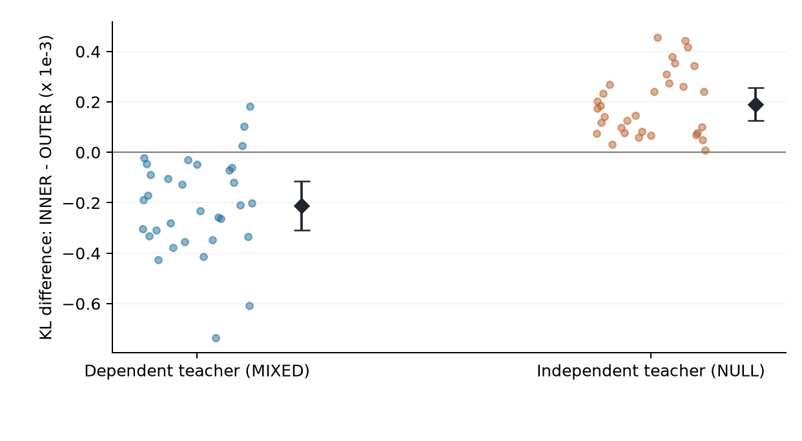

# Appendix I. Additional protocols, controls and selection boundaries

## I.1. Fixed-candidate high-dimensional score comparison

<!-- V141_RELOCATED_PREFERENCE_START -->

For the four-variable fixture in this appendix, $\delta=.1$ and the true eigenvalues are $(.5,1,1.2,1.3)$. At least two limiting eigenvalues equal .1. Weyl's inequality forces an error of at least .3 in some correlation entry. Here $\kappa'_{ij}>1/8$, so pairwise data processing and Pinsker yield $\liminf_n\mathcal R(\widehat C_n)\ge\tfrac12(.3/8)^2=9/12800$.

Figure S3 places this geometry beside a separate finite stress test of the unmodified SCBM concept-loss interface, with K100 and sixteen independent streams of 4096 complete observations. Its candidate multiplies the true off-diagonal correlations by 1.75; its full observation KL relative to truth stays .001724195 as nuisance coordinates are appended. The raw score reverses its ranking between zero and 256 nuisance coordinates. This deliberately specified radial comparison tests a finite preference; it neither trains six free correlations nor estimates the asymptotic minimum set.

{width=100%}

<!-- V141_RELOCATED_PREFERENCE_END -->

The finite panel in this subsection uses the Gaussian teacher in (A.21), with active means and variances fixed. Candidates are $C(t)=I+(1+t)(C_*-I)$ for $t=-.75, 0,.75$; the high candidate is $t=.75$. Its observation KL relative to truth is .001724195 at every nuisance dimension. There is no fitting, learned direction or finite-$n$ global-optimum certificate.

Sixteen independent streams draw 4096 active observations and 256 independent fair nuisance bits per observation. Paddings $n=0, 64, 256$ share prefixes and observations. The unmodified `SCBLoss.compute_concept_loss` at official commit `58c3e602cb11fb4ea9106226e0f9e58f50d5d10a` is evaluated with float32 inputs, K100, batches of 64 and no feature network, task head or precision penalty. For each batch, 400 base prior particles are generated; the primary score uses their first 100, while the K400 auxiliary analysis uses only the first 1024 observations. Gaussian-logistic prior blocks and candidate comparisons are coupled. PCG64 SeedSequence is `[202610030100,stream,role]`, with roles 0/1/2 for data Gaussian, active uniforms and nuisance uniforms, and 3/4 for per-batch active/nuisance priors. All data are drawn before batch priors. The factorized score uses the same active API calculation plus the analytic nuisance constant.

Four prespecified paired contrasts use q=4, alpha=.05, df15 and SE limits .0005/.001/.002/.0005 in the order below. The correlation-gradient shift is at truth in direction $C_*-I$, comparing n256 with n0; the final gradient is with respect to common nuisance scale, divided by 256. Values are in units of $10^{-3}$ (gradients per stated parameter). Other paddings/candidates and K400 are descriptive. No extra trials repair failed gates.

|Contrast|Mean|SE|Interval|SE pass|
|---|---|---|---|---|
|High-truth n0|1.424043|0.210974|[0.825588, 2.022499]|True|
|High-truth n256|-3.781125|0.941392|[-6.451504, -1.110746]|True|
|Gradient shift n256-n0|-4.175460|0.962616|[-6.906043, -1.444877]|True|
|Scale gradient /256|125.835210|0.049772|[125.694024, 125.976396]|True|

## I.2. Active-only matched-particle learning

The mixed teacher is (A.21); the null teacher replaces its latent correlation by I while preserving the Gaussian marginals. Each condition has 32 independent streams with 8192 observations. PCG64DXSM SeedSequence `[202610054010,case,rep,role]` uses cases NULL/MIXED=0/1 and roles 0=data Gaussian, 1=emission uniforms, 2=training priors. At each step the common prior array has shape [400, 64, 4]. Observations cycle in their original order through batches of 64 for 512 steps, four data passes, with no reshuffling.

The independent baseline has $p_i=(n_i+.5)/8193$. With initial scales 1 and C=I, each initial mean solves $E\sigma(\mu_i+G)=p_i$ using one-dimensional GH64 within [-2, 2]. Both arms share that state and zero Adam moments. Thereafter each arm has private parameters/moments. Adam uses learning rate .01, betas(.9,.999), offset $10^{-8}$, no decay, clipping, schedule or early stopping. Means are clipped to [-2, 2], scales to [.001, 2]; correlations use radial repair (H.2). OUTER100x4 averages four K100 negative-log-mean losses before one update; INNER400 takes one K400 negative-log-mean. A dummy nuisance constant is analytically subtracted. This is stable float64 active-only arithmetic, not native32 full SCBM training.

TAIL follows (H.4) with nuisance absent. Candidate selection or checkpoint search is not performed. GH32/40/48 references use order 40 as primary; maximum PMF change is at most $2\times10^{-7}$, KL change $2\times10^{-6}$, mass error $2\times10^{-12}$, with positive probabilities. Each condition's three risk contrasts form one combined six-contrast family: q=6, alpha=.05, df31, SE threshold .0002. The material improvement gate for INNER-OUTER requires mean improvement at least .0001 and upper interval endpoint below zero, not an interval lower bound on improvement of .0001. All six contrasts follow in $10^{-3}$ units.

|Case|Contrast|Mean|SE|Interval|
|---|---|---|---|---|
|NULL|INNER-OUTER|0.190922|0.022849|[0.126526, 0.255319]|
|NULL|INNER-IND|0.408803|0.044112|[0.284481, 0.533124]|
|NULL|OUTER-IND|0.217880|0.035875|[0.116773, 0.318987]|
|MIXED|INNER-OUTER|-0.211117|0.034250|[-0.307642, -0.114591]|
|MIXED|INNER-IND|-2.220325|0.064242|[-2.401378, -2.039271]|
|MIXED|OUTER-IND|-2.009208|0.079666|[-2.233730, -1.784686]|

The three prospective studies together also receive a stricter q26 sensitivity calculation. For INNER-OUTER it gives NULL [.000113470,.000268375] and MIXED [-.000327212,-.000095021]. Original families and their gates are unchanged; this check does not eliminate all study-selection exploration. These intervals cover original training-data/prior variation, not the later fixed-panel MC uncertainty.

<!-- V14_RELOCATED_MAIN_LEARNING_START -->

**Allocation losses and paired learning outcomes.**

$$
\begin{aligned}
\widehat L_{\rm out}&=\frac14\sum_{b=1}^4-\log\left[\frac1{100}\sum_{k=1}^{100}A_{bk}\right],\\
\widehat L_{\rm in}&=-\log\left[\frac1{400}\sum_{b=1}^4\sum_{k=1}^{100}A_{bk}\right].
\end{aligned}
$$

{width=100%}

<!-- V14_RELOCATED_MAIN_LEARNING_END -->

## I.3. Independent cross-objective and readout evaluation

For each of 64 original streams, empirical weights T are the frequencies of all 16 active bit patterns in the saved 8192 labels; P is the qualified teacher PMF. Cross-evaluation estimates the two expected finite objectives by four K100 blocks averaged outside the logarithm and the same 400 points averaged inside it. Shared particles across all patterns preserve each expectation but do not reproduce the training estimator's observation-wise variance. Both arm endpoints and both T/P weights share evaluation randomness.

The TAIL-only cross-evaluation uses 4096 independent banks per stream, PCG64DXSM seed `[202610055010,case,rep, 0]`. Its q12 family contains the eight arm contrasts (two cases, two weights, two K) and four paired K400-minus-K100 contrasts. For each fixed case, the 32 stream differences are first averaged at each bank index, giving 4096 independent panel replicates; SE is their sample SD divided by 64, with df4095, alpha=.05 and SE limit $10^{-5}$. It conditions on the old data and models rather than treating evaluation banks as new training datasets. The full family is in $10^{-3}$ units below.

|Case|Weight|Contrast|Mean|Interval|
|---|---|---|---|---|
|NULL|F_D|K100|1.364091|[1.359985, 1.368196]|
|NULL|F_D|K400|0.203642|[0.201430, 0.205854]|
|NULL|F_D|K400-K100|-1.160449|[-1.163915, -1.156982]|
|NULL|F_P|K100|1.734812|[1.730348, 1.739276]|
|NULL|F_P|K400|0.575608|[0.572838, 0.578379]|
|NULL|F_P|K400-K100|-1.159204|[-1.162660, -1.155747]|
|MIXED|F_D|K100|1.163887|[1.160083, 1.167692]|
|MIXED|F_D|K400|0.047289|[0.045271, 0.049307]|
|MIXED|F_D|K400-K100|-1.116598|[-1.119792, -1.113404]|
|MIXED|F_P|K100|1.275788|[1.271694, 1.279881]|
|MIXED|F_P|K400|0.159545|[0.157078, 0.162012]|
|MIXED|F_P|K400-K100|-1.116243|[-1.119431, -1.113054]|

The readout control fixes LAST at post-update 512 and TAIL at the original final 64-state average. All 128 trajectories contribute both readouts, giving 256 evaluated models. LAST parameters and TAIL reconstruction are checked against original trajectories. There is no new training, window search or best-checkpoint selection. New evaluation seeds are `[202610056010,case,rep, 0]`, otherwise the same 4096-bank/400-particle coupling. LAST adds GH32/40/48 (primary 40); TAIL reuses its PMFs. PMF/loss/KL and mass qualification thresholds are $2\times10^{-7}$/$2\times10^{-6}$/$2\times10^{-12}$.

For each case, weight and K, the q24 family includes LAST's INNER-OUTER difference, TAIL's difference, and their interaction LAST minus TAIL. The same fixed-panel df4095/alpha .05/SE $10^{-5}$ rules apply. All comparisons are preserved in $10^{-3}$ units. A resolved interaction changes the gap and need not reverse a ranking. The small MIXED empirical F400 LAST advantage is about $3.5\times10^{-6}$ nats per observation, not practical optimization superiority.

|Case|Weight|K|Contrast|Mean|Interval|
|---|---|---|---|---|---|
|NULL|F_D|100|LAST|1.325372|[1.320764, 1.329980]|
|NULL|F_D|100|TAIL|1.367371|[1.362936, 1.371806]|
|NULL|F_D|100|INTERACTION|-0.041999|[-0.044111, -0.039887]|
|NULL|F_D|400|LAST|0.191150|[0.188371, 0.193929]|
|NULL|F_D|400|TAIL|0.205512|[0.203100, 0.207924]|
|NULL|F_D|400|INTERACTION|-0.014362|[-0.016440, -0.012283]|
|NULL|F_P|100|LAST|1.692359|[1.687453, 1.697266]|
|NULL|F_P|100|TAIL|1.738473|[1.733695, 1.743252]|
|NULL|F_P|100|INTERACTION|-0.046114|[-0.048209, -0.044019]|
|NULL|F_P|400|LAST|0.559464|[0.556217, 0.562712]|
|NULL|F_P|400|TAIL|0.577939|[0.574945, 0.580933]|
|NULL|F_P|400|INTERACTION|-0.018475|[-0.020536, -0.016414]|
|MIXED|F_D|100|LAST|1.075806|[1.071800, 1.079812]|
|MIXED|F_D|100|TAIL|1.161741|[1.157766, 1.165716]|
|MIXED|F_D|100|INTERACTION|-0.085935|[-0.087515, -0.084355]|
|MIXED|F_D|400|LAST|-0.003498|[-0.005821, -0.001175]|
|MIXED|F_D|400|TAIL|0.045790|[0.043647, 0.047934]|
|MIXED|F_D|400|INTERACTION|-0.049289|[-0.050832, -0.047746]|
|MIXED|F_P|100|LAST|1.184558|[1.180285, 1.188831]|
|MIXED|F_P|100|TAIL|1.273783|[1.269497, 1.278069]|
|MIXED|F_P|100|INTERACTION|-0.089225|[-0.090817, -0.087633]|
|MIXED|F_P|400|LAST|0.105597|[0.102859, 0.108335]|
|MIXED|F_P|400|TAIL|0.158186|[0.155526, 0.160845]|
|MIXED|F_P|400|INTERACTION|-0.052589|[-0.054144, -0.051033]|

The classical identity $\Delta J_{P, 400}=\Delta F_{P, 400}-\Delta\mathcal R$ yields the following MIXED accounting, in $10^{-3}$ units. It adds no test or optimizer attribution. The source values, rather than independently rounded displayed values, determine the differences.

|Readout|Delta F400|Delta risk|Delta J400|
|---|---|---|---|
|LAST|0.105597|-0.252239|0.357836|
|TAIL|0.158186|-0.211117|0.369302|

## I.4. Synthetic latent-trait selection

The model is $Z\sim N(0,I_2)$ and conditionally independent $Y_j\sim\operatorname{Bernoulli}(\sigma(b_j+W_jZ))$ [@tipping1998]. For the eight-dimensional teacher,

$$
b=(-.6,-.2,.2,.6,-.4,.4, 0, 0),\qquad
W_a=a\begin{pmatrix}1&0\\.8&.3\\.8&-.3\\0&1\\.3&.8\\-.3&.8\\0&0\\0&0\end{pmatrix},
\quad a\in\{0,.65, 1\}.
\tag{I.1}
$$

The conditions are NULL/WEAK/STRONG. Each of 32 workflows per condition generates independent 8192-row training, validation and test samples after one hidden coordinate permutation. All eight-by-two loadings remain learnable; the learner is not given a true block mask. PCG64DXSM seed `[202610052010,case,rep,role]` uses role 0 for the permutation; 1/2, 3/4, 5/6 for Gaussian/uniform pairs of the three datasets; 7 for a shared $N(0,.15^2)$ loading start; 8 for validation priors.

The candidates are IND and penalties lambda=0,.002,.02. IND uses Jeffreys-smoothed marginals. Joint training minimizes GH20x20 empirical NLL plus $\lambda\|W\|_F^2/2$, with b in [-2.5, 2.5] and W entries in [-1.5, 1.5]. Two starts share the clipped empirical-logit bias. One takes the top two nonnegative eigendirections of off-diagonal empirical covariance divided elementwise by $p_i(1-p_i)p_j(1-p_j)$, scaled by square-root eigenvalues and clipped to [-.8,.8]; the other uses the Gaussian loading start. L-BFGS-B has maxiter 180, maxfun 400, maxls 25, ftol $10^{-12}$, gtol $10^{-7}$ and hard 450 objective/gradient calls. The lower returned training objective selects the start, before validation. All 576 fits report convergence; there is no checkpoint selection.

A shared 1600x2 prior pool defines RAW100 (first 100), OUT16 (mean of 16 K100 losses), INNER1600 and first-order delete-one JVI100 [@nowozin2018]. If $L_K=-\log\bar A_K$ and $L_{-i}=-\log\bar A_{-i}$, the bias-corrected score is

$$
L^{\rm JVI}_{100}=100L_{100}-99\frac1{100}\sum_{i=1}^{100}L_{-i}.
\tag{I.2}
$$

The fifth rule uses the GH60 reference, checked against orders 40/80 with PMF tolerance $2\times10^{-7}$, risk $2\times10^{-6}$ and mass $2\times10^{-12}$. All 256 patterns are included. IND is analytic. Validation minimizes mean score with ties within $10^{-12}$ resolved by the fixed IND/L0/L002/L020 order. Choices are locked before teacher/test risks are evaluated; the teacher oracle is reporting information only.

There are 15 paired risk contrasts: per condition RAW100-GH, OUT16-INNER1600, INNER1600-GH, JVI100-GH and GH-IND. The original family has alpha .05, df31, SE limit .0002, and material scale .0002 nats per eight-bit observation. All original contrasts follow in $10^{-3}$ units. A harmful mean must reach the scale and have a positive lower interval endpoint; small upper excess-risk bounds for alternatives are separate decisions.

|Case|Contrast|Mean|Interval|
|---|---|---|---|
|NULL|RAW100-GH|-0.023202|[-0.110656, 0.064252]|
|NULL|OUT16-INNER1600|-0.107316|[-0.269056, 0.054424]|
|NULL|INNER1600-GH|0.026958|[-0.091806, 0.145722]|
|NULL|JVI100-GH|0.242125|[-0.044229, 0.528479]|
|NULL|GH-IND|0.080174|[-0.029309, 0.189657]|
|WEAK|RAW100-GH|0.187716|[-0.394953, 0.770385]|
|WEAK|OUT16-INNER1600|0.011339|[-0.023213, 0.045891]|
|WEAK|INNER1600-GH|-0.006204|[-0.024205, 0.011797]|
|WEAK|JVI100-GH|0.210485|[-0.370420, 0.791390]|
|WEAK|GH-IND|-13.790287|[-13.923889, -13.656686]|
|STRONG|RAW100-GH|0.093474|[-0.020404, 0.207351]|
|STRONG|OUT16-INNER1600|0.054478|[-0.027708, 0.136665]|
|STRONG|INNER1600-GH|0.004622|[-0.048429, 0.057673]|
|STRONG|JVI100-GH|0.088284|[-0.016282, 0.192851]|
|STRONG|GH-IND|-56.905062|[-57.079405, -56.730720]|

## I.5. Natural binary-image selection

The official Optdigits data [@optdigits1998] contain 3823 training and 1797 test observations, from disjoint writer sets, with 64 integer pixel counts in 0..16. Every feature is thresholded at 8; class labels are ignored. In 32 workflows, seed `[202610052710,rep, 0]` permutes the official training rows into 3058 fit and 765 validation observations. Roles 1/2 supply loading initialization and one shared 1600x2 validation prior pool. The official test set remains fixed and is never used in fitting or selection. These intervals quantify workflow randomization conditional on the dataset, not 32 independent natural datasets.

Candidates are IND and lambdas .001/.01/.1 for the same two-dimensional latent model, with 64 free biases and 64x2 free loadings. Training uses GH24x24 NLL plus $\lambda\|W\|_F^2/2$, bias bounds[-10, 10], loading bounds[-3, 3]. The two starts use clipped empirical marginal logits and either four times the top-two square-root covariance eigendirections (clipped to [-1, 1]) or Gaussian loadings with SD.15. L-BFGS-B uses maxiter 120, maxfun 260, maxls 20, ftol $10^{-10}$, gtol $10^{-6}$ and hard 300 calls. Finite feasible returned endpoints are retained; only 85/192 runs report convergence. Starts are selected by training objective, not validation or test.

Numerical reference uses adaptive Gaussian quadrature, an established approach [@pinheiro1995]. For each observed pattern, Newton iterations find the unique mode of $\|z\|^2/2-\log p_\theta(y\mid z)$, whose Hessian is $H=I+W^\top\operatorname{diag}[p(1-p)]W$. The $N(\hat z,H^{-1})$ transform includes the exact prior/proposal density ratio. At most 60 Newton and 20 backtracking steps require maximum gradient $10^{-8}$. Initial GH12/20/32 accepts order 32 when the coarse log-probability discrepancy is at most $10^{-4}$ and adjacent discrepancy $10^{-5}$; otherwise the predetermined 48 then 64 refinements require adjacent difference $10^{-5}$. Probabilities are never normalized over the observed-pattern subset. This is not a Laplace-only likelihood or a certified integration remainder.

The same five selectors and tie rule apply, with candidate order IND/L001/L010/L100. Test losses are computed only after selection locks. The q5 family (alpha .05, df31, SE .025, material scale .05 nats/image) consists of RAW100-AGH, OUT16-INNER1600, INNER1600-AGH, JVI100-AGH and AGH-IND. All five rules select L001 in every workflow; mean test NLL is 22.655264436 versus 25.173057822 for IND. AGH-IND is -2.517793386 with original interval[-2.521272593,-2.514314179]. The other four observed differences are zero. Their computed zero-width t intervals are not guarantees against future rare failures. A supplementary four-event Bonferroni one-sided zero-count bound is $1-(.05/4)^{1/32}=.127976$, without a bound on unseen loss magnitude.

## I.6. Realized score errors and candidate margins

This is a post-hoc census of all 128 saved workflows, 512 approximate-method decisions and 1536 rival comparisons, with no new data or particles. For reference winner w, write $g_j=\ell_j-\ell_w$, $e_j=\hat\ell_j-\ell_j$ and $d_j=e_j-e_w$. The identity $\hat\ell_j-\hat\ell_w=g_j+d_j$ is checked for every rival, including rivals that are not reference runners-up. With $\Delta=\min_{j\ne w}g_j$, $A=\max|e_j|$ and $E=\max e-\min e$, either $\Delta>2A+10^{-12}$ or $\Delta>E+10^{-12}$ is a sufficient realized stability condition. Failure of a sufficient condition does not imply a switch; a shared score offset cancels. None of these elementary facts is claimed as a new general theorem.

Optdigits RAW100's maximum absolute error has median .1062184, while the reference minimum gap has median .1124287. Its minimum remaining gap is .0358984, with no switch. Full-pool absolute/range bounds certify 4/15 of 32 RAW100 workflows and 0/21 of 32 OUT16 workflows; INNER1600 satisfies both in 32/32. Synthetic RAW100 changes 28 decisions: 19 increase teacher risk and 9 decrease it. A validation winner is not the population oracle.

WEAK workflow 27 selects L020 rather than reference winner L0. L020 is not the reference runner-up: its gap .007191156 plus relative error -.012022360 becomes -.004831204. Teacher KL increases .005859842; this case contributes .000183120 to the group mean, 97.55% of the signed total. The case is retained, without deletion-based re-testing. Scores use a single saved prior pool per workflow, so realized errors are not identified expected biases.

{width=100%}

## I.7. Numerical checks, execution records and reproducibility limits

As in H.7, data roles, outputs, budgets and decision rules are fixed before scientific execution; the margin census is explicitly post-hoc. Cross-rule numerical agreement is not a rigorous remainder bound.

For active learning, all 65536 saved Adam/repair/TAIL updates were checked; 24 prespecified actual states received independent finite-difference gradients, and 8 TAILs received symmetric-root GH44. The cross-objective and readout studies each check all 262144 saved banks and their families; 8 fixed flow prefixes receive direct probability-product score checks (1024/2048 values). Readout adds 8 LAST GH44 checks. LAST main references use $128\times(32^4+40^4+48^4)=1141374976$ nodes, with 29984768 independent nodes. No checkpoints or averaging windows were added after inspection.

Synthetic selection checks all 96 streams, 384 candidates, 480 choices and 15 comparisons, with 36 alternate GH72 models and 9 full-gradient checks. Initial selection serialization failed on a NumPy boolean after all training had completed. The original errors and partial score files were retained; a separately frozen continuation reused the same candidates/data and reproduced 96/96 choices with maximum original-score difference 0. No model was retrained or dataset regenerated. A subsequent one-stream reproduction adds six optimizer runs but zero new independent units. The natural workflow checks all splits, 160 choices and five contrasts, with 1536 independently evaluated profiles using a different mode solver and rotated, enlarged-covariance GH64/80.

Shared inputs count once. Active learning uses 524288 new observations, 128 optimizers and 838860800 prior vectors. Cross-evaluation and readout each use 104857600 independent evaluation vectors plus 6400 replay vectors in score audits. Synthetic selection uses 2359296 new observations, 576 optimizations and 153600 validation vectors; deterministic recovery repeats 153600 vectors and 3340800 reference nodes, counted as recovery cost, not new evidence. Natural selection collects no new images, uses 192 optimizations, 51200 validation vectors, 377561856 primary reference nodes and 16121856 independent nodes. This paragraph accounts for the preceding studies; the separate finite-selection study is reported in Appendix J.

Public model/statistic records, RNG specifications and hashes do not replace the local array files needed for full computational replay. All failures, finite optimizer endpoints, original confidence families and numerical qualifications are retained. No interval is upgraded by later MC precision or by algebraic reuse of an earlier result.
