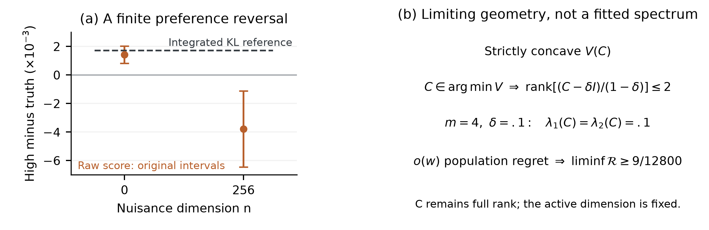
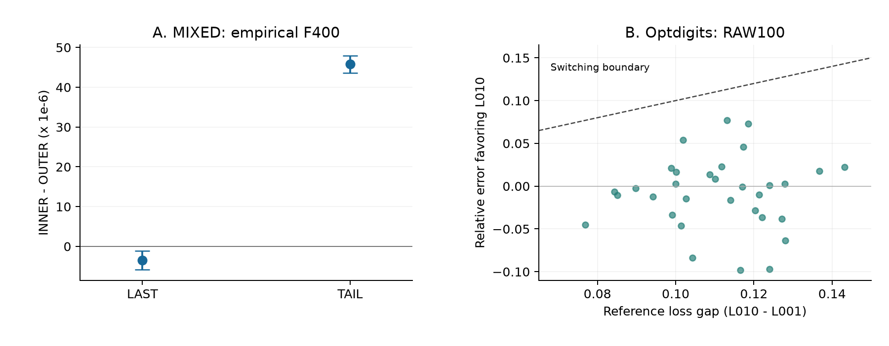

# 附录I 补充协议、控制与选择边界

## I.1. 固定候选的高维评分比较

<!-- V141_RELOCATED_PREFERENCE_START -->

在本附录四变量设定中，$\delta=.1$，真实特征值为$(.5,1,1.2,1.3)$。至少两个极限特征值等于.1。Weyl不等式迫使某个相关条目的误差至少为.3。这里$\kappa'_{ij}>1/8$，结合投影到观测对的数据处理不等式与Pinsker不等式，得到$\liminf_n\mathcal R(\widehat C_n)\ge\tfrac12(.3/8)^2=9/12800$。

下图将这一几何与未修改SCBM概念损失接口的另一项有限压力测试并列：K100，16个独立流，每流4096个完整观察。指定候选将真实非对角相关乘以1.75；附加无关坐标时，其相对真值的完整观测KL始终为.001724195。原评分在零个与256个无关坐标之间反转排序。这个预先指定的径向比较检验有限偏好，既不训练六个自由相关，也不估计渐近极小点集合。

{width=100%}

<!-- V141_RELOCATED_PREFERENCE_END -->

本节图中的有限对照使用(A.21)的Gaussian教师，固定有效均值和方差。候选为$C(t)=I+(1+t)(C_*-I)$，$t=-.75,0,.75$；高相关候选取$t=.75$，其相对真值的观察KL在所有无关维数下均为.001724195。没有拟合、学习方向或有限$n$全局最优性证书。

16个独立流各生成4096个有效观察及每观察256个独立公平无关比特。$n=0,64,256$共享前缀和观测。官方提交`58c3e602cb11fb4ea9106226e0f9e58f50d5d10a`中未修改的`SCBLoss.compute_concept_loss`使用float32、K100、批64，无特征网络、任务头或precision惩罚。每批先生成400个基础prior，主要评分用前100，K400辅助分析仅用前1024观察。候选和维数间耦合基础粒子。PCG64 SeedSequence为`[202610030100,stream,role]`，role0/1/2对应数据Gaussian、有效Uniform、无关Uniform，3/4对应逐批有效/无关prior；先生成全部数据，再逐批生成prior。因子化评分复用相同有效API计算并加解析无关常数。

四项预定配对比较取q=4、alpha=.05、df15，SE门依次为.0005/.001/.002/.0005。相关梯度位移在真值处沿$C_*-I$比较n256与n0；末项为共同无关尺度梯度除以256。下表单位$10^{-3}$，梯度按上述参数单位。其他维数/候选及K400只作描述，不追加运行修补门槛。

|Contrast|Mean|SE|Interval|SE pass|
|---|---|---|---|---|
|High-truth n0|1.424043|0.210974|[0.825588, 2.022499]|True|
|High-truth n256|-3.781125|0.941392|[-6.451504, -1.110746]|True|
|Gradient shift n256-n0|-4.175460|0.962616|[-6.906043, -1.444877]|True|
|Scale gradient /256|125.835210|0.049772|[125.694024, 125.976396]|True|

## I.2. 消去无关因子的匹配粒子学习

MIXED教师为(A.21)，NULL将潜在相关换为I而保持Gaussian边际。每条件32个独立流、每流8192观察。PCG64DXSM SeedSequence为`[202610054010,case,rep,role]`，NULL/MIXED=0/1，role0为数据Gaussian、1为发射Uniform、2为训练prior。每步公共prior形状[400,64,4]。原序批64循环512步，即四遍数据，无额外洗牌。

独立基线为$p_i=(n_i+.5)/8193$。初始s=1、C=I时，以一维GH64在[-2,2]内解$E\sigma(\mu_i+G)=p_i$。两臂共享初态和零Adam矩，随后参数/矩私有。Adam学习率.01、betas(.9,.999)、offset $10^{-8}$，无衰减、梯度裁剪、调度或早停。均值裁剪到[-2,2]，尺度到[.001,2]，相关按(H.2)修复。OUTER100x4在一次更新前平均四个K100负log-mean；INNER400取一次K400负log-mean。共同虚拟无关常数解析扣除。这是稳定float64有效块计算，不是原生float32完整SCBM训练。

TAIL按(H.4)计算，无无关尺度。没有候选选择或checkpoint搜索。GH32/40/48以40为主，模式概率最大变化≤$2\times10^{-7}$、KL变化≤$2\times10^{-6}$、质量误差≤$2\times10^{-12}$且概率全正。每条件三风险差合为六比较家族，q=6、alpha=.05、df31、SE门.0002。INNER−OUTER实质改善门要求点估计改善至少.0001且区间上端<0，不要求改善量的区间下界>.0001。全部六项如下，单位$10^{-3}$。

|Case|Contrast|Mean|SE|Interval|
|---|---|---|---|---|
|NULL|INNER-OUTER|0.190922|0.022849|[0.126526, 0.255319]|
|NULL|INNER-IND|0.408803|0.044112|[0.284481, 0.533124]|
|NULL|OUTER-IND|0.217880|0.035875|[0.116773, 0.318987]|
|MIXED|INNER-OUTER|-0.211117|0.034250|[-0.307642, -0.114591]|
|MIXED|INNER-IND|-2.220325|0.064242|[-2.401378, -2.039271]|
|MIXED|OUTER-IND|-2.009208|0.079666|[-2.233730, -1.784686]|

三项前瞻研究合并的更严格q26敏感性，对INNER−OUTER给出NULL [.000113470,.000268375]、MIXED [-.000327212,-.000095021]。原家族和门保持，不消除研究问题选择的全部探索性。该区间覆盖原训练数据/prior变化，不是后来固定面板MC区间。

<!-- V14_RELOCATED_MAIN_LEARNING_START -->

**采样分配损失与配对学习结果。**

$$
\begin{aligned}
\widehat L_{\rm out}&=\frac14\sum_{b=1}^4-\log\left[\frac1{100}\sum_{k=1}^{100}A_{bk}\right],\\
\widehat L_{\rm in}&=-\log\left[\frac1{400}\sum_{b=1}^4\sum_{k=1}^{100}A_{bk}\right].
\end{aligned}
$$

{width=100%}

<!-- V14_RELOCATED_MAIN_LEARNING_END -->

## I.3. 独立交叉目标与读出评价

每条原流的经验权重T为保存8192标签的16种模式频率，P为已获资格的教师PMF。四块K100损失外平均估计F100，同400点内平均估计F400。全部模式共享prior保持每个期望，但不复现训练估计器每观察独立粒子的方差。两臂及T/P共享评价随机数。

TAIL交叉评价每流4096独立bank，PCG64DXSM seed为`[202610055010,case,rep,0]`。q12家族为八项臂差（两条件、两权重、两K）及四项配对K400−K100差。每条件先按bank序号平均32流，得到4096个独立面板重复；SE为其样本SD/64，df4095、alpha=.05、SE门$10^{-5}$。这是条件于旧数据和模型的推断，不把评价bank视为新训练数据。完整家族如下，单位$10^{-3}$。

|Case|Weight|Contrast|Mean|Interval|
|---|---|---|---|---|
|NULL|F_D|K100|1.364091|[1.359985, 1.368196]|
|NULL|F_D|K400|0.203642|[0.201430, 0.205854]|
|NULL|F_D|K400-K100|-1.160449|[-1.163915, -1.156982]|
|NULL|F_P|K100|1.734812|[1.730348, 1.739276]|
|NULL|F_P|K400|0.575608|[0.572838, 0.578379]|
|NULL|F_P|K400-K100|-1.159204|[-1.162660, -1.155747]|
|MIXED|F_D|K100|1.163887|[1.160083, 1.167692]|
|MIXED|F_D|K400|0.047289|[0.045271, 0.049307]|
|MIXED|F_D|K400-K100|-1.116598|[-1.119792, -1.113404]|
|MIXED|F_P|K100|1.275788|[1.271694, 1.279881]|
|MIXED|F_P|K400|0.159545|[0.157078, 0.162012]|
|MIXED|F_P|K400-K100|-1.116243|[-1.119431, -1.113054]|

读出控制固定LAST为第512次更新后状态，TAIL为原末64状态平均。128条轨迹均提供两读出，共256模型。LAST物理参数和TAIL重建均核对原轨迹，无新训练、窗口搜索或最佳checkpoint选择。新评价seed为`[202610056010,case,rep,0]`，其余4096bank/400粒子耦合不变。LAST新增GH32/40/48，主40；TAIL复用PMF。PMF、损失/KL、质量资格阈值分别为$2\times10^{-7}$、$2\times10^{-6}$、$2\times10^{-12}$。

每条件、权重和K，q24家族包括LAST臂差、TAIL臂差及LAST−TAIL交互；保持固定面板df4095、alpha .05和SE $10^{-5}$规则。全部比较如下，单位$10^{-3}$。交互可分辨意味着差额改变，不必改变排名。MIXED经验F400的LAST优势约$3.5\times10^{-6}$ nats/观察，不是实质优化优越性。

|Case|Weight|K|Contrast|Mean|Interval|
|---|---|---|---|---|---|
|NULL|F_D|100|LAST|1.325372|[1.320764, 1.329980]|
|NULL|F_D|100|TAIL|1.367371|[1.362936, 1.371806]|
|NULL|F_D|100|INTERACTION|-0.041999|[-0.044111, -0.039887]|
|NULL|F_D|400|LAST|0.191150|[0.188371, 0.193929]|
|NULL|F_D|400|TAIL|0.205512|[0.203100, 0.207924]|
|NULL|F_D|400|INTERACTION|-0.014362|[-0.016440, -0.012283]|
|NULL|F_P|100|LAST|1.692359|[1.687453, 1.697266]|
|NULL|F_P|100|TAIL|1.738473|[1.733695, 1.743252]|
|NULL|F_P|100|INTERACTION|-0.046114|[-0.048209, -0.044019]|
|NULL|F_P|400|LAST|0.559464|[0.556217, 0.562712]|
|NULL|F_P|400|TAIL|0.577939|[0.574945, 0.580933]|
|NULL|F_P|400|INTERACTION|-0.018475|[-0.020536, -0.016414]|
|MIXED|F_D|100|LAST|1.075806|[1.071800, 1.079812]|
|MIXED|F_D|100|TAIL|1.161741|[1.157766, 1.165716]|
|MIXED|F_D|100|INTERACTION|-0.085935|[-0.087515, -0.084355]|
|MIXED|F_D|400|LAST|-0.003498|[-0.005821, -0.001175]|
|MIXED|F_D|400|TAIL|0.045790|[0.043647, 0.047934]|
|MIXED|F_D|400|INTERACTION|-0.049289|[-0.050832, -0.047746]|
|MIXED|F_P|100|LAST|1.184558|[1.180285, 1.188831]|
|MIXED|F_P|100|TAIL|1.273783|[1.269497, 1.278069]|
|MIXED|F_P|100|INTERACTION|-0.089225|[-0.090817, -0.087633]|
|MIXED|F_P|400|LAST|0.105597|[0.102859, 0.108335]|
|MIXED|F_P|400|TAIL|0.158186|[0.155526, 0.160845]|
|MIXED|F_P|400|INTERACTION|-0.052589|[-0.054144, -0.051033]|

经典身份$\Delta J_{P,400}=\Delta F_{P,400}-\Delta\mathcal R$给出以下MIXED账目，单位$10^{-3}$，不增加检验或优化归因。差额由原始数值计算，不用显示值再次四舍五入相减。

|Readout|Delta F400|Delta risk|Delta J400|
|---|---|---|---|
|LAST|0.105597|-0.252239|0.357836|
|TAIL|0.158186|-0.211117|0.369302|

## I.4. 合成latent-trait选模

模型为$Z\sim N(0,I_2)$，给定Z时各$Y_j\sim\operatorname{Bernoulli}(\sigma(b_j+W_jZ))$独立[@tipping1998]。八维教师为

$$
b=(-.6,-.2,.2,.6,-.4,.4,0,0),\qquad
W_a=a\begin{pmatrix}1&0\\.8&.3\\.8&-.3\\0&1\\.3&.8\\-.3&.8\\0&0\\0&0\end{pmatrix},
\quad a\in\{0,.65,1\}.
\tag{I.1}
$$

条件依次NULL/WEAK/STRONG。每条件32流程，先作隐藏坐标排列，再独立生成各8192行训练、验证和测试。全部8x2载荷可学，不给真实分块mask。PCG64DXSM seed为`[202610052010,case,rep,role]`，role0排列；1/2、3/4、5/6分别为三份数据的Gaussian/Uniform；7为公共$N(0,.15^2)$载荷初值；8为验证prior。

候选为IND及lambda=0,.002,.02。IND使用Jeffreys平滑边际。联合训练最小化GH20x20经验NLL+$\lambda\|W\|_F^2/2$，b在[-2.5,2.5]、W元素在[-1.5,1.5]。两初值共享裁剪的经验logit偏置；一组为经验协方差除以$p_i(1-p_i)p_j(1-p_j)$、对角置零后的两个最大非负特征方向，乘特征值平方根并裁剪[-.8,.8]；另一组为Gaussian载荷。L-BFGS-B的maxiter180、maxfun400、maxls25、ftol $10^{-12}$、gtol $10^{-7}$、硬调用上限450。只依据返回终态训练目标选初值，先于验证。576次拟合均报告收敛，无checkpoint选择。

共享1600x2 prior池定义RAW100（前100）、OUT16（16个K100损失均值）、INNER1600及一阶delete-one JVI100[@nowozin2018]。若$L_K=-\log\bar A_K$、$L_{-i}=-\log\bar A_{-i}$，去偏评分为

$$
L^{\rm JVI}_{100}=100L_{100}-99\frac1{100}\sum_{i=1}^{100}L_{-i}.
\tag{I.2}
$$

第五准则为GH60，对照40/80，PMF门$2\times10^{-7}$、风险$2\times10^{-6}$、质量$2\times10^{-12}$，包含全部256模式。IND解析评分。验证均分最小者获选，差≤$10^{-12}$时按IND/L0/L002/L020顺序。选择锁定后才评教师/测试风险；教师oracle只作报告信息。

15项配对风险差为每条件RAW100−GH、OUT16−INNER1600、INNER1600−GH、JVI100−GH、GH−IND。原家族alpha .05、df31、SE门.0002、实质量级.0002 nats/八位观察。完整结果如下，单位$10^{-3}$。危害均值须达到量级且区间下端>0；替代方法额外风险上界小于量级是另一判断。

|Case|Contrast|Mean|Interval|
|---|---|---|---|
|NULL|RAW100-GH|-0.023202|[-0.110656, 0.064252]|
|NULL|OUT16-INNER1600|-0.107316|[-0.269056, 0.054424]|
|NULL|INNER1600-GH|0.026958|[-0.091806, 0.145722]|
|NULL|JVI100-GH|0.242125|[-0.044229, 0.528479]|
|NULL|GH-IND|0.080174|[-0.029309, 0.189657]|
|WEAK|RAW100-GH|0.187716|[-0.394953, 0.770385]|
|WEAK|OUT16-INNER1600|0.011339|[-0.023213, 0.045891]|
|WEAK|INNER1600-GH|-0.006204|[-0.024205, 0.011797]|
|WEAK|JVI100-GH|0.210485|[-0.370420, 0.791390]|
|WEAK|GH-IND|-13.790287|[-13.923889, -13.656686]|
|STRONG|RAW100-GH|0.093474|[-0.020404, 0.207351]|
|STRONG|OUT16-INNER1600|0.054478|[-0.027708, 0.136665]|
|STRONG|INNER1600-GH|0.004622|[-0.048429, 0.057673]|
|STRONG|JVI100-GH|0.088284|[-0.016282, 0.192851]|
|STRONG|GH-IND|-56.905062|[-57.079405, -56.730720]|

## I.5. 自然二元图像选模

Optdigits官方数据[@optdigits1998]有3823训练和1797测试观察，书写者集合不重合，64个特征为0..16像素计数。按8二值化全部特征，类别标签不用。32流程以`[202610052710,rep,0]`排列官方训练行，分3058拟合/765验证；role1/2为载荷初始化和公共1600x2验证prior池。官方测试始终固定，不参与拟合或选择。区间条件于同一数据集的流程随机化，不是32个独立自然数据集。

候选为IND和lambda=.001/.01/.1，同一二维latent模型，64偏置和64x2载荷全可学。训练GH24x24 NLL+$\lambda\|W\|_F^2/2$，b界[-10,10]、W界[-3,3]。两初值使用裁剪经验logit，以及训练协方差前两特征方向乘平方根再乘4、裁剪[-1,1]，或SD.15的Gaussian载荷。L-BFGS-B为maxiter120、maxfun260、maxls20、ftol $10^{-10}$、gtol $10^{-6}$、硬调用上限300。有限可行返回点保留；85/192运行报告收敛。按训练目标选初值，不使用验证或测试。

数值参考使用已有自适应Gaussian求积[@pinheiro1995]。逐模式以Newton求$\|z\|^2/2-\log p_\theta(y\mid z)$的唯一极小点，Hessian为$H=I+W^\top\operatorname{diag}[p(1-p)]W$；用$N(\hat z,H^{-1})$变换并包含精确prior/proposal密度比。最多60次Newton、20次回溯，最大梯度≤$10^{-8}$。初始GH12/20/32以coarse差≤$10^{-4}$、相邻差≤$10^{-5}$接受32，否则只按预定48、64升级，要求相邻log概率差≤$10^{-5}$。不把已观察模式子集重新归一化；不是仅用Laplace近似，也不是严格求积余项证书。

五选择准则和tie规则不变，候选顺序IND/L001/L010/L100，锁选择后才算测试。q5家族（alpha .05、df31、SE .025、实质量级.05 nats/图像）为RAW100−AGH、OUT16−INNER1600、INNER1600−AGH、JVI100−AGH和AGH−IND。全部流程五准则都选L001，平均测试NLL22.655264436，IND为25.173057822。AGH−IND为-2.517793386，原区间[-2.521272593,-2.514314179]；另四项观察差为零。退化t区间不保证未来无罕见失败；四事件Bonferroni单侧零计数概率上界为$1-(.05/4)^{1/32}=.127976$，未限制未见失败的损失幅度。

## I.6. 实现评分误差与候选间隔

这是全部128个保存流程、512个近似方法决定、1536个竞争比较的事后分析，无新数据或粒子。对参考赢家w，令$g_j=\ell_j-\ell_w$、$e_j=\hat\ell_j-\ell_j$、$d_j=e_j-e_w$，逐竞争者核对$\hat\ell_j-\hat\ell_w=g_j+d_j$，包含非参考次优的竞争者。令$\Delta=\min_{j\ne w}g_j$、$A=\max|e_j|$、$E=\max e-\min e$；$\Delta>2A+10^{-12}$或$\Delta>E+10^{-12}$均足以维持本次实现选择。充分条件未过不等于改选，公共偏移会抵消。这些基本代数不是新的通用定理。

Optdigits RAW100最大绝对误差中位.1062184，参考最小间隔中位.1124287，最小剩余间隔.0358984，未改选。全池绝对/范围充分界覆盖RAW100的4/15次、OUT16的0/21次（各32），INNER1600两界均32/32。合成RAW100改选28次，19次增加教师风险、9次降低；验证赢家不是总体oracle。

WEAK流程27从参考赢家L0改为L020，后者不是参考次优：间隔.007191156加相对误差-.012022360得到-.004831204，教师KL增加.005859842，对组均值贡献.000183120，占有符号总差97.55%。该流保留，不删除后重做检验。每流程评分来自一个保存prior池，实现误差不等于已识别的期望偏差。

{width=100%}

## I.7. 数值核验、执行记录与复现限制

同H.7，各阶段在科学执行前固定数据角色、读出、预算与规则；间隔分析为事后。跨规则数值一致不构成严格余项界。

有效学习核对全部65536个保存Adam/修复/TAIL更新，预定24个实际状态作独立有限差分梯度，8个TAIL作对称根GH44。交叉和读出各核全部262144bank及统计家族；固定8流前缀直接概率核1024/2048分数。读出另核8个LAST GH44。LAST主参考$128\times(32^4+40^4+48^4)=1141374976$节点，独审29984768节点；未追加checkpoint或平均窗口。

合成选模核96流、384候选、480选择、15比较，另36个旋转GH72模型与9个全梯度。原选择写盘在训练全部完成后因NumPy布尔失败，错误和部分评分文件保留；单独冻结的接续复用同模型/数据，96/96选择相同、原评分最大差0，没有重训或重采数据。后续一流复现另计6次优化、0新增独立单位。自然流程核全部划分、160选择和5统计，另1536个profile使用独立模式求解、旋转及扩大协方差的GH64/80。

共享输入只计一次。有效学习新增524288观察、128优化器和838860800prior向量。交叉与读出各104857600独立评价向量，评分审计各另重放6400向量。合成选模新增2359296观察、576优化和153600验证向量；确定性修复重复153600向量和3340800参考节点，计恢复成本但不加证据。自然选模不采新图像，有192优化、51200验证向量、377561856主参考节点和16121856独审节点。本节记录既有研究；新增有限选择见附录J。公开模型/统计、RNG与哈希不替代全量复算所需数组。全部失败、有限优化终态、原统计家族与数值资格保留；后续MC精度或代数重用不升级原检验结论。
