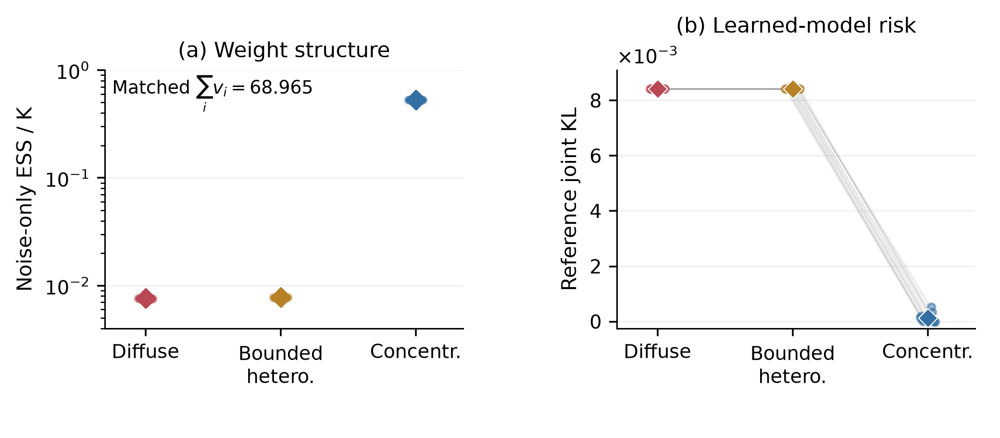
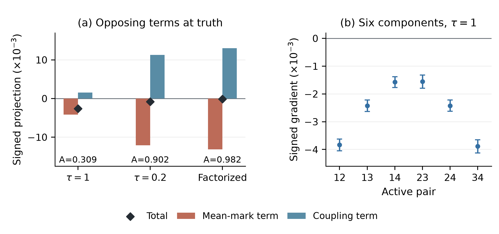

# 附录H　实验协议与复现

## H.1　新数据比较：风险与原评分

有限学习主实验使用(A.21)的四有效变量Gaussian-logistic教师、256个独立公平无关观察和已知零交叉协方差。有效均值和单位方差固定，从C=I开始在\(\mathcal E_{.1}^{(4)}\)中学习全部六个相关。16份新数据各含N4096个完整iid观察，每份使用两个独立训练prior四元组。这是同一个合成生成律的新实现，不是新领域。目标为完整观察KL，单位nats，不按维数归一：

$$
\mathcal R(\theta)=\sum_{y\in\{0,1\}^4}P(y)\log\frac{P(y)}{Q_\theta(y)}.
\tag{H.1}
$$

无关因子在(H.1)消失，但在随机粒子评分中不消失。训练调用未修改的官方`SCBLoss.compute_concept_loss` [@scbmcode]，采用float32输入与自动微分，K100、批64、学习率.02、Adam系数(.9,.999)及分母偏置\(10^{-8}\)。数据循环而不重排，无head、特征网络、precision惩罚、梯度裁切、学习率计划或提前停止。每步每个观察使用独立新prior粒子。程序共享生成输入，各有自己的参数与优化器状态。

IN4在同一状态平均四个K100梯度后更新，共512步；OUT4运行四条独立512步路径，平均其物理TAIL相关向量为一个Gaussian模型，不是预测混合。SEQ4在前一步更新后计算下一梯度，每个粗步按固定顺序执行四个微步，每微步仍用原学习率.02。FACT使用bank0的有效样本，计算有效有限K评分加\(256\log2\)；它是质量参照，不是精确似然或等预算竞争臂。

|程序|每四元组评分调用|每四元组更新|路径|
|---|---:|---:|---:|
|IN4|2048|512|1|
|OUT4|2048|2048|4|
|SEQ4|2048|2048|1|
|FACT|512|512|1|

TAIL平均最后64个更新后物理状态；SEQ4仅平均最后64个**粗步末态**。OUT4再平均四条路径的输出。32个四元组中，每个raw策略各65536次评分。评分调用匹配不等于每路径优化时间、Adam时间索引、参数位移或端到端成本匹配，也未把粒子合并成K400。IN4/OUT4/SEQ4/FACT平均风险为.0047217613/.0019111960/.0041083895/.0008839913，不训练I为.0027110543。

相关提议后，在float64计算\(l=\lambda_{\min}(C^{\rm prop})\)，使用

$$
C^{\rm repaired}=I+\alpha(C^{\rm prop}-I),\qquad
\alpha=1\ (l\ge .1),\quad \alpha=\frac{1-.1001}{1-l}\ (l<.1).
\tag{H.2}
$$

实际float32矩阵须通过.1谱下界与原生Cholesky检查，保留Adam动量。此为带安全间隙不连续点的径向修复，不是最近点投影。

独立外层单位是数据实现：风险先平均其两个训练输出。每份数据另有8组独立评价，每组512个K100 bank；原P差先平均这些组及两个训练输出。评价枚举16个有效模式，采用合格数值真PMF；期望对称性允许将公平无关标签规范化。16个外层单位包含数据/训练随机性，评分还含评价随机性。对q项家族、错误分配\(\alpha_f\)与L个独立配对单位，原开发区间为

$$
\bar d\ \pm\ t_{L-1,\,1-\alpha_f/(2q)}s_d/\sqrt L,
\qquad s_d^2=(L-1)^{-1}\sum_s(d_s-\bar d)^2.
\tag{H.3}
$$

风险家族q5、\(\alpha_f=.025\)，评分家族q2、\(\alpha_f=.025\)，L均16。程序间风险SE门槛.0005，对I风险.0002，评分.0005。这些是开发t近似，不是精确覆盖证书，也不含积分误差。**完整七项原比较如下，单位均乘\(10^3\)。**

|对比|均值|SE|原共同区间|SE通过|
|---|---:|---:|---|---|
|风险 / OUT4 − IN4|-2.810565|0.482752|[-4.396906, -1.224224]|是|
|风险 / SEQ4 − OUT4|2.197194|0.443207|[0.740799, 3.653588]|是|
|风险 / OUT4 − I|-0.799858|0.129247|[-1.224570, -0.375146]|是|
|风险 / SEQ4 − I|1.397335|0.409976|[0.050139, 2.744532]|否|
|风险 / FACT − I|-1.827063|0.111457|[-2.193314, -1.460812]|是|
|原评分P / OUT4 − IN4|1.953277|0.219853|[1.329636, 2.576918]|是|
|原评分P / SEQ4 − OUT4|-0.808023|0.282956|[-1.610665, -0.005381]|是|

五个风险方向均通过，但SEQ4−I精度失败：.000409976超过.0002。两个评分方向与精度均通过；SEQ4−OUT4评分上端仅−.0000053808。没有追加运行来关闭这些边界。OUT4−I支持本任务内平均改善，不是逐数据或完整恢复。FACT仍较低：将原共同OUT4−I及FACT−I区间相减，得到**事后派生**OUT4−FACT均值.0010272047、范围[.0002362414,.0018181681]，不新增更窄检验或SE门。

经典身份\(F_P=H(P)+\mathcal R+J_P\)中，OUT4−IN4和SEQ4−OUT4的偏差差为+.0047638424与−.0030052162。原评分/风险矩形端点相减，给[.0025538601,.0069738247]及[−.0052642523,−.0007461801]。不要求两者独立，也不相加SE。这是期望对数偏差记账，不分解方差或因果解释Adam。

## H.2　有效与无关尺度共同学习

另一研究从相同mixed教师新抽16份数据。每程序学习四个均值、四个有效标准差及六个相关。FIXED固定无关尺度\(\tau=1\)；FREE学习一个共同无关尺度；ZERO直接计算有效K100评分加\(256\log2\)，仍有有效有限K偏差，不是精确MLE。NEAR与UNIT仅初始有效尺度为.1和1。全部从C=I出发，均值由同一数据初始化为\(\operatorname{clip}(\operatorname{logit}[(n_i+.5)/(N+1)],-2,2)\)，FREE从\(\tau=1\)开始。

共96个私有程序，各512步，沿用上述优化器及输入配对，物理盒约束为\(\mu\in[-2,2]^4,s\in[.001,2]^4,\tau\in[0,2]\)，相关修复用(H.2)。盒裁切和修复保留Adam动量。这是物理坐标更新，不是softplus尺度优化。与H.1不同，主TAIL平均**均值及完整协方差**，不分别平均尺度/相关因子：

$$
\bar\mu=\frac1{64}\sum_{j=449}^{512}\mu_j,\quad
\bar\Sigma=\frac1{64}\sum_{j=449}^{512}\operatorname{diag}(s_j)C_j\operatorname{diag}(s_j),\quad
\bar s_i=\sqrt{\bar\Sigma_{ii}},\quad
\bar C=\operatorname{diag}(\bar s)^{-1}\bar\Sigma\operatorname{diag}(\bar s)^{-1}.
\tag{H.4}
$$

无关尺度单独平均，形成单一Gaussian输出。\(\Sigma\succeq.1\operatorname{diag}\Sigma\)的凸性保持输出相关下界。没有事后挑选LAST或checkpoint风险积分。六项原比较共用\(\alpha_f=.05,q=6,L=16\)，SE门均.0002，预期方向全为负。下表单位乘\(10^3\)。

|初值 / 风险差|均值|SE|原共同区间|方向通过|
|---|---:|---:|---|---|
|NEAR / FREE − FIXED|−.077630|.048803|[−.225811, .070551]|否|
|NEAR / FREE − 真实产品|.612683|.119274|[.250534, .974831]|否|
|NEAR / ZERO − 真实产品|−.661155|.166211|[−1.165817, −.156492]|是|
|UNIT / FREE − FIXED|−.363094|.073796|[−.587160, −.139028]|是|
|UNIT / FREE − 真实产品|.329162|.155077|[−.141695, .800018]|否|
|UNIT / ZERO − 真实产品|−1.147031|.141899|[−1.577875, −.716186]|是|

六项精度全过、方向3/6。真实产品边际风险为.0027110543，也是所有独立观察模型的最小风险。NEAR的FIXED/FREE/ZERO均值风险为.003401367/.003323737/.002049900，UNIT为.003403310/.003040216/.001564023。FREE平均无关尺度为.0457988和.0452287。小无关尺度尚未建立净风险恢复：NEAR FREE比真实产品更差，UNIT FREE未确定；ZERO两个初值都改善。原矩形区间派生FREE−ZERO范围分别为[.0004070266,.0021406482]和[.0005744919,.0023778931]，没有新检验。

FREE并非完全失去依赖。恒等式

$$
D(P\Vert\textstyle\prod_i Q_i)=D(P\Vert\prod_i P_i)+\sum_iD(P_i\Vert Q_i)
\tag{H.5}
$$

给每个输出自身的产品参照。FREE相对自身产品的平均联合logscore收益为正：.0000838938/.0003710605。该描述不是互信息或因果份额，不替换预定真实产品比较。训练bank碰撞同样只作描述，不能认证进入总体曲率窗口。A.9的参数化限制适用，因此这些轨迹不建立普遍困陷结论。

数值资格与风险推断分开。科学前制造fixture的native32/math64值-梯度资格5/6通过：NEAR_FREE共同\(\tau\)梯度差\(4.5489\times10^{-5}\)超过\(4\times10^{-5}\)。保留该失败后，研究对象明确为实际native32程序。384个预定训练状态控制全过，最大loss/梯度差为\(3.11738\times10^{-5}/3.23815\times10^{-5}\)，不追认制造fixture失败。

## H.3　无拟合的有限有效尺度激活

有限曲率研究固定四个教师，均值用(A.21)：独立C=I、mixed、.4等相关，以及\(C=.15I+.85qq^\top,q=(1,1,-1,-1)\)。各教师沿(A.40)取s=ta、\(\mu=\operatorname{logit}p\)。独立null用解析\(R_Y=I\)、\(v=(1,1,1,1)/2\)。有效尺度改变观察模型，无关扩维保持其风险。预定t为0/.1/.2/.4，主t=.2；K100，n为0/4/16/64/256，共享prior输入。本研究没有新观察或拟合。

16个独立prior流各2048bank，16有效模式采用归一化GH40教师权重。八项主raw比较用(H.3)，q8、\(\alpha_f=.025\)、L16，条件于固定数值教师；SE门.00015。null没有方向门。完整家族如下，单位乘\(10^3\)；KL差来自参考积分，不带抽样区间。

|教师|n|原评分差|原共同区间|风险差|
|---|---:|---:|---|---:|
|独立|0|.061887|[.060973, .062801]|.014367|
|独立|256|3.290798|[3.203203, 3.378392]|.014367|
|混合|0|−.151197|[−.152543, −.149851]|−.201177|
|混合|256|3.195826|[3.113491, 3.278160]|−.201177|
|等相关|0|−.790653|[−.793718, −.787588]|−.846886|
|等相关|256|3.023317|[2.936012, 3.110623]|−.846886|
|符号相关|0|−1.775128|[−1.781811, −1.768444]|−1.842596|
|符号相关|256|2.686154|[2.601506, 2.770802]|−1.842596|

三个依赖教师共6个方向、8个SE门全过。独立激活提高风险；其精确二阶曲率为零，与有限剂量结果不矛盾。五个n下无关碰撞均值为.010000/.018767/.085491/.394337/.688640。四个非零n单列Hoeffding家族：q4、\(\alpha_f=.025\)、32768个有界bank值，共同半宽.0092879515并裁至[1/K,1]；n0解析为1/K。mixed/等相关/符号相关的门槛\(1-1/B\)为.0430900/.1524316/.2794412。n64时区间已超过三门槛。通过(A.41)映射同一个区间不构成新检验。有界变量家族与开发t家族不能合称严格联合证书，二者均不覆盖数值PMF误差；其余t及n单元保持描述性。

## H.4　原六相关学习与方向支撑

较早六相关研究固定有效均值/方差，比较FIXED、学习**256个独立softplus无关尺度**的FREE，以及FACT。其同名方法不能与H.2的一个共同物理尺度混淆。16个独立数据/prior流，N4096/K100/512步，TAIL平均物理相关；均值风险.0063134213/.0014017301/.0009340534，修复次数1342/385/0。原q3、\(\alpha_f=.05\)、L16训练家族如下，单位乘\(10^3\)。

|TAIL风险对比|均值|SE|共同区间|SE门槛|
|---|---:|---:|---|---:|
|FIXED − FREE|4.9116912|1.0646554|[2.0437871, 7.7795952]|.2|
|FIXED − FACT|5.3793679|1.0543566|[2.5392060, 8.2195299]|.2|
|FREE − FACT|.4676768|.1330681|[.1092259, .8261276]|.05|

两个改善方向通过，但三项SE均失败；FREE−FACT在.0002界下的非劣仍未确认。正差区间不证明差超过此界，也不用LAST替换TAIL。

独立方向研究为32组×512bank，在I和真值比较无关尺度1、共同.2及因子分解。18项家族（\(\alpha_f=.05\)、df31、各SE门.00005）包含6个带符号梯度A、6个尺度1减FACT的梯度B、6个尺度.2减尺度1的梯度C。18个方向全部通过，**18个精度要求全部失败**。完整原区间如下，单位乘\(10^3\)。

|对比 / pair|均值|SE|共同区间|
|---|---:|---:|---|
|A / 01|−3.8366286|.0649866|[−4.0478385, −3.6254187]|
|A / 02|−2.4232542|.0635255|[−2.6297156, −2.2167928]|
|A / 03|−1.5734998|.0593550|[−1.7664066, −1.3805930]|
|A / 12|−1.5573868|.0722035|[−1.7920521, −1.3227215]|
|A / 13|−2.4231801|.0622794|[−2.6255914, −2.2207687]|
|A / 23|−3.8882056|.0739706|[−4.1286140, −3.6477971]|
|B / 01|−3.6267273|.0708552|[−3.8570107, −3.3964439]|
|B / 02|−2.2855209|.0675505|[−2.5050638, −2.0659781]|
|B / 03|−1.5005665|.0597903|[−1.6948880, −1.3062449]|
|B / 12|−1.4695288|.0716189|[−1.7022941, −1.2367634]|
|B / 13|−2.2626261|.0641267|[−2.4710413, −2.0542109]|
|B / 23|−3.6728456|.0823170|[−3.9403803, −3.4053108]|
|C / 01|2.6737233|.0753470|[2.4288415, 2.9186052]|
|C / 02|1.6774227|.0815887|[1.4122550, 1.9425905]|
|C / 03|1.0962796|.0637099|[.8892191, 1.3033401]|
|C / 12|1.0002334|.0812983|[.7360097, 1.2644571]|
|C / 13|1.6779526|.0824088|[1.4101197, 1.9457856]|
|C / 23|2.6970217|.1003027|[2.3710327, 3.0230107]|

该表pair采用从0开始的(01,02,03,12,13,23)，图中对应从1开始的(12,13,14,23,24,34)。符号按真实相关对齐。.2是固定探针，不是FREE学得向量；Price样本不是优化器路径梯度样本。固定自旋协方差参考中心\(h^{\rm ref}_{ij}\)时，恒等式为

$$
g_{ij}=-h^{\rm ref}_{ij}A-\sum_k\pi_k(1-\pi_k)(H_{k,ij}-h^{\rm ref}_{ij}),
\qquad A=1-\sum_k\pi_k^2.
\tag{H.6}
$$

这里是完整likelihood权重；平均重叠为\(1-E(1/\mathrm{ESS})\)，不是\(1-1/E\mathrm{ESS}\)。换参考中心会使两项反向移动，均非因果百分比。事后六相关平方误差身份也不分摊KL：FIXED/FREE/FACT的样本离散.44026324/.08986095/.06273747，样本均值平方误差.01028331/.01177915/.00465239；后者不是总体偏差平方。

## H.5　冻结面板与固定数据对照

冻结输出研究条件于16个旧FIXED/FACT TAIL及数据，32组×1024bank评价35候选，分开数值P与经验D频率。原q11、\(\alpha_f=.05\)、df31、SE门.0002的家族如下，单位乘\(10^3\)。FACT score指评价准则，不同于FACT训练得到的候选。

|评分 / 权重 / 对比|均值|原共同区间|SE通过|
|---|---:|---|---|
|Raw / P / FIXED − truth|−.958815|[−1.704038, −.213591]|否|
|Raw / P / FIXED − FACT|−.907856|[−1.568204, −.247507]|否|
|Raw / D / FIXED − truth|−1.337861|[−2.086233, −.589488]|否|
|Raw / D / FIXED − FACT|−.605863|[−1.268919, .057193]|否|
|FACT / P / FIXED − truth|6.075270|[6.061753, 6.088786]|是|
|FACT / P / FIXED − FACT|5.174403|[5.162305, 5.186501]|是|
|FACT / D / FIXED − truth|5.142748|[5.129907, 5.155590]|是|
|FACT / D / FIXED − FACT|5.924402|[5.911604, 5.937199]|是|
|Raw / P / high − truth|−2.836999|[−3.629602, −2.044397]|否|
|Raw / P / panel − mean|−.861525|[−1.505467, −.217583]|否|
|FACT / P / panel − mean|5.944371|[5.930723, 5.958020]|是|

10项方向和5项精度通过。6项raw精度失败保持，raw D的FIXED−FACT仍含零。积分风险panel−mean为+.0061704631，而raw P对应差为负；均值矩阵风险.0001429581仅为描述，不是等成本程序。原区间相减得FIXED−high raw P [.0003403590,.0034160105]，说明面板平均有改进空间，不等于每次运行的全局优化误差。

随后两研究固定4份旧数据，各用16列新prior。L4先平均4个梯度再更新，保持L1的当前批期望梯度，评分调用为4倍。IN4相同；OUT4平均4条独立L1物理输出。各原训练/评分家族分别分配.025。下表风险/评分乘\(10^3\)，参数行保留平方欧氏单位。

|研究 / 对比|均值|原共同区间|SE通过|
|---|---:|---|---|
|L4 − L1 / 风险|−1.229258|[−2.279813, −.178703]|是|
|L4 − L1 / 离散|−.172395|[−.264123, −.080668]|是|
|L4 − L1 / raw D|−1.409279|[−1.786109, −1.032449]|是|
|L4 − L1 / raw P|−1.134853|[−1.512167, −.757539]|是|
|OUT4 − IN4 / 风险|−3.136097|[−4.485575, −1.786619]|是|
|OUT4 − IN4 / 离散|−.115067|[−.231044, .000910]|是|
|OUT4 − IN4 / 均值误差|−.108253|[−.220002, .003496]|是|
|OUT4 − IN4 / raw D|1.819468|[1.321781, 2.317156]|是|
|OUT4 − IN4 / raw P|1.697666|[1.202711, 2.192621]|是|

风险单位为对4旧数据取平均后的16列（df15），不是64新数据。参数单位为8个不重叠列对（df7）：半平方距离估计条件协方差迹，真值中心化交叉乘积估计条件均值平方误差，后者可负。评分32独立组×1024bank（df31），条件于实际输出。风险/参数/评分SE门.0005/.05/.0002。L1/L4两家族通过；目标和风险同时改善是“普遍反向排序”主张的必要反例。IN4/OUT4两参数区间仍含零，不能确认它们是KL收益原因。旧OUT4风险.002681300接近I，但未设对I优越/等效门；H.1不追认旧门。

## H.6　匹配log权重方差及早期边界

**原接口的有限比较（图S3）。** 另一项研究使用16个独立流、每流4096个完整观察、K100及逐观察新prior粒子。四变量教师见(A.21)，high候选协方差为$I+1.75(C_*-I)$。无关扩维配对共享相应输入，其积分KL惩罚.001724195保持不变。图中复用原q=4、alpha=.05、df15的双尾Bonferroni开发t家族中的两项：n=0时high−truth为+.001424043，区间[.000825588,.002022499]；n=256时为−.003781125，区间[−.006451504,−.001110746]。另外两项涉及径向梯度偏移和正的无关尺度导数，原四项效应与精度门均通过。n256仍有两个流符号反向，均值结果不是逐流保证。参考使用12个主PMF和3个独审PMF；native32/stable64对照只给当前限定输入资格。本研究没有参数训练，且数据不同于H.1。

两有效变量支撑研究比较分散、有界异质和集中无关尺度，精确观察模型及总log权重方差相同。n254时，分散尺度为1；异质使用.5与1.30631561；集中使用253个1/254及一个14.2713171，共同方差68.9646835。集中族离开固定正紧尺度窗口，与A.4一致而非反例。

65536bank的方向研究在K64/K256、真相关0/.6下通过原12项经验Bernstein家族，区间条件于数值参考矩，不含积分/浮点误差。独立共享bank学习研究用16个基础数据、N4096/n254/K256/B128及801个预定候选；两个教师世界共享输入，不是32独立单位。真值0时分散/集中平均风险.008417575/.000126907，真值.6时.000347575/.000149114。原3项训练比较均过：风险差区间[.008193944,.008387391]与[.000094344,.000302577]，汇总的同数据MLE参数差异区间[.228358106,.294443131]。开发t家族与12项家族分开。128个网格/插值资格全过，最大\(1.90189\times10^{-5}\)低于\(3\times10^{-5}\)，不认证连续总体全局最优或浮点误差。接近MLE保持描述，没有新增非劣门。

早期径向FREE对FACT非劣及精度失败也保持。后续冻结径向模型的条件评价不修复这些失败，固定切片评分改善也不证明共同训练风险改善。有限校准与双预算仍是指定程序的理论支撑，不包装为通用算法或运行时间保证。

## H.7　数值参考、工作量与核验范围

经验区间沿用各自原独立单位、家族与数值权重。来源包在新抽样前冻结协议和代码，保留失败；不声称精确区间覆盖或严格积分误差证书。本节保留原研究的来源与统计家族；新增有限选择的预算和核验另见附录J。

|研究|新观察|优化数|主/审计PMF|
|---|---:|---:|---:|
|原接口有限比较|65,536|0|12 / 3|
|原六相关与方向|65,536|48|291 / 9|
|冻结六相关评价|0|0|3 / 1|
|L1/L4|0|128|408 / 16|
|固定数据IN4/OUT4|0|320|408 / 16|
|新数据IN4/OUT4/SEQ4|65,536|224|384 / 16|
|有限有效激活|0|0|48 / 16|
|共同尺度学习|65,536|96|288 / 32|

全部优化数仅指受控参数，神经网络训练为0；共享随机输入只计一次。L1/L4与固定数据IN4/OUT4各用218103808000个训练Gaussian及851968000个评价Gaussian；新数据研究对应109051904000与1703936000。有限激活用32768bank、3276800prior向量、851968000Gaussian；共同学习用52428800prior向量、13631488000Gaussian，49152次主API与384次资格API。复用教师积分及解析产品概率不计新PMF。

六相关参考用GH24/32/40（主32）；有限激活用GH24/32/40（主40），63045632结点，另4个解析产品PMF；共同学习用GH32/40/48（主40），856031232结点。对应独立对称根审计阶数为36、36、44；共同学习审计另119939072结点。全部声明PMF资格通过，但正性、归一化和跨阶吻合不等于严格余项证书。原真PMF与后来归一化GH40教师保留不同数值合同。

审计重放全部输入hash、保存输出/统计算术，以及适用时的保存Adam/修复更新。底层限定为：原六相关24训练状态与128方向bank；冻结评价143360单元；L1/L4的80训练bank调用与282624评价单元；固定数据80聚合状态/128bank调用/282624评价单元；新数据160训练状态/208bank调用/81920评价单元；有限激活32prefix bank及4096原API；共同尺度384状态。共同尺度独核全部49152个保存更新，但未重算每个底层梯度。全输入重放不等于全训练或全评分重跑。

固定数据IN4/OUT4审计的文件名覆盖故障使首轮只有data0-repeat1可确认完成；另行冻结的软件修复在相同输入上完成预定核验。共同尺度记录保留输出格式故障及原失败开发源码未保存的事实。修复没有科学重抽样或扩预算。本地大NPZ并非全部入Git，公开JSON、RNG定义和哈希不能替代二进制数据。

\clearpage

{width=100%}

{width=100%}
