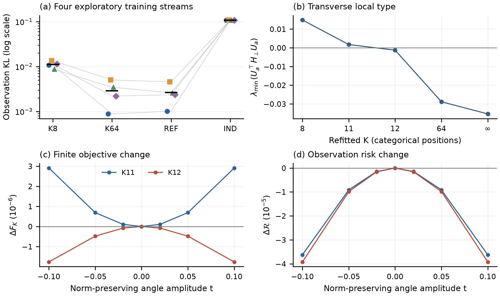

# 附录 I. 无指定可删块的联合学习与局部稳定性

本附录证明两件相连但不同的事：有限目标在完整参数空间中有严格局部极小；从同一根沿保持候选边际的角路径，仍能降低联合风险而提高有限目标。先由I.1–I.3的[模型](#dense-model)、[完整导数](#full-derivatives)和[Laplace表示](#laplace-representation)固定对象，再由I.8建立[严格局部见证](#proof-theorem-3)，I.10证明[同根固定边际角路径冲突](#same-root-angle)。I.11给出[明确教师族中的定量持续性](#quantitative-teacher-family)。I.9的[定性延续](#local-persistence)针对原径向风险方向，允许更一般的教师扰动。I.4–I.7的学习与重拟合比较为这些结论提供数值背景；经验拟合和K11/K12的结论仍属数值层级。

## I.1. 模型、目标与弱载荷接口 {#dense-model}

本附录研究一个有限维模型，与定理1–2的无关维度增长设定不同。取$m=8$、$Z\sim N(0,I_2)$，全部偏置和载荷均可变化：

$$
\begin{aligned}
A_y(z;b,W)&=\prod_{j=1}^m\sigma(b_j+W_jz)^{y_j}
[1-\sigma(b_j+W_jz)]^{1-y_j},\qquad y\in\{0,1\}^m,\\
p_\theta(y)&=E_ZA_y(Z;\theta),\qquad
F_K^q(\theta)=\sum_yq_yE\left[-\log\left\{K^{-1}\sum_{k=1}^KA_y(Z_k;\theta)\right\}\right],\\
F_\infty^q(\theta)&=-\sum_yq_y\log p_\theta(y),\qquad
R(\theta)=D_{\mathrm{KL}}(q_*\Vert p_\theta).
\end{aligned}
\tag{I.1}
$$

对候选参数求导时，目标$q$固定：它可以是经验状态频率，也可以是教师分布$q_*$。教师满足$b_*=0$，载荷行为$W_{*,j}=.8(\cos\phi_{*,j},\sin\phi_{*,j})$，其中$\phi_*=(-.7,-.5,-.3,-.1,.1,.3,.5,.7)$。所有行非零，所有非对角载荷内积均为正；Gaussian logistic的单调性还给出非零的观察两两依赖。这里没有指定的独立观察块可供删除。Bernoulli潜变量建模已有基础[@tipping1998]；本附录的贡献针对具体目标几何，不是新模型或一般潜变量塌缩现象[@burda2016; @lucas2019; @urban2021]。

由于$\operatorname{rank}(WW^\top)\le2$，这个参数类不同于定理1–2中施加正谱下界的完整相关矩阵类。其谱结论和无关维度增长速率均不移用到本模型。

仅在弱载荷计算中使用自旋$Y_j\in\{-1,1\}$、零偏置、$W_j^\top=\varepsilon v_j(\phi)$及$v_j=s_j(\cos\phi_j,\sin\phi_j)^\top$，其中$s_j>0$固定。记$c=(v_i^\top v_j)_{i<j}$，教师使用相同的$\varepsilon,s$及角度$\phi_*$。对固定$m,K$，在紧角度邻域上连同两阶角度导数一致地有

$$
\begin{aligned}
F_{K,\varepsilon}(\phi)-F_{K,\varepsilon}(\phi_*)
&=\varepsilon^4\{a_K(\|c\|^2-\|c_*\|^2)-b_Kc_*^\top(c-c_*)\}+O(\varepsilon^6),\\
a_K&=\frac{(K-1)(K-2)}{32K^2},\qquad b_K=\frac{K-1}{16K}.
\end{aligned}
\tag{I.2}
$$

沿通过教师的光滑路径，记$\dot c=dc/dt|_0$。相应风险和方向导数为

$$
\begin{aligned}
R_\varepsilon(\phi)&=\frac{\varepsilon^4}{32}\|c-c_*\|^2+O(\varepsilon^6),\\
F_{K,\varepsilon}'(0)&=-\frac{K-1}{8K^2}\varepsilon^4c_*^\top\dot c+O(\varepsilon^6),\\
R_\varepsilon'(0)&=0,\qquad
R_\varepsilon''(0)=\frac{\varepsilon^4}{16}\|\dot c\|^2+O(\varepsilon^6).
\end{aligned}
\tag{I.3}
$$

下面给出系数推导。令$x_j=v_j^\top Z$，展开$2^mA_y=1+\varepsilon h_1+\varepsilon^2h_2+\varepsilon^3h_3+\cdots$：

$$
\begin{aligned}
h_1&=\tfrac12\sum_jy_jx_j,\qquad h_2=\tfrac14\sum_{i<j}y_iy_jx_ix_j,\\
h_3&=\tfrac18\sum_{i<j<\ell}y_iy_jy_\ell x_ix_jx_\ell-\tfrac1{24}\sum_jy_jx_j^3,\\
[-\log(1+\textstyle\sum_{r\ge1}\varepsilon^r\bar h_r)]_{\varepsilon^4}
&=-\bar h_4+\bar h_1\bar h_3+\tfrac12\bar h_2^2-\bar h_1^2\bar h_2+\tfrac14\bar h_1^4.
\end{aligned}
\tag{I.4}
$$

横线表示对$K$个粒子取平均。均匀自旋正交性与Gaussian四阶矩给出每个$c_{ij}^2$的下列系数；仅依赖固定行范数的项在差分中消去。

|式（I.4）中的项|$c_{ij}^2$的系数|
|---|---:|
|$-E\bar h_4$|$0$|
|$E\bar h_1\bar h_3$|$0$|
|$E\bar h_2^2/2$|$(K+1)/(32K)$|
|$-E\bar h_1^2\bar h_2$|$-(K+1)/(8K^2)$|
|$E\bar h_1^4/4$|$3/(16K^2)$|

特别地，

$$
\begin{aligned}
E(\overline{x_ix_j})^2&=(1+K^{-1})c_{ij}^2+K^{-1}s_i^2s_j^2,\\
E(\bar x_i\bar x_j\overline{x_ix_j})&=K^{-2}\{s_i^2s_j^2+(K+1)c_{ij}^2\},\\
E_Z[-\bar h_2+\bar h_1^2/2]
&=\frac{\sum_js_j^2}{8K}-\frac{K-1}{4K}\sum_{i<j}y_iy_jc_{ij}.
\end{aligned}
\tag{I.5}
$$

教师矩$E(Y_iY_j)=\varepsilon^2c_{*,ij}/4+O(\varepsilon^4)$给出$b_K$项。展开有限字母表上的KL并使用同一自旋正交性，即得（I.3）。在$K=2$时，精确的双粒子log-cosh身份独立给出两个$\|c\|^2$系数的相消，确认$a_2=0$、$b_2=1/32$。

这个余项不是对无界Gaussian输入逐点一致的Taylor界。log-sigmoid的实导数有界；log-sum-exp的导数是权重位于$[0,1]$的加权累积量。在所需的六阶载荷导数及两阶角度导数范围内，紧参数集上可用$\max_k\|Z_k\|$的多项式支配。Gaussian矩保证可以交换求导与期望。同时反转全部潜粒子使目标关于$\varepsilon$为偶函数。这些事实给出所述余项；没有提供显式六阶常数、随$K$增长的一致性或适用于$\varepsilon=.8$的阈值。

当$K>2$时，(I.2)平方完成后，除去与候选角度无关的项，得到$\varepsilon^4a_K\|c-\{K/(K-2)\}c_*\|^2+O(\varepsilon^6)$：这个固定行长弱载荷近似倾向拟合放大的成对内积。对文中教师角度和$s_j=1$，令$L_*$为边权$\cos(\phi_{*,i}-\phi_{*,j})$的Laplacian。共线候选在$\mathbf1^\perp$上的首项角度Hessian为$\varepsilon^4\{b_KL_*-2a_K(8)I\}$；最小特征值的形式变号边界为$K=16/(8-\lambda_{\min}(L_*|_{\mathbf1^\perp}))\simeq4.32690638$，由一个固定特征分解得到，没有扫描$K$。这是固定等行长、共同载荷充分小时首项系数的实数边界，不是载荷$.8$下的定量预测。I.6中通过资格的11/12分离对应完整有限载荷目标，且每个$K$都重新拟合偏置和行长。弱展开提供偏好直觉，尚未定量预测重新拟合后的转变；两个数字都不确定普适临界粒子数。

取$s_j=1$、$\phi(t)=(1-t)\phi_*$，则所有$c_{*,ij}>0$且$\dot c_{ij}=(\phi_{*,i}-\phi_{*,j})\sin(\phi_{*,i}-\phi_{*,j})>0$。因此足够弱的载荷下，有限目标下降而局部风险增加。$K=1$对角度精确不变。有限$\varepsilon$的核对保留两个未通过精度门的情形：

|$\varepsilon$|$F_2(.05)-F_2(0)$|$R(.05)$|$F_2'(0)$|GH16/20导数差|资格|
|---:|----------:|----------:|----------:|----------:|--------|
|.125|$-2.46194897\,10^{-6}$|$1.53201221\,10^{-7}$|$-5.01126089\,10^{-5}$|$9.92045\,10^{-18}$|通过|
|.25|$-3.78093733\,10^{-5}$|$2.20782999\,10^{-6}$|$-7.68065055\,10^{-4}$|$1.01103\,10^{-12}$|通过|
|.5|$-4.60084001\,10^{-4}$|$2.51342565\,10^{-5}$|$-.00932588949$|$1.40079\,10^{-7}$|未通过|
|.8|$-.00187535140$|$1.00148195\,10^{-4}$|$-.0379671263$|$2.04217\,10^{-5}$|未通过|

这些结果使用GH阶数8/12/16/20的完整四维$K=2$银行；导数与配对损失的资格要求16/20相邻阶差不超过$10^{-7}$。独立的二维教师PMF核对在$.8$通过，因而允许继续学习，但不使该点的四维角度计算获得资格。

## I.2. 完整导数与条件性局部类型准则 {#full-derivatives}

::: {#full-hessian-criterion}

**命题3（秩一Hessian结构）。** 固定$q$与$K$，并允许积分目标，令$W=(a,0)$且$a_j>0$。在坐标$(b,u,v)$中，记$H_{ba}$为偏置与第一列载荷块、$H_\perp$为第二列载荷块、$g_a=\partial_a F_K^q$，以及$D_a=\operatorname{diag}(a)$，则

$$
\begin{aligned}
H_{\rm full}&=\operatorname{diag}(H_{ba},H_\perp),\\
H_\phi&=D_aH_\perp D_a-\operatorname{diag}(a\odot g_a),\\
H_\perp a&=g_a,\qquad H_\phi\mathbf1=0.
\end{aligned}
$$

:::

回到二元位编码。在$W_j=(a_j,0)$、$a_j>0$处，记

$$
\begin{aligned}
p_k&=\sigma(b+az_k),\quad r_k=y-p_k,\quad D_k=\operatorname{diag}\{p_{kj}(1-p_{kj})\},
\quad\pi_k=\frac{A_y(z_k)}{\sum_\ell A_y(z_\ell)},\\
G_k&=\binom{r_k}{z_kr_k},\qquad
B_k=\begin{pmatrix}D_k&z_kD_k\\z_kD_k&z_k^2D_k\end{pmatrix}.
\end{aligned}
\tag{I.6}
$$

下列期望包括$y\sim q$及独立同分布粒子。按$(b,a)$坐标顺序对log-sum-exp求导得到

$$
\begin{aligned}
g_{ba}&=-E\sum_k\pi_kG_k,\\
H_{ba}&=E\sum_k\pi_kB_k-E\sum_k\pi_k(1-\pi_k)G_kG_k^\top\\
&\quad+E\sum_{k\ne\ell}\pi_k\pi_\ell G_kG_\ell^\top.
\end{aligned}
\tag{I.7}
$$

最后一项不可省略：负Hessian等于加权条件负Hessian减去粒子得分协方差。跨粒子外积必须先于标签平均形成。

在完整坐标$(b,u,v)$下，$W_j=(u_j,v_j)$。第二Gaussian坐标的反射给出$F(b,u,v)=F(b,u,-v)$。在$(u,v)=(a,0)$处，

$$
\begin{aligned}
g_v&=0,\qquad H_{(b,u),v}=0,\qquad
H_{\rm full}=\operatorname{diag}(H_{ba},H_\perp),\\
H_\perp&=E\left[\sum_k\pi_kD_k-\sum_k\pi_k(1-\pi_k)r_kr_k^\top\right].
\end{aligned}
\tag{I.8}
$$

独立、中心化的第二粒子坐标只消去横向块中的跨粒子项。保持行范数的角度路径还具有二阶变化$\ddot W_{j1}=-a_j\dot\phi_j^2$，故

$$
H_\phi=\operatorname{diag}(a)H_\perp\operatorname{diag}(a)
-\operatorname{diag}(a\odot g_a),\qquad H_\perp a=g_a,\qquad H_\phi\mathbf1=0.
\tag{I.9}
$$

完整起见，对下式应用Gaussian分部积分：

$$
\begin{aligned}
\partial_{z_k}(\pi_kr_{ki})
&=\pi_k(1-\pi_k)(a^\top r_k)r_{ki}-\pi_ka_i(D_k)_{ii},\\
E[z_k\pi_kr_{ki}]&=E[\partial_{z_k}(\pi_kr_{ki})].
\end{aligned}
\tag{I.10}
$$

这证明了（I.9）的Ward关系。等价的有符号Laplacian为

$$
\begin{aligned}
w_{ij}&=a_ia_jE\sum_k\pi_k(1-\pi_k)r_{ki}r_{kj},\qquad i\ne j,\\
(H_\phi)_{ij}&=-w_{ij},\qquad (H_\phi)_{ii}=\sum_{j\ne i}w_{ij},\\
d^\top H_\phi d&=\sum_{i<j}w_{ij}(d_i-d_j)^2.
\end{aligned}
\tag{I.11}
$$

边权可以为负；仅使行和结构性地等于零，不能验证求积。$K=1$时$H_\phi=0$是精确身份。

在**真正**的驻点$g_b=g_a=0$处，令$V$的列为$a^\perp$的一组正交归一基。充分条件为

$$
\lambda_{\min}(H_{ba})>0,\qquad
\lambda_{\min}(V^\top H_\perp V)>0.
\tag{I.12}
$$

切片$a^\top v=0$与共同旋转轨道横截。由（I.8），条件（I.12）使切片上的Hessian正定，从而得到模去旋转后的严格局部极小；$m=8$时有23个正曲率的非旋转方向。横向负方向则给出局部下降。离散反射不增加连续零模。这些条件性结论不会把一个很小的浮点梯度变成经认证的精确驻点。I.8为总体K8问题补上误差界与根包含；四个经验拟合及K11/K12延续仍保持数值证据层级。紧邻域上的Gaussian多项式支配保证上述求导合法；每个积分标签概率为正，对$F_\infty^q$也可作相应的局部论证。

## I.3. 单粒子Laplace计算与配对差 {#laplace-representation}

对每个标签取任意$c_y>0$，令$x=A_y/c_y$、$u=e^v$，定义

$$
\Psi_y(u)=E e^{-ux},\qquad B_{0,y}(u)=E[xe^{-ux}],\qquad M_{G,y}(u)=E[xe^{-ux}G].
\tag{I.13}
$$

利用$S^{-1}=\int_0^\infty e^{-uS}du$、$S^{-2}=\int_0^\infty ue^{-uS}du$以及粒子交换性，可把银行期望降为单粒子潜变量积分与一个辅助积分。对离散normal节点$(z_\ell,\omega_\ell)$，将内层期望替换为加权和：

$$
\begin{aligned}
d_{y\ell}&=\omega_\ell x_\ell K\int_{\mathbb R}u e^{-ux_\ell}\Psi_y(u)^{K-1}\,dv,\\
c_{y\ell}&=\omega_\ell x_\ell K(K-1)\int_{\mathbb R}u^2e^{-ux_\ell}B_{0,y}(u)\Psi_y(u)^{K-2}\,dv.
\end{aligned}
\tag{I.14}
$$

逐标签导数因而为

$$
\begin{aligned}
g_{ba,y}&=-\sum_\ell d_{y\ell}G_\ell,\\
H_{ba,y}&=\sum_\ell d_{y\ell}B_\ell-\sum_\ell c_{y\ell}G_\ell G_\ell^\top\\
&\quad+K(K-1)\int_{\mathbb R}u^2M_{G,y}(u)M_{G,y}(u)^\top\Psi_y(u)^{K-2}\,dv.
\end{aligned}
\tag{I.15}
$$

最后再按$q_y$平均。有符号项的Fubini交换由$\sum_k\pi_k(1-\pi_k)\le1-1/K$及可积Gaussian得分矩保证。$K=1$时$g=-EG$、$H=EB$。对积分似然，后验为$\pi_y(dz)\propto A_y(z)\varphi(z)dz$，有

$$
\begin{aligned}
g_{ba,\infty,y}&=-E_{\pi_y}G,\\
H_{ba,\infty,y}&=E_{\pi_y}B-E_{\pi_y}GG^\top
+(E_{\pi_y}G)(E_{\pi_y}G)^\top,\\
H_{\perp,\infty,y}&=E_{\pi_y}D-E_{\pi_y}rr^\top.
\end{aligned}
\tag{I.16}
$$

对目标平均后，反射及Ward关系仍成立。当目标恰为该积分模型自身分布时，共线点的角度Hessian为零；这项核对不要求严格正定。对于原质量为$M$的数值normal测度$\nu$，保留其原权重及有限银行质量$M^K$：

$$
\begin{aligned}
F_{K,y}^{(\nu)}&=-M^K\log c_y+
\int_{\mathbb R}\{\Psi_y^{(\nu)}(e^v)^K-M^Ke^{-Ke^v}\}\,dv,\\
\sum_\ell d_{y\ell}&=M^K,\qquad
0\le\sum_\ell c_{y\ell}\le M^K(1-1/K).
\end{aligned}
\tag{I.17}
$$

等式针对未截断的辅助积分；程序检查相应数值残差。积分后验权重的质量则为1。normal权重和目标权重均不静默重归一。

对于角度方向$d_{\mathrm{ang}}^{(12)}\in\mathbb R^8$的匹配非共线路径，共同尺度在基线处固定：

$$
W_j(t)=a_j(\cos(td_{\mathrm{ang},j}^{(12)}),\sin(td_{\mathrm{ang},j}^{(12)})),\qquad
c_y=\frac{\int A_{y,0}\,d\nu}{M},\qquad
\Psi_{y,t}^{(\nu)}(u)=\int e^{-uA_{y,t}/c_y}\,d\nu.
\tag{I.18}
$$

主差额直接计算为

$$
\begin{aligned}
\Delta F_K^{(\nu)}(t)&=\sum_yq_y\int_{\mathbb R}
\{\Psi_{y,t}^{(\nu)}(e^v)^K-\Psi_{y,0}^{(\nu)}(e^v)^K\}\,dv,\\
\Delta R^{(\nu)}(t)&=-\sum_yq_y\{\log p_t^{(\nu)}(y)-\log p_0^{(\nu)}(y)\}.
\end{aligned}
\tag{I.19}
$$

由Frullani身份，共同常数消去。只有内层积分变为二维，并非$2K$维。指数差使用保留符号的`expm1`；绝对损失相减只作接口核对。小$u$计算使用原质量及`log1p`／`expm1`，极小和回退到log-sum-exp。在真实Gaussian律下，固定行范数保持每个一维观察边际，反射使两种差额关于$t$为偶函数。局部光滑性给出

$$
F_K(t)-F_K(0)=\tfrac12t^2(d_{\mathrm{ang}}^{(12)})^\top H_\phi d_{\mathrm{ang}}^{(12)}+O(t^4),\qquad
R(t)-R(0)=\tfrac12t^2(d_{\mathrm{ang}}^{(12)})^\top H_{\phi,\infty}d_{\mathrm{ang}}^{(12)}+O(t^4).
\tag{I.20}
$$

下面的有限差额并非由（I.20）生成。

## I.4. 完整学习与混合的固定边际对照

四条探索流各含4096条来自$.8$教师的完整观察。所有方法共享数据与初始化：Jeffreys平滑边际logit，以及独立$N(0,.25^2)$载荷元素。偏置和载荷元素均约束在$[-2,2]$。投影Adam执行1200次更新，前800步学习率$.02$、其后$.005$，$(\beta_1,\beta_2)=(.9,.999)$，稳定项$10^{-8}$；输出为LAST。每步K8与K64共享128个新的二维prior向量，分别组成16或2个银行。每个银行先独立取log-mean再平均；合并银行会优化另一目标。GH20给出积分经验目标对照。相同粒子数不等于相同梯度噪声或总成本。

REF从GH-Adam LAST开始，用GH40 L-BFGS-B，最多300次迭代／450次调用，梯度容差$10^{-7}$、函数容差$10^{-12}$。四流均已满足梯度门：只调用一次，没有新增迭代。IND使用Jeffreys平滑拟合独立Bernoulli边际。教师只进入输出锁定后的总体评价，不进入训练。数据／prior流使用PCG64DXSM及SeedSequence $[202610070100,r,\mathrm{role}]$；角色0–4分别对应潜变量、发射均匀数、初始化、训练prior及独立评价。

|流|K8 KL|K64 KL|REF KL|IND KL|
|---|---:|---:|---:|---:|
|0|.010714173|.000882779|.001013446|.106851719|
|1|.013518917|.005017770|.004563076|.108354984|
|2|.008767421|.003466091|.002591933|.107382320|
|3|.011357337|.002199853|.002356989|.107318617|
|均值|.011089462|.002891623|.002631361|.107476910|

每流K64的风险都低于K8，但其中两流还低于REF：有限数据下，更精确的积分并非逐例最优。K8单位行Gram矩阵的第二特征值为$1.20\,10^{-5}$–$2.30\,10^{-4}$，REF为1.3403–1.5988，K64为1.0785–1.4567。这指的是近一因子的**载荷结构**，不是秩一的观察协方差。

每流使用4096个新的64粒子银行配对评价固定模型；$F_8$取前8个粒子。下表为K8减REF，括号内是条件MCSE，单位为每条八位观察的nats。

|流|经验$F_8$差|总体$F_8$差|
|---|---:|---:|
|0|−.017111839 (.000420685)|−.019030398 (.000421690)|
|1|−.017389742 (.000861898)|−.017994448 (.000870445)|
|2|−.016952623 (.000519001)|−.019887290 (.000506188)|
|3|−.017387109 (.000383751)|−.018698806 (.000387336)|

积分经验NLL和总体KL都偏好REF；$F_{64}$评价也在所有流及两类目标下偏好REF。这些是固定输出之间的排序比较，不是全局最优或训练总体置信结论。

分阶段profile对照固定REF的偏置和行范数，将单位方向换成K8或K64方向，得到H8／H64，不作教师对齐或重新拟合。另行冻结的银行家族$[202610070300,r,0]$使用相同评价预算。全部候选仍在可行域内，边际最大差为$6.67\,10^{-16}$。

|流|H8−REF KL|经验$F_8$差（MCSE）|总体$F_8$差（MCSE）|
|---|---:|---:|---:|
|0|+.015649258|−.000384622 (.000474800)|−.001914842 (.000475939)|
|1|+.015691309|−.000283583 (.000921181)|+.000805674 (.000943760)|
|2|+.015529662|−.002605471 (.000575264)|−.000903313 (.000572604)|
|3|+.016110010|+.001209140 (.000399319)|−.000149413 (.000400167)|

H8在四流都增加风险，但$F_8$排序混合，且一些差值与MCSE同量级。$F_{64}$一致惩罚H8。H64减REF的KL为$(−.000009563,+.000896783,+.000587691,+.000160217)$；H64平均KL为$.00304014$，H8为$.01837642$。这个改善对照及后续曲率结果都没有消除H8比较的不一致；没有追加银行追求特定符号。

## I.5. 行长对照与完整驻定数值签名

规范共线锚点使用正行范数，而不是原载荷第一列。每流交叉组合K8／REF偏置与K8／REF行范数；固定K8偏置时，还在$\lambda=.25,.5,.75$处插值行范数。在K8偏置及行范数下，角度Hessian投影至$\mathbf1^\perp$后的最小特征值为：

|流|经验$F_8$|总体$F_8$|总体$F_{64}$|风险|
|---|---:|---:|---:|---:|
|0|+.002854452|+.003744359|−.004021564|−.005337262|
|1|+.004466493|+.002889122|−.006012170|−.007533965|
|2|+.004168796|+.002341562|−.008817385|−.010706974|
|3|+.003203522|+.003711700|−.003994969|−.005288578|

只换成REF行范数后，经验$F_8$最小值变为$−.01958$到$−.01101$，总体最小值变为$−.02006$到$−.01332$。本面板中只换偏置不改变端点类型。插值给出$(0,.25)$或$(.25,.5)$的数值异号区间，不保证唯一或单调。这些锚点的偏置／径向梯度非零；角度稳定本身不是完整驻点结论。

为核对这一差别，对四个经验$F_8$问题E0–E3和一个总体问题P优化全部$(b,a)$，约束$b\in[-2,2]^8$、$a\in[.05,2]^8$。它们从相应K8规范锚点开始，P使用流0。P是使用教师的机制诊断，不是第五份独立数据。

|终点|$\|g_{ba}\|_\infty$|$\lambda_{\min}(H_{ba})$|$\lambda_{\min}(V^\top H_\perp V)$|KL|
|---|---:|---:|---:|---:|
|E0|$9.93946\,10^{-11}$|.05029121|.01062942|.01110942|
|E1|$4.53156\,10^{-11}$|.05191026|.01891921|.01373345|
|E2|$5.02400\,10^{-14}$|.05465116|.01576894|.00908874|
|E3|$2.96443\,10^{-12}$|.05410205|.01389994|.01229271|
|P|$2.93578\,10^{-12}$|.05396628|.01485717|.01043357|

五点都通过完整局部极小的数值签名。表中仍是原近似终点的数值读数。总体P目标另有I.8认证的附近精确局部极小；该证书不外推到E0–E3。在P处，积分风险梯度范数为$.02456458$。沿其固定负单位$(b,a)$方向，预定五个有限步均通过相应资格：

|步长|$\Delta F_8$|$\Delta R$|
|---:|---:|---:|
|−.02|$+1.49974827\,10^{-5}$|$+5.09524051\,10^{-4}$|
|−.01|$+3.74871128\,10^{-6}$|$+2.50202674\,10^{-4}$|
|0|0|0|
|+.01|$+3.74715392\,10^{-6}$|$-2.41091767\,10^{-4}$|
|+.02|$+1.49850334\,10^{-5}$|$-4.73081829\,10^{-4}$|

正向$.02$步把KL从$.01043357299$降到$.00996049116$，同时升高$F_8$。在同一五个终点上，总体$F_{64}$和风险的角度块具有负方向；这两个目标没有在那里被优化到驻定。

## I.6. 对每个K重新拟合与同方向比较

随后对每个总体问题重新拟合，从前一个可行LAST开始，完成整个粗序列中的K=9、10、12、16、24、32、64、128及积分目标。之后才对首个相邻且合格的有限正→负对作整数细化，最多六个中点，起点按端点参数插值。实际只在11处细化一次，得到保留对$[11,12]$。下表是Cartesian横向特征值，不是角度方向曲率。

|K|$\|g_{ba}\|_\infty$|$\lambda_{\min}(H_{ba})$|横向最小值|负模数|KL|
|---:|---:|---:|---:|---:|---:|
|8，复用|$2.936\,10^{-12}$|.0539663|+.01485717|0|.010433573|
|9|$4.910\,10^{-14}$|.0530561|+.00959400|0|.009461482|
|10|$5.902\,10^{-11}$|.0524036|+.00530421|0|.008842072|
|11|$2.513\,10^{-12}$|.0519187|+.00174653|0|.008426627|
|12|$4.369\,10^{-14}$|.0515476|−.00124838|1|.008136147|
|16|$3.982\,10^{-14}$|.0506760|−.00960756|1|.007557032|
|24|$3.617\,10^{-14}$|.0500081|−.01810993|1|.007228793|
|32|$3.951\,10^{-11}$|.0497429|−.02239912|1|.007134125|
|64|$3.200\,10^{-14}$|.0494177|−.02886195|1|.007055936|
|128|$9.837\,10^{-12}$|.0492813|−.03210040|1|.007039262|
|$\infty$|$7.083\,10^{-12}$|.0491572|−.03533998|2|.007034194|

所有新点均通过径向驻定资格。积分极限仍受共线子模型约束，其正风险不是完整两因子模型的恢复上限。没有继续追踪积分极限的第二负模。整数类型区分不是关于唯一分支、单调转换或普适临界K的定理。

方向$d_{\mathrm{ang}}^{(12)}\in\mathbb R^8$取K12终点的最小角度特征向量，从固定Helmert基映回，并令最大绝对分量为正。舍入分量： $(-.5316182,-.3864170,-.2460486,-.0867412,.0867412,.2460486,.3864170,.5316182)$；实际始终使用与$\mathbf1$正交的全精度单位向量。角度特征值间隙为$.0122054$。此角度方向不同于I.8.5的物理风险方向$d_{\mathrm{risk}}$。四格均使用同一$(d_{\mathrm{ang}}^{(12)})^\top H_\phi d_{\mathrm{ang}}^{(12)}$，得到：

|参数|$F_{11}$|$F_{12}$|
|---|---:|---:|
|$\theta_{11}$|+.000542300179|−.000056581709|
|$\theta_{12}$|+.000226560907|−.000394546595|

先换K的两项贡献为$−.000598881888$和$−.000337964886$；先换参数的两项为$−.000315739271$和$−.000621107502$。总和均为$−.000936846774$，交互项为$−.000022225614$。这是依赖顺序的四格代数，而非唯一因果分解。交叉格并未对其交叉目标驻定，仍须保留径向补偿。

## I.7. 直接非共线行为、数值资格与边界

两个锁定终点使用同一$d_{\mathrm{ang}}^{(12)}$及（I.18）。主幅度为$|t|=.02$，$.05,.10$是固定敏感性幅度。正负两侧全部独立评价，零点共享基线。主规则读数如下：

|K|t|$\Delta F_K$|$\Delta R$|$2\Delta F_K/t^2$|$2\Delta R/t^2$|
|---:|-----:|-------------:|-------------:|-------------:|-------------:|
|11|−.10|$+2.90960527\,10^{-6}$|$-3.62277988\,10^{-5}$|+.000581921053|−.00724555975|
|11|−.05|$+6.90272432\,10^{-7}$|$-9.10994254\,10^{-6}$|+.000552217946|−.00728795403|
|11|−.02|$+1.08777517\,10^{-7}$|$-1.45996822\,10^{-6}$|+.000543887585|−.00729984112|
|11|+.02|$+1.08777517\,10^{-7}$|$-1.45996822\,10^{-6}$|+.000543887585|−.00729984112|
|11|+.05|$+6.90272432\,10^{-7}$|$-9.10994254\,10^{-6}$|+.000552217946|−.00728795403|
|11|+.10|$+2.90960527\,10^{-6}$|$-3.62277988\,10^{-5}$|+.000581921053|−.00724555975|
|12|−.10|$-1.76055405\,10^{-6}$|$-3.91948957\,10^{-5}$|−.000352110811|−.00783897915|
|12|−.05|$-4.79905287\,10^{-7}$|$-9.85357108\,10^{-6}$|−.000383924230|−.00788285687|
|12|−.02|$-7.85692828\,10^{-8}$|$-1.57903202\,10^{-6}$|−.000392846414|−.00789516009|
|12|+.02|$-7.85692828\,10^{-8}$|$-1.57903202\,10^{-6}$|−.000392846414|−.00789516009|
|12|+.05|$-4.79905287\,10^{-7}$|$-9.85357108\,10^{-6}$|−.000383924230|−.00788285687|
|12|+.10|$-1.76055405\,10^{-6}$|$-3.91948957\,10^{-5}$|−.000352110811|−.00783897915|

两锚点的零点差额均按定义为0。在$.02$处，$2\Delta R/t^2$为$−.00729984112$和$−.00789516009$。有限目标的二阶读数与保存曲率分别偏离.293%／.431%；在$.10$处，偏离增至7.31%／10.76%。Taylor接近程度不是资格门。主幅度的风险改善仅约为基线KL的.017%／.019%：这是机制核对，不是显著恢复或一个新优化的两因子解。

**数值方案。** PMF及学习终点使用GH40/60/80，以及旋转$\pi/7$的GH72张量规则：质量容差$2\,10^{-12}$、PMF差$2\,10^{-7}$、风险差$2\,10^{-6}$，NLL／梯度容差$10^{-5}/10^{-4}$。固定边际曲率对照比较$[-10,10]$上的正态加权Legendre384与$[-11,11]$上的Legendre512，log-u网格分别为$[-24,56]/.125$和$[-28,64]/.125$。另保存Hermite96与Legendre256／$[-10,10]$核对，两者均使用$[-24,48]/.25$。矩阵、谱、Ward及质量门采用下文对应标准。全部固定锚点曲率资格通过。

驻定求解采用两个固定阶段：Legendre128／$[-10,10]$、log-u $[-24,48]/.25$，最多12个接受步／80次调用；随后Legendre256／$[-10,10]$、$[-28,56]/.25$，最多4步／40次调用。梯度停止门为$10^{-9}/10^{-10}$。Newton方向使用$H_s=(H+H^\top)/2$及移位$\max(0,10^{-4}-\lambda_{\min}(H_s))I$，无穷范数限幅$.25$。初始步长乘子为$\min(1,.99\alpha_{\rm box})$，其中$\alpha_{\rm box}$是最大可行乘子，之后至多二分12次。Armijo常数为$10^{-4}$，固定损失松弛为$5\,10^{-13}$。资格使用**未加移位**的Hessian；对称化仅消除算术反对称误差，不裁剪特征值。

驻定／延续终点评价比较Legendre256／$[-10,10]$、log-u $[-28,56]/.25$与Legendre384／$[-11,11]$、$[-32,64]/.125$。门为：损失$10^{-7}$，梯度／矩阵／Ward及原系数质量残差$2\,10^{-7}$，谱$2\,10^{-6}$，normal质量$2\,10^{-12}$。自身目标的签名还要求梯度无穷范数不超过$10^{-8}$、box边距至少$10^{-3}$、径向最小特征值大于$10^{-5}$，以及Cartesian Ward／旋转残差不超过$2\,10^{-7}$。横向符号阈值为$\pm10^{-5}$。所报告的驻定、延续和四格资格均通过。

直接路径使用三套分别指定的规则：

|规则|第一Gaussian轴|第二轴|log-u区间／步长|
|---|---|---|---|
|A|GH96|GH24|$[-28,56]/.25$|
|B，主值|GH144|GH32|$[-32,64]/.125$|
|C，核对|正态加权Legendre384, $[-11,11]$|GH40|$[-36,72]/.125$|

配对$\Delta F$要求B／C绝对差$\le10^{-10}$且相对差$\le2\%$，A／C为$\le10^{-9}$且$\le10\%$；风险对应门为$10^{-11}/2\%$和$10^{-10}/10\%$。相对比较以两边幅度及$10^{-12}$的最大值为基准。符号还要求B／C同号，且最小幅度超过$\max(10^{-9},20|\Delta_B-\Delta_C|)$。每个规则核对范数误差$\le5\,10^{-14}$、边际变化$\le2\,10^{-10}$、两种效应的偶性残差$\le10^{-11}$及PMF偶性$\le2\,10^{-12}$。

直接路径还要求normal／模型质量误差$\le2\,10^{-12}$、偏置不变且PMF非负。A／B相对C的绝对损失、原KL和PMF门分别为$10^{-7},10^{-10},2\,10^{-10}$。二维基线与保存的一维参考比较，损失／PMF容差为$10^{-7}/2\,10^{-10}$。直接差与相减差的接口容差为$5\,10^{-12}$。这些预定筛查既不是统计置信界，也不是严格积分误差界；此前$10^{-7}$的绝对损失门单独不足以分辨主效应。

全部六个基线规则和十二个非零参数点均通过。B／C配对差的最大偏差为：$\Delta F$的$5.620\,10^{-17}$及$\Delta R$的$1.551\,10^{-16}$；最大边际变化为$3.886\,10^{-16}$。独立执行核验重建保存量的聚合、求解决策和资格，并使用另行实现的选定标签积分。直接路径中，全部十四个C规则PMF均独立重建；对两锚点正向$.02,.10$处的标签0、85、255，另作自适应辅助积分，最大逐标签差额偏差为$2.776\,10^{-16}$。负侧积分没有另行独立重复，但每个保存的负侧结果均参加聚合与偶性核对。这不是完整独立重新优化，也不是严格Gaussian／辅助积分余项证书。

保留的训练记录勘误涉及十六个中间参数字段，它们因别名而指向GH-LAST。当时落盘的路径文件及保存轨迹给出正确参数；损失、梯度、资格标志、更新、锁定输出和profile构造均未受影响。保留原记录及失败审计尝试，以新增补正元数据处理，而未重写科学输出。

四条训练流仍是仅有的独立学习重复。确定性后续核对没有增加新的统计置信家族，也不继承旧附录的覆盖保证。固定有限路径面板已完成当前局部机制检验，没有追加二维优化、第二负模搜索或更多K／教师／种子扫描。四个经验拟合与K11/K12延续的严格驻点存在性仍未建立。下节认证总体K8问题；全局恢复、Adam吸引及独立条件下的事前预测仍未建立。

{width=100%}

## I.8. 总体局部极小与风险冲突的认证证明 {#proof-theorem-3}

本节对（I.1）的精确总体目标、K8情形证明定理3。见证是期望目标的真实驻点，由根包含定位，不把打印出的数值终点当作精确根。教师、中心及证明中的每个范数均指向同一个模型。

::: {#full-local-statement}

**定理3的完整定量陈述。**

**(i) 完整空间局部极小与正风险。**

对(13)指定的精确教师，令$q_*$为其观察分布，$\mathcal R(\theta)=D(q_*\Vert Q_\theta)$。存在共线内部参数$\theta_*=(0,a_*,0)$、$a_{*,i}>0$及固定物理单位方向$d_{\mathrm{risk}}\in\mathbb R^{24}$，使$\theta_*$在完整24维参数空间中模共同潜变量旋转后为$F_8^{q_*}$的严格局部极小。对[附录I.8](#proof-theorem-3)指定的精确dyadic中心$\theta_0$，

$$
\begin{gathered}
\|\theta_*-\theta_0\|_2<1.805\times10^{-8},\\
\nabla F_8^{q_*}(\theta_*)=0,\qquad
D\mathcal R(\theta_*)[d_{\mathrm{risk}}]<-.0201723.
\end{gathered}
$$

每个观察边际均正确，$Q_{\theta_*}(Y_j=1)=q_*(Y_j=1)=1/2$，但$0.0104335716\le\mathcal R(\theta_*)\le0.0104335744$。沿$d_{\mathrm{risk}}$的固定$10^{-7}$步提高$F_8$、严格降低风险，并保持这些观察边际；行长与Gaussian logit方差发生变化。

```{=latex}
\Needspace{5\baselineskip}
```

**(ii) 同根角冲突。**

还存在固定角方向$d=d_{\mathrm{ang}}^{(8)}\in\mathbf1^\perp\subset\mathbb R^8$、$\|d\|_2=1$，使路径$\theta_{\mathrm{ang}}(t)=(0,W(t))$满足

$$
\begin{aligned}
W_i(t)&=a_{*,i}\bigl(\cos(td_i),\sin(td_i)\bigr),\\
r(t)&=\mathcal R(\theta_{\mathrm{ang}}(t)),\\
r'(0)&=0,\qquad r''(0)<-.00450377.
\end{aligned}
$$

存在$\varepsilon>0$，使每个$0<|t|<\varepsilon$均满足

$$
\begin{gathered}
F_8^{q_*}(\theta_{\mathrm{ang}}(t))>F_8^{q_*}(\theta_*),\\
\mathcal R(\theta_{\mathrm{ang}}(t))<\mathcal R(\theta_*),\\
\operatorname{rank}W(t)=2.
\end{gathered}
$$

路径保持全部行长、logit边际$N(0,a_{*,i}^2)$及公平观察边际。单位归一化在角空间中成立，并非对Cartesian路径速度归一化；所保持的候选logit方差不同于教师的$.8^2$。

:::

### I.8.1. 精确输入、对称性与完整参数空间

教师行长与角度是精确有理数。候选中心将旧总体终点的成对对称化数值视为精确dyadic；其前四个正行长如下，后四个为反序。中心没有重新优化。载荷两列记为u、v；向量使用物理Euclidean范数，矩阵使用operator范数。

$$
\begin{aligned}
W_{*,j}&=\tfrac45(\cos\phi_{*,j},\sin\phi_{*,j}),\quad b_*=0,\quad
\phi_*=(-\tfrac7{10},-\tfrac12,-\tfrac3{10},-\tfrac1{10},\tfrac1{10},\tfrac3{10},\tfrac12,\tfrac7{10}),\\
\theta_0&=(0,a_0,0),\qquad a_{0,j}=a_{0,9-j},\\
(a_{0,1},\ldots,a_{0,4})&=
\left(\frac{4236614515730759}{9007199254740992},
\frac{1274451243427741}{2251799813685248},
\frac{181129089615167}{281474976710656},
\frac{775431105319425}{1125899906842624}\right).
\end{aligned}
\tag{I.21}
$$

令P反序八个观察。教师具有标签补集与反序对称性；后者对应第二潜变量反号。标签及全部粒子同时反号给整个偏置向量的偶性，不是逐个偏置独立偶性。第二潜变量反射对任意目标均成立。因此，使用四个等距坐标时，

$$
\begin{aligned}
q_*(\mathbf1-y)&=q_*(y)=q_*(Py),\qquad
F_8^{q_*}(-b,W)=F_8^{q_*}(b,W),\\
F_8^q(b,u,-v)&=F_8^q(b,u,v),\qquad
U_+=\frac1{\sqrt2}(e_1+e_8,e_2+e_7,e_3+e_6,e_4+e_5),\\
a&=U_+\xi,\qquad f(\xi)=F_8^{q_*}(0,U_+\xi,0),\qquad
\nabla_bF_8^{q_*}=\nabla_vF_8^{q_*}=0,\quad \nabla_aF_8^{q_*}=U_+\nabla f.
\end{aligned}
\tag{I.22}
$$

最后一行在成对、零偏置、共线子空间成立，给四坐标梯度与完整24坐标梯度的范数相等。局部类型检查仍保留八个偏置、四个对称和四个反对称行长、七个非旋转横向方向。下文Hessian均先在未约束完整模型中求导，再在成对中心评价。

仅为计算，将标签归为四个成对计数；Gaussian粒子反号使每类与其补类等价，留下41个按lexicographic选择的代表。各类权重从原教师概率求和，不假定教师在单对内部可交换。

$$
\begin{aligned}
c_j&=y_j+y_{9-j}\in\{0,1,2\},\qquad
A_c(z)=\prod_{j=1}^4\sigma(a_{0,j}z)^{c_j}[1-\sigma(a_{0,j}z)]^{2-c_j},\\
G_{\xi,c}(z)&=\frac z{\sqrt2}\{c-2\sigma(a_{0,1:4}z)\},\qquad
A_{2-c}(-z)=A_c(z),\quad G_{\xi,2-c}(-z)=G_{\xi,c}(z),\\
\mu_c&=-E\sum_{k=1}^8\pi_kG_{\xi,c}(Z_k)=\mu_{2-c},\qquad
\nabla f=\sum_{r\in\mathcal C}w_r\mu_r,\\
\mathcal C&=\{\min(c,2-c):c\in\{0,1,2\}^4\},\quad|\mathcal C|=41,\quad
w_r=\sum_{y:\min(c(y),2-c(y))=r}q_*(y).
\end{aligned}
\tag{I.23}
$$

类梯度相等使用反号后的Gaussian银行，不是保持同一个固定银行不动。Hessian还必须保留完整标签残差。

### I.8.2. 实际求积的Hessian密度

似然尺度固定为1，使用物理Laplace变量。以（I.6）的完整16坐标得分和条件负Hessian定义以下内层矩；在共线点，期望均为一维标准Gaussian期望。这里$B=B_y(z)$是单粒子条件负Hessian，$\mathcal B=\mathcal B_y(v)$是其$t$加权Gaussian矩；（I.24）省略标签及辅助坐标依赖。

$$
\begin{aligned}
u&=e^v,\quad t=uA_y(z)e^{-uA_y(z)},\quad\Psi=E e^{-uA_y(Z)},\quad T_0=Et,\\
\mathcal R&=E[tG],\quad\mathcal Q=E[tGG^\top],\quad\mathcal B=E[tB],\quad
\mathcal Q_p=E[trr^\top],\quad\mathcal B_p=E[t\operatorname{diag}\sigma'(a_0Z)],\\
I_{ba,y}(v)&=K\Psi^{K-1}\mathcal B-K(K-1)\Psi^{K-2}(T_0\mathcal Q-\mathcal R\mathcal R^\top),\\
I_{p,y}(v)&=K\Psi^{K-1}\mathcal B_p-K(K-1)\Psi^{K-2}T_0\mathcal Q_p,\qquad K=8.
\end{aligned}
\tag{I.24}
$$

将密度在实辅助轴上积分，再按标签平均，得到完整径向和横向块。首项为条件负Hessian；次项包含同粒子项减异粒子得分外积。横向块的异粒子外积因不同粒子的第二坐标独立且中心化而消失。I.3中的倒数及平方倒数身份给上述幂次与系数，无额外K或u缩放。

必须区分同／异粒子密度与直接对梯度密度作参数导数。对实银行定义以下和及似然权重；所得covariance为半正定。

$$
\begin{aligned}
S&=\sum_kA_k,\quad w_k=A_k/S,\quad s=e^vS,\\
\bar B&=\sum_kw_kB_k,\quad\bar G=\sum_kw_kG_k,\quad\bar Q=\sum_kw_kG_kG_k^\top,\\
I_{ba}(v)&=E[e^{-s}\{s\bar B-s^2(\bar Q-\bar G\bar G^\top)\}],\\
I_{\rm dir}(v)&=E[e^{-s}\{s(\bar B-\bar Q)+s^2\bar G\bar G^\top\}],\\
I_{ba}(v)-I_{\rm dir}(v)&=E[\partial_v(se^{-s})\bar Q],\\
\int_{\mathbb R}(I_{ba}-I_{\rm dir})\,dv&=0.
\end{aligned}
\tag{I.25}
$$

每个正银行和的边界项为零，Gaussian得分矩保证期望与积分交换。两密度的全实积分相同，有限格值不同。以下误差包络对应首个密度，正是证书计算的密度。

补侧标签使用其有效补标签，自补计数只计一次。这保持三个对角块；偏置—径向混块变号，只有使用精确教师对称性后才为零。逐代表构造加权标签矩及内层概率矩：

$$
\begin{aligned}
W&=\sum q_y,\quad M_i=\sum q_y\widetilde y_i,\quad S_{ij}=\sum q_y\widetilde y_i\widetilde y_j,\\
T_l&=E[tz^l],\quad P_{l,i}=E[tz^lp_i(z)],\quad PP_{l,ij}=E[tz^lp_i(z)p_j(z)],\quad p_i(z)=\sigma(a_{0,i}z),\\
D_l&=W\operatorname{diag}(P_l-\operatorname{diag}PP_l),\quad l=0,2,\\
J_{bb}&=W(T_0PP_0-P_0P_0^\top),\\
J_{aa}&=(T_0T_2-T_1^2)S-T_0(MP_2^\top+P_2M^\top)
+T_1(MP_1^\top+P_1M^\top)+W(T_0PP_2-P_1P_1^\top),\\
J_p&=T_0(T_0S-MP_0^\top-P_0M^\top+WPP_0),\\
I_{bb}&=K\Psi^{K-1}D_0-K(K-1)\Psi^{K-2}J_{bb},\quad
I_{aa}=K\Psi^{K-1}D_2-K(K-1)\Psi^{K-2}J_{aa},\\
I_p&=K\Psi^{K-1}D_0-K(K-1)\Psi^{K-2}J_p.
\end{aligned}
\tag{I.26}
$$

标签矩在首个covariance差中代数消去，在另外两块仍保留。它们是八坐标向量及矩阵，公式不除以类质量。四个不同概率使内层标量矩数量为36（包含Laplace变换），却不降低Hessian维数；broken-pair及反对称行长方向的信息仍在。

### I.8.3. 区间求积、离散尾与合成

计算使用192-bit midpoint-radius算术[@johansson2017]，有限和用精确dyadic端点外包，再加解析无限格及遗漏格误差。浮点规则相符不作为误差界。对于轮廓端边界消失、边界包络可积的解析条带，Fourier轮廓平移及Poisson周期化给[@trefethen2014]

$$
\left\|\int_{\mathbb R}f(x)\,dx-h\sum_{k\in\mathbb Z}f(kh)\right\|
\le\frac{M_++M_-}{e^{2\pi d/h}-1},\qquad
M_\pm\ge\int_{\mathbb R}\|f(x\pm id)\|\,dx.
\tag{I.27}
$$

同一论证适用于向量Euclidean范数和矩阵operator范数。本模型各阶实轴导数具有Gaussian多项式或辅助轴快速衰减包络，故函数属Schwartz类；Fourier级数绝对收敛也验证周期化身份。仅有解析性并不足够。

教师使用以下矩形内全权二维格。在polystrip中，各logit避开sigmoid极点，所有标签似然绝对值之和因子化，因此直接控制完整概率向量，不把逐标签界乘256。

具体地，$\sum_y|A_y(x+it)|\le\prod_j\sec(B_j/2)$，且$|\varphi(x_i+it_i)|=e^{t_i^2/2}\varphi(x_i)$。两个坐标的Fourier平移给几何alias和之积，删去零频即得下一式的因子。

$$
\begin{aligned}
\theta_{\rm T}&=(b_*,W_*),\quad h_t=\tfrac18,\quad L_t=10,\quad d_t=1,\\
q_y^f&=h_t^2\sum_{|k_1|,|k_2|\le80}\varphi(h_tk_1)\varphi(h_tk_2)A_y(h_tk;\theta_{\rm T}),\\
B_j&=d_t(|W_{*,j1}|+|W_{*,j2}|)<\pi,\quad
M_t=e^{d_t^2}\prod_j\sec(B_j/2),\quad \rho_t=e^{-2\pi d_t/h_t},\\
\|q_*-q^f\|_1&\le\delta_t:=M_t\frac{4\rho_t}{(1-\rho_t)^2}
+2(1+h_t\varphi(0))\frac{2\varphi(L_t)}{L_t}<4.894\,10^{-21}.
\end{aligned}
\tag{I.28}
$$

第二项是遗漏Gaussian格点质量界：一轴无限格质量至多1加中央格权重，每个遗漏右尾由相邻连续尾控制。保留的边与角都取全权。有限和算术半径另保留在概率球内。

候选内外格及全权端点固定如下。定义载荷总和、扇形角及secant常数。各sigmoid因子的argument在零与logit虚部之间，故似然乘积可选连续argument，其幅度不超过扇形角。因此整个内层条带中实部为正，对每个实辅助坐标统一成立。

$$
\begin{aligned}
h_z&=\tfrac1{40},\ L_z=11,\ d_z=\tfrac18,\qquad
h_v=\tfrac18,\ v_-=-32,\ v_+=64,\ d_v=\tfrac12,\ W_v=96.125,\\
C_a&=\sum_i|a_{0,i}|,\quad\beta=C_ad_z<\pi/2,\quad
c_i=\sec(|a_{0,i}|d_z/2),\ C_R^2=\sum_i c_i^2,\ c_*^2=\max_i c_i^2,\\
\operatorname{Re}A_y(x+it)&\ge|A_y(x+it)|\cos\beta>0,\quad
|e^{-uA_y}|\le1,\quad |uA_ye^{-uA_y}|\le(e\cos\beta)^{-1},\\
F_z&=\frac{e^{d_z^2/2}}{e\cos\beta},\quad J_z=2+d_z^2,\quad
\rho_z=e^{-2\pi d_z/h_z},\qquad
\delta_X=\frac{2M_X\rho_z}{1-\rho_z}+T_X.
\end{aligned}
\tag{I.29}
$$

内层881点、外层769点。条带内残差及条件Hessian范数由secant控制，Gaussian边界积分给下表包络。中列按对象为标量、向量或operator边界积分界；末列为遗漏内层格界。

有限和实现可将$e^{-x}$和$xe^{-x}$外包为$[0,e^{-128}]$和$[0,128e^{-128}]$，条件是区间输入证明$x=uA\ge128$。这些是保守饱和区间，不是替换成零值；半径仍保留在最终有限和球中。

|内层矩|$M_X$|$T_X$|
|---|---|---|
|$\Psi$|$e^{d_z^2/2}$|$p_L$|
|$T_0$|$F_z$|$p_L/e$|
|$\mathcal R$|$F_z\sqrt{C_R^2J_z}$|$2\sqrt{2m}\varphi(L_z)/e$|
|$\mathcal Q$|$F_z C_R^2J_z$|$m j_L/e$|
|$\mathcal B$|$F_z c_*^2J_z/4$|$j_L/(4e)$|
|$\mathcal Q_p$|$F_z C_R^2$|$m p_L/e$|
|$\mathcal B_p$|$F_z c_*^2/4$|$p_L/(4e)$|

尾部符号为$p_L=2\varphi(L_z)/L_z$和$j_L=2\varphi(L_z)(L_z+2/L_z)$，$m=8$；由保留端点之外的单调右矩形比较以及Gaussian一、二阶矩得到。解析密度使用普通转置而非共轭转置；复秩一矩阵的operator范数仍由向量范数平方控制。

统一内层误差必须穿过嵌套幂及矩阵乘积。仅在以下估计中，用小写字母记真实矩的范数上界，采用以下乘积误差算子。

$$
\begin{aligned}
P&=1+\delta_\Psi,\quad
\mathcal E_n(b,\delta b)=P^n\delta b+nP^{n-1}\delta_\Psi b,\\
C&=T_0\mathcal Q-\mathcal R\mathcal R^\top,\quad
\|C\|\le tq+r^2,\quad
\delta_C\le\delta_{T_0}q+(t+\delta_{T_0})\delta_{\mathcal Q}+2r\delta_{\mathcal R}+\delta_{\mathcal R}^2,\\
C_p&=T_0\mathcal Q_p,\quad\|C_p\|\le tq_p,\quad
\delta_{C_p}\le\delta_{T_0}q_p+(t+\delta_{T_0})\delta_{\mathcal Q_p},\\
E_{{\rm in},ba}&=W_v\{K\mathcal E_{K-1}(b,\delta_{\mathcal B})
+K(K-1)\mathcal E_{K-2}(tq+r^2,\delta_C)\},\\
E_{{\rm in},p}&=W_v\{K\mathcal E_{K-1}(b_p,\delta_{\mathcal B_p})
+K(K-1)\mathcal E_{K-2}(tq_p,\delta_{C_p})\}.
\end{aligned}
\tag{I.30}
$$

因子$W_v=769h_v=96.125$是有限外层和的权重总量，端点使用完整权重。$E_{{\rm in},ba}$和$E_{{\rm in},p}$比较这个有限和中的精确内层矩与近似内层矩；外层alias与遗漏格点尾另计。

可用实轴界为$t=1/e$、$r=\sqrt{2m}/e$、$q=2m/e$、$b=1/(2e)$、$q_p=m/e$、$b_p=1/(4e)$。幂的telescoping与矩阵三角不等式给（I.30），不静默删除接近1的因子。四梯度计算对$D=E[tG_\xi]$用同一论证，$\|D\|\le E_G/e$，向量包络如下。

$$
\begin{aligned}
E_G&=\sqrt m\sqrt{2/\pi},\quad
M_D=F_z\sqrt{C_R^2(1+d_z^2)},\quad
\delta_D=\frac{2M_D\rho_z}{1-\rho_z}+2\sqrt m\varphi(L_z)/e,\\
E_{{\rm in},g}&=KW_v\{P^{K-1}\delta_D+(K-1)P^{K-2}\delta_\Psi E_G/e\}.
\end{aligned}
\tag{I.31}
$$

在外层条带中，实银行似然权重仍为实数，只有辅助标量变成复数。换为银行缩放后的辅助半径，积分银行密度绝对值，得到

$$
\begin{aligned}
M_{ba}&=(1+K)\{(4\cos d_v)^{-1}+m(\cos d_v)^{-2}\},\\
M_p&=(4\cos d_v)^{-1}+m(\cos d_v)^{-2},\quad M_g=KE_G/\cos d_v,\\
E_{{\rm alias},X}&=\frac{2M_X\rho_v}{1-\rho_v},\qquad
\rho_v=e^{-2\pi d_v/h_v},\quad X\in\{ba,p,g\}.
\end{aligned}
\tag{I.32}
$$

在下端，密度及导数指数衰减。上端按与辅助坐标成比例的潜变量阈值拆分银行：有界潜变量部分的似然和给双指数衰减，补集由Gaussian尾给快速衰减。求导只产生银行缩放辅助半径的多项式乘阻尼指数，同一拆分适用于每个固定阶导数；因此外层（I.27）的轮廓端边界与Schwartz条件成立。

遗漏外层点需要离散尾界。以下两个银行核的总variation，使右格尾至多连续尾加“步长乘variation”；若边界已经越过峰值，单调右矩形可用更紧的连续尾界。

$$
\begin{aligned}
f_1(v)&=se^{-s},\quad f_2(v)=s^2e^{-s},\quad
\int_{\mathbb R}|f_1'(v)|\,dv=2/e,\quad\int_{\mathbb R}|f_2'(v)|\,dv=8/e^2,\\
l_1&=\frac{h_ve^{v_-}}{e^{h_v}-1},\quad l_2=\frac{h_ve^{2v_-}}{e^{2h_v}-1},\quad
E_{{\rm low},p}\le Kl_1/4+mK^2l_2,\quad E_{{\rm low},ba}\le(1+K)E_{{\rm low},p},\\
T&=4,\quad U=e^{v_+},\quad\eta=2^{-m}e^{-C_aT},\quad U\eta>2,\\
p_T&=2\varphi(T)/T,\quad t_{2T}=2\varphi(T)(T+1/T),\quad
C_{\rm bad}=\tfrac14(1+2h_v/e)+m(1+8h_v/e^2),\\
G_p&=\{\tfrac14+m(1+U\eta)\}e^{-U\eta},\quad
E_{{\rm up},p}\le G_p+C_{\rm bad}p_T^K,\\
E_{{\rm up},ba}&\le(1+K)G_p+C_{\rm bad}(p_T^K+Kt_{2T}p_T^{K-1}).
\end{aligned}
\tag{I.33}
$$

这里$Z_k$是共线似然及其一维内层积分使用的标量第一潜坐标。定义$G=\{\min_{1\le k\le8}|Z_k|\le T\}$及$G^c=\bigcap_{k=1}^8\{|Z_k|>T\}$。在$G$上，似然和满足$S=\sum_k A_y(Z_k)\ge\eta$。在$G^c$上，独立性与双侧Gaussian尾给$\Pr(G^c)\le p_T^K$及$E[(1+M^2)\mathbf1_{G^c}]\le p_T^K+Kt_{2T}p_T^{K-1}$，其中$M=\max_k|Z_k|$。因此bad集合保留格点修正，不把连续Laplace尾直接挪作每个遗漏格点的界。梯度的相应界为

$$
\begin{aligned}
E_{{\rm low},g}&\le KE_Gl_1,\\
E_{{\rm up},g}&\le\sqrt m\{\sqrt K e^{-U\eta}+(1+2h_v/e)2K\varphi(T)p_T^{K-1}\}.
\end{aligned}
\tag{I.34}
$$

将内层替代、外层alias及两个离散尾相加，得到逐标签统一误差。有限教师质量至多1加其L1误差。以下逐标签真梯度界及保守Hessian界把教师误差每个向量／矩阵范数只传入一次。

$$
\begin{aligned}
E_X^{\rm unif}&=E_{{\rm in},X}+E_{{\rm alias},X}+E_{{\rm low},X}+E_{{\rm up},X},\\
\|g_{\xi,y}\|&\le\sqrt m E\max_k|Z_k|\le\sqrt{mK}=8,\\
\|H_{ba,y}\|&\le(2m+\tfrac14)(1+K)=146.25,\quad\|H_{p,y}\|\le m+\tfrac14=8.25,\\
E_g&\le(1+\delta_t)E_g^{\rm unif}+8\delta_t,\quad
E_{ba}\le(1+\delta_t)E_{ba}^{\rm unif}+146.25\delta_t,\\
E_p&\le(1+\delta_t)E_p^{\rm unif}+8.25\delta_t.
\end{aligned}
\tag{I.35}
$$

Hessian使用逐标签偏置／径向principal blocks组成的block diagonal以及横向块；折叠正好保持这些对象。精确教师混块为零，不要求有限教师概率逐位对称。有限矩阵区间保留权重及算术不确定性；与保存dyadic矩阵比较时，Frobenius上界支配operator范数。

最终向外舍入界如下。保存矩阵是前序对称binary64矩阵的精确dyadic解释，其正性由区间LDL证明。固定横向切片的有理基按Gram矩阵检查，不假定它正交归一。

有理基的列为$V_j=e_j-(a_{0,j}/a_{0,8})e_8$，$1\le j\le7$。检查$V^\top(S_p-.014I)V\succ0$，相对于$V^\top V$认证物理曲率界。

$$
\begin{aligned}
\|\nabla F_8^{q_*}(\theta_0)\|_2&<7.572\,10^{-10},\\
\|H_{ba}(\theta_0)-S_{ba}\|_{\rm op}&<1.138\,10^{-8}<.001,\\
\|H_p(\theta_0)-S_p\|_{\rm op}&<2.531\,10^{-9}<.001,\\
S_{ba}&\succ.050I_{16},\qquad
w^\top S_pw>.014\|w\|_2^2\quad(0\ne w\perp a_0).
\end{aligned}
\tag{I.36}
$$

|分量|梯度L2|径向Hessian operator|横向Hessian operator|
|---|---:|---:|---:|
|内层替代|2.49106e−10|9.04057e−9|2.27090e−9|
|外层alias|5.00387e−10|2.33628e−9|2.59587e−10|
|外层下尾|2.14647e−13|2.14005e−13|2.37783e−14|
|数学总误差，含教师|<7.497076e−10|<1.137708e−8|<2.530514e−9|
|有限球范数或到保存矩阵距离|<7.490176e−12|<1.456e−13|<2.663e−14|

表中小数概括上界，（I.36）由精确dyadic端点及有理数比较决定；未单列的上尾已包含在总数中。已经按向量或operator范数给出的界，不再乘41类、256标签或矩阵元素数量。

### I.8.4. 根包含与23方向局部极小

完整参数的一致Hessian变化界把中心证书传入邻域。以下银行包络包含两个潜坐标；条件log-kernel的一、二、三阶导数由相应幂控制。log-sum-exp的三阶导数由平均三阶导数、三个covariance项及中心三阶矩组成，其界给出所列常数；Gaussian矩保证期望内求导。

$$
\begin{gathered}
q_Z=\sqrt{1+\max_{k\le K}\|Z_k\|^2},\\
\|D\ell_k\|\le\sqrt m q_Z,\quad\|D^2\ell_k\|\le q_Z^2/4,\quad\|D^3\ell_k\|\le q_Z^3/4,\\
L_F\le(\tfrac14+\tfrac32\sqrt m+8m^{3/2})
[1+2dK+dK(dK+2)]^{3/4}<14069,\quad m=K=8,\ d=2,\\
\|H_F(\theta)-H_F(\theta')\|_{\rm op}\le14069\|\theta-\theta'\|_2.
\end{gathered}
\tag{I.37}
$$

例如每个covariance项至多为一、二阶导数界乘积的两倍，中心三阶矩至多为一阶界立方的八倍。银行包络平方由1加十六自由度chi-square变量支配。整数上限以有理数上界核对，不由数值导数拟合。使用预定物理半径，

$$
\begin{aligned}
r&=5\,10^{-7},\qquad
m_r=m_{16}=.050-.001-14069r=.0419655,\\
m_T&=.014-.001-14069r=.0059655,\qquad
\epsilon_g=7.572\,10^{-10}<m_rr=2.098275\,10^{-8}.
\end{aligned}
\tag{I.38}
$$

四坐标闭球内受限目标强凸。球面上沿中心到边界的线段积分Hessian，得到以下向外不等式。闭球极小点不可能在边界，因为向内移动可下降；故它是内部受限根，且由强凸性在该球内唯一。（I.22）的精确对称性将其提升为完整驻点，强单调性进一步给位置。

$$
\begin{aligned}
\delta^\top\nabla f(\xi_0+\delta)&\ge-\epsilon_g r+m_rr^2>0\quad(\|\delta\|=r),\\
\nabla F_8^{q_*}(\theta_*)&=0,\qquad\theta_*=(0,a_*,0),\qquad
\|\theta_*-\theta_0\|_2<\epsilon_g/m_r<1.805\,10^{-8}.
\end{aligned}
\tag{I.39}
$$

固定切片为$a_0^\top v=0$，其沿共同潜变量旋转的约束导数是$a_0^\top u$，在小邻域中为正。隐函数定理给唯一的小旋转使邻点进入切片。真根处，反射使径向／横向混块为零；（I.38）使16个径向及七个切片横向方向为正。Taylor定理给严格切片极小，旋转不变性将其提升为模共同旋转严格局部极小。旋转不变性要求24维Hessian沿共同旋转方向奇异；这里的严格极小是模共同旋转的，16个偏置／径向方向和七个横向方向的正曲率均已认证。

### I.8.5. 风险方向、固定小步与范围

同一中心及一个固定成对dyadic向量定义数学单位方向$d_{\mathrm{risk}}\in\mathbb R^{24}$。候选概率与方向导数由一维177个全权节点外包，步长八分之一、区间负十一到十一；再加条带及Gaussian尾误差，教师概率误差通过后验比值传入。Jensen不等式给物理球内统一正概率下界，后验负Hessian身份给风险曲率界。

（I.40）中定义方向的向量$h$不同于格步长$h_t,h_z,h_v$及（I.27）的一般标量步长。其分量来自数值径向风险梯度的成对对称化；认证只使用固定的精确dyadic，未假定它等于真实梯度。其前四个分量为以下精确dyadic；令$h_{9-j}=h_j$，并使用数学范数$\|h\|_2=\sqrt{\sum_{j=1}^8h_j^2}$。

|分量|精确dyadic|
|---|---|
|$h_1$|$-8589911184852041/1152921504606846976$|
|$h_2$|$-2443582330405755/288230376151711744$|
|$h_3$|$-5282230754430109/576460752303423488$|
|$h_4$|$-2739850785036709/288230376151711744$|

$$
\begin{aligned}
d_{\mathrm{risk}}&=(0,-h/\|h\|_2,0),\\
B_{h,y}&=E[A_y(Z)Z\sum_i h_i\{y_i-\sigma(a_{0,i}Z)\}],\\
DR(\theta_0)[d_{\mathrm{risk}}]&=\sum_yq_*(y)\frac{B_{h,y}}{Q_y(\theta_0)\|h\|_2}\\
&\in[-.024564580310120128,-.024564580310120124],\\
Q_y(\theta)&\ge q_{\min}:=2^{-8}
\exp\{-3r/2-[r^2+(\|a_0\|_2+r)^2]/8\},\\
\|H_R(\theta)\|&\le M_R:=24/q_{\min}<8784.371,\\
DR(\theta)[d_{\mathrm{risk}}]&<-\nu,\quad\nu=.0201723,\qquad\|\theta-\theta_0\|_2\le r.
\end{aligned}
\tag{I.40}
$$

分子$B_{h,y}$是$Q_y$沿$+(0,h,0)$的导数，故$DQ_y(\theta_0)[d_{\mathrm{risk}}]=-B_{h,y}/\|h\|_2$。风险中的负log概率贡献第二个负号，得到（I.40）中的正号。

为完整起见，候选概率在宽度一条带的边界范数至多为Gaussian平移因子乘行长secant之积；分子的界再乘secant加权方向绝对值之和及二的平方根。（I.27）控制格误差；遗漏尾分别至多为端点Gaussian密度的两倍除以端点、以及该密度两倍乘方向绝对值之和。正概率下界使区间相除合法，教师L1余量只乘最大绝对后验比值一次。

曲率界的验证如下：逐标签负log概率Hessian是后验平均条件负Hessian减后验得分covariance。两项均半正定，差的范数至多二者范数的较大值。似然至多1，将prior得分矩除以统一概率下界，得到上述界。方向没有在评价根之后重新选择。

预定步长从未知精确根出发仍在已认证球内。它保持零偏置，故Gaussian中心对称性使各观察Bernoulli边际严格公平；行logit方差则随行长改变。这不是I.7的固定行范数角度路径。径向曲率及统一风险导数给

$$
\begin{aligned}
t&=10^{-7},\quad \|\theta_*-\theta_0\|_2+t<r,\\
F_8^{q_*}(\theta_*+td_{\mathrm{risk}})-F_8^{q_*}(\theta_*)&\ge\tfrac12m_{16}t^2=2.098275\,10^{-16}>0,\\
R(\theta_*)-R(\theta_*+td_{\mathrm{risk}})&>\nu t=2.01723\,10^{-9},\qquad
R(\theta_*)>2.01723\,10^{-9}.
\end{aligned}
\tag{I.41}
$$

这是已认证邻域的解析推论，不是相近float64损失相减。它认证一个总体局部极小处的严格冲突，不估计典型训练改善大小。KL非负给最后一个不等式。

**保存概率区间给风险量级。** 上述小步界仍是核心存在性证书。教师与候选概率区间还允许确定性外包中心KL，再传入精确根。观察得分信息由完整数据信息支配，因此以下导数界只使用概率比值。

$$
\begin{aligned}
\chi^2(q_*\Vert Q_0)&=\sum_y\frac{(q_*(y)-Q_y(\theta_0))^2}{Q_y(\theta_0)},\quad
I_{\rm obs}(\theta_0)\preceq I_{\rm complete}(\theta_0)\preceq\tfrac14I_{24},\\
\|\nabla R(\theta_0)\|_2&\le\tfrac12\sqrt{\chi^2(q_*\Vert Q_0)},\\
|R(\theta_*)-R(\theta_0)|&\le\tfrac12\sqrt{\chi^2(q_*\Vert Q_0)}\,\eta_*+\tfrac12M_R\eta_*^2,\quad
\eta_*=\epsilon_g/m_r.
\end{aligned}
\tag{I.42}
$$

完整数据条件得分的跨行信息为零，同行信息至多为增广Gaussian输入外积期望的四分之一，该期望是单位矩阵。条件期望给观察得分，Jensen不等式使信息不增。观察得分的模型概率加权均值为零，对目标减模型权重使用Cauchy–Schwarz即得（I.42）。目标概率不重归一化，也不把旧浮点梯度代作完整梯度范数。

仅用保存端点的区间合成给中心风险约0.01043357299286302、chi-square散度约0.021791388777069481、完整梯度界小于0.073809534、根传递余量小于1.334e−9。向外有理数舍入给严格包含区间

$$
R(\theta_*)\in[.0104335716,\ .0104335744].
\tag{I.43}
$$

这一额外界是保存概率区间与认证根距离的确定性合成，没有新积分、拟合或随机样本；它解释了为何不能将（I.41）的保守正风险下界读成实际风险量级。

证据由完整区间有限和及上述解析误差组成。另行实现对八个选定教师标签的完整网格、41个梯度／Hessian类中的两个完整网格作独立重算，不是所有类独立复算。全部端点不确定性进入最终证书。此前经验拟合、弱载荷K2精度失败、K11/K12数值延续及混合profile比较均保持原范围。本结果不认证全局最优、优化器进入邻域的概率、普适临界K或微小保证步长的数值可分辨性。

## I.9. 目标扰动下的定性稳定性 {#local-persistence}

**推论I.1（教师分布的定性持续性）。** 精确教师概率向量在概率单纯形内部有一个邻域，其中每个目标的K8准则都具有附近的秩一模共同旋转严格局部极小，并沿同一固定方向$d_{\mathrm{risk}}\in\mathbb R^{24}$具有负积分风险导数。扰动概率不必保持补集或反序对称性。结论也适用于原两因子模型中所有充分邻近教师参数所诱导的观察分布。该邻域不量化。

**证明。** 使用固定切片$\mathcal S=\{a_0^\top v=0\}$上的全部23个坐标，不使用四坐标对称分支。令$E_{\mathcal S}$的列为切空间的正交归一基，对总和为1的概率使用仿射坐标。有限粒子目标对目标权重线性、对参数光滑，各阶导数由Gaussian多项式支配。以认证根定义

$$
\begin{aligned}
\mathcal F(s,q)&=E_{\mathcal S}^\top\nabla_\theta F_8^q(\theta_*+E_{\mathcal S}s),\\
\mathcal F(0,q_*)&=0,\qquad
D_s\mathcal F(0,q_*)=E_{\mathcal S}^\top H_F(\theta_*)E_{\mathcal S}\succ0.
\end{aligned}
\tag{I.44}
$$

隐函数定理给唯一的局部光滑切片驻定分支$\theta(q)$。取以$\theta_*=(0,a_*,0)$为中心、在$T(b,u,v)=(b,u,-v)$下不变的充分小切片邻域，使其包含在定理的唯一性邻域内；再缩小目标邻域，使分支始终留在其中。对任意目标，潜变量反射均保持目标及固定切片。因此切片驻点的反射是同一邻域内的另一个切片驻点，唯一性使二者相等。连续性使$u(q)$保持非零，故

$$
\begin{aligned}
F_8^q(T\theta)&=F_8^q(\theta),\qquad T\mathcal S=\mathcal S,\qquad T\theta(q)=\theta(q),\\
v(q)&=0,\qquad \operatorname{rank}W(q)=1.
\end{aligned}
$$

切片驻定意味着环境梯度与切片法向量成比例；旋转不变性使梯度与轨道切向量正交，而原横截条件持续保持，使法向量与此切向量的内积非零。因此环境梯度为零，不对扰动目标施加零偏置或成对行长约束。切片正曲率由连续性保持，给模旋转严格局部极小。

$$
\begin{aligned}
\theta(q)&=\theta_*+E_{\mathcal S}s(q),\qquad
\nabla F_8^q(\theta(q))=0,\\
R_q(\theta)&=D_{\rm KL}(q\Vert p_\theta),\qquad
D R_q(\theta(q))[d_{\mathrm{risk}}]<0.
\end{aligned}
\tag{I.45}
$$

最后一个严格不等式由风险方向导数的连续性得到，因为在单纯形内部教师向量和认证根附近，各概率仍为正；它也给正风险。对正确指定的教师子类，每个观察概率随教师参数连续：标签似然连续且被1支配，可用支配收敛定理。因此概率邻域的逆像是原教师参数的一个邻域，结论在其中同样成立。这不声称每个附近概率向量都属于原两因子模型。

这是非退化性的定性推论，不是新教师网格实验或量化适用区间，不增加K范围。附近分支仍为秩一，但其偏置及成对行长不必保持原对称性。尤其不将I.8.5原认证根及其风险步上的公平观察边际推广到扰动教师或其根。

## I.10. 同一精确根上的固定边际角路径冲突 {#same-root-angle}

本节在I.8的同一精确教师$q_*$、中心$\theta_0=(0,a_0,0)$及真根$\theta_*=(0,a_*,0)$上加强局部见证，不重新拟合根。新路径保持各行长度，仅改变相对角度；它诊断的是完整模型中的局部极小，并非对原学习问题增加约束。

### I.10.1. 方向与完整路径导数

定义整数向量及数学单位角方向

$$
\begin{aligned}
(u_1,u_2,u_3,u_4)&=(-8440215,-6758298,-4585241,-1673686),\\
u_{9-i}&=-u_i\quad(1\le i\le4),\qquad S=\sum_i u_i^2=281474961915412,\\
d=d_{\mathrm{ang}}^{(8)}&=u/\sqrt S,\qquad \|d\|_2=1,\qquad \mathbf1^\top d=0.
\end{aligned}
\tag{I.46}
$$

该方向由先前P点保存的风险角矩阵数值信息启发；其精确构造在新增积分评价前固定，评价后没有更换。这是探索性的存在性见证，不是盲选方向。所有二次系数均使用$(u_i-u_j)^2/S$等精确比值，不舍入$\sqrt S$。角空间的单位归一化不同于Cartesian路径速度的单位归一化。此方向也不同于I.8.5的$d_{\mathrm{risk}}$及I.6–I.7的$d_{\mathrm{ang}}^{(12)}$。

对共线载荷$a$，取独立标准Gaussian变量$Z,X$，令$\eta_i(t)=a_i\{Z\cos(td_i)+X\sin(td_i)\}$。记$p_i(z)=\sigma(a_i z)$、$r_i=y_i-p_i(z)$、$D_i=p_i(1-p_i)$、$A_y(z)=\prod_i p_i^{y_i}(1-p_i)^{1-y_i}$及$Q_y=E A_y(Z)$。本段另记$U=\sum_i a_i d_i r_i$、$V=\sum_i a_i d_i^2r_i$、$G=\sum_i a_i r_i$和$T=\sum_i a_i^2d_i^2D_i$。对似然求导并积掉$X$，得到

$$
\begin{aligned}
W_i(t)&=a_i(\cos(td_i),\sin(td_i)),\qquad b_i(t)=0,\\
\dot\eta_i(0)&=a_i d_iX,\qquad \ddot\eta_i(0)=-a_i d_i^2Z,\\
Q_y'(0)&=0,\qquad Q_y''(0)=E B_y(Z),\\
B_y(z)&=A_y(z)\{U^2-T-zV\}.
\end{aligned}
\tag{I.47}
$$

第一导数由$X$反射对称性为零，故这不是一阶负风险方向。加速度项$-zV$不能删去：仅使用Cartesian横向Hessian会对另一条路径求导。实sigmoid导数有界以及Gaussian多项式包络保证上述微分合法。

令$P_y(z)=\sum_{i<j}a_ia_j(d_i-d_j)^2r_ir_j$。展开给出$P_y=GV-U^2$、$A_y'=A_yG$及$V'=-T$，因而

$$
\begin{aligned}
B_y+A_yP_y&=(A_yV)'-zA_yV
=\{\varphi A_yV\}'/\varphi,\\
Q_y''(0)&=-E[A_y(Z)P_y(Z)],\qquad N_y:=E[A_y(Z)P_y(Z)],\\
\mathcal H_R(a;d)&:=\left.\frac{d^2R(\theta(t))}{dt^2}\right|_{t=0}
=\sum_yq_*(y)\frac{N_y}{Q_y}
=\sum_yq_*(y)E_{\pi_y}P_y,\\
\pi_y(dz)&=A_y(z)\varphi(z)\,dz/Q_y.
\end{aligned}
\tag{I.48}
$$

由$A_y\le1$及$V$有界，$\varphi A_yV$在实轴两端消失。第一行是Gaussian权下的全导数，第二行仅在积分后成立；并不声称被积函数$B_y$和$-A_yP_y$逐点相等。对负log概率求导提供第二个负号，$Q_y'(0)=0$消去一阶导数平方项。常量$d$给$P_y=0$，符合共同旋转不变性。

### I.10.2. 中心外包与另一完整路径表达

在（I.21）的精确中心，$|a_{0,i}|<1$且$\sum_{i<j}(d_i-d_j)^2=8$，故$|P_y|\le8$。全部256标签逐一评价。在闭条带$|\operatorname{Im}z|\le1$上令$c=\sec(1/2)$。对$s\ge0$、$|v|\le1$，不等式$|1+s e^{iv}|\ge(1+s)\cos(v/2)$将每个复Bernoulli因子界为对应实轴值的$c$倍。因此$|A_y|\le c^8$、$|r_i|\le c$且$|D_i|\le c^2/4$。两种分子表达各有自己的单侧边界积分及遗漏格点界：

$$
\begin{aligned}
h&=1/8,\quad N=88,\quad L=Nh=11,\quad c=\sec(1/2),\\
M_{\rm pair}&=e^{1/2}c^8\,8c^2,\qquad M_Q=e^{1/2}c^8,\\
M_{\rm path}&=e^{1/2}c^8\{8c^2+c^2/4+c\sqrt2\},\\
T_{\rm pair}&=16\varphi(L)/L,\qquad T_Q=2\varphi(L)/L,\\
T_{\rm path}&=(8+1/4)2\varphi(L)/L+2\varphi(L),\\
\epsilon_j&=\frac{2M_j}{e^{2\pi/h}-1}+T_j,\qquad j\in\{{\rm pair},{\rm path},Q\}.
\end{aligned}
\tag{I.49}
$$

配对式的被积函数为$\varphi A_yP_y$，另一表达为$-\varphi B_y$。条带边界上$|U|\le\sqrt8c$、$|T|\le c^2/4$、$|V|\le c$且$E|Z\pm i|\le\sqrt2$，由此得到$M_{\rm path}$。轮廓平移给Fourier衰减$M_j e^{-|\xi|}$，对非零Poisson频率求和给alias项，与（I.27）一致；Gaussian包络使轮廓端边界消失。实轴上两种分子因子的绝对值分别不超过$8$及$8+1/4+|z|$。由$\varphi(x)$和$x\varphi(x)$在$x\ge L\ge1$上的单调性，遗漏全权节点$|k|>N$由相邻连续尾外包，再用$\int_L^\infty x\varphi(x)dx=\varphi(L)$及$\int_L^\infty\varphi(x)dx\le\varphi(L)/L$得到所列尾界。

每个177节点和的两端均取全权，使用192-bit Arb算术。向外算术区间与解析误差分别保留。配对式每标签误差约为$1.44001098659947\,10^{-20}$，它不是最终曲率的误差。另一实现由（I.47）构造完整路径二阶导数，保留加速度，独立按整数标签相乘概率因子，使用（I.49）中自己的误差界，并重新计算$Q_y$。

令$[F_y]$为配对有限和区间，$[Q_y]$为I.8.5已使用的严格正真实概率外包。令$\widehat q_y$为保存教师有限和区间两个向外端点的精确中点，不对这些中点重归一化。原教师证书给出$\|q_*-\widehat q\|_1<\epsilon_q:=4.894\,10^{-21}$。区间合成为

$$
\begin{aligned}
[N_y]&=[F_y]+[-\epsilon_{\rm pair}^{\rm up},\epsilon_{\rm pair}^{\rm up}],\\
[\mathcal H_0]&=\sum_y\widehat q_y[N_y]/[Q_y]+[-8\epsilon_q,8\epsilon_q],\\
|N_y/Q_y|&=|E_{\pi_y}P_y|\le8,\qquad
8\epsilon_q=3.9152\,10^{-20}.
\end{aligned}
\tag{I.50}
$$

其中$\epsilon^{\rm up}$为认证的向外上端点。教师余量通过真实后验比值界只计一次；每标签分子误差则穿过相除和加权。另一中心外包换用完整路径有限和及$\epsilon_{\rm path}$，但仍使用原$[Q_y]$。新计算的概率用于交叉核对，不替换该合成中的分母。

分别加入对应解析误差后，全部256对分子区间相交，全部256个重算概率区间也与原区间相交。这些检查比较同一积分的外包，不要求有限和相同，也不替代解析误差证明。两种实现共享Arb、教师输入和根证书。另有精确有理算术检查独立复合保存端点，不重算超越函数或积分。因此这些是不同表达与实现的核对，而不是不同算术后端的端到端独立认证。

### I.10.3. 向认证真根的标量转移

所需的是固定$q_*,b=0,d$下单个标量$\mathcal H_R(a;d)$的变化界，不是完整风险Hessian的界。设所考虑线段上$\max_i|a_i|\le A$，共有$m$行且$\|d\|_2=1$。在实轴积分$(zA_y\varphi)'$，得到

$$
\begin{aligned}
E_{\pi_y}Z^2&=1+E_{\pi_y}[Z\,\partial_z\log A_y],\qquad
|\partial_z\log A_y|\le mA,\\
\mu_y^2&\le E_{\pi_y}Z^2\le1+mA\mu_y,\qquad \mu_y:=E_{\pi_y}|Z|,\\
\mu_y&\le M_1:=\frac{mA+\sqrt{m^2A^2+4}}2.
\end{aligned}
\tag{I.51}
$$

Gaussian衰减使边界项消失，Cauchy–Schwarz不等式给第二行。这个后验矩估计不需要$Q_y$的数值下界。记$c_{ij}=(d_i-d_j)^2$，则$\sum_{i<j}c_{ij}\le m$且$|P_y|\le mA^2$。对单位载荷变化方向$h_0$直接微分，得到

$$
\begin{aligned}
D_aP_y[h_0]&=\sum_{i<j}c_{ij}\big[(h_{0,i}a_j+a_ih_{0,j})r_ir_j\\
&\hspace{20mm}-za_ia_j(D_ih_{0,i}r_j+r_iD_jh_{0,j})\big],\\
|D_aP_y[h_0]|&\le2mA+(mA^2/2)|z|,\qquad
|D_a\log A_y[h_0]|\le\sqrt m|z|,\\
D_a E_{\pi_y}P_y[h_0]&=E_{\pi_y}D_aP_y[h_0]
+\operatorname{Cov}_{\pi_y}(P_y,D_a\log A_y[h_0]),\\
|\operatorname{Cov}_{\pi_y}(P_y,D_a\log A_y[h_0])|
&\le2m^{3/2}A^2 E_{\pi_y}|Z|.
\end{aligned}
\tag{I.52}
$$

协方差保留了后验分母的微分；用$|P_y|\le mA^2$分别界定它的两项即得末行。按固定概率向量加权，再沿载荷线段积分导数界，得到

$$
\begin{aligned}
|\mathcal H_R(a;d)-\mathcal H_R(a';d)|&\le L_{\rm ang}\|a-a'\|_2,\\
L_{\rm ang}&=2mA+(mA^2/2+2m^{3/2}A^2)M_1,\\
L_{\rm ang}\big|_{m=8,A=1}
&=16+(4+16\sqrt8)(8+\sqrt{68})/2<417.
\end{aligned}
\tag{I.53}
$$

最后的帽值可精确有理核对：$\sqrt8<2829/1000$及$\sqrt{68}<8247/1000$给上界$52024513/125000<417$。$a_0\pm(1.805\,10^{-8})\mathbf1$各坐标均在$(0,1)$内。由（I.39），连接中心与同一真根的线段满足$A=1$，且没有偏置或教师变化。因此

$$
|\mathcal H_R(a_*;d)-\mathcal H_R(a_0;d)|
<417(1.805\,10^{-8})=7.52685\,10^{-6}.
\tag{I.54}
$$

这里没有将（I.40）的风险Hessian范数帽或（I.37）的有限目标变化常数当作风险曲率变化界。合成（I.50）及（I.54），得到以下保守十进制外包，每一行均包含两种表达对应的保存dyadic证书：

| 对象 | 下端点 | 上端点 |
|---|---:|---:|
| $\mathcal H_R(a_0;d)$ | $-0.004511298531248709$ | $-0.004511298531248699$ |
| $\mathcal H_R(a_*;d)$ | $-0.004518825382$ | $-0.004503771681$ |

### I.10.4. 固定边际的局部冲突

最后在（I.47）中取$a=a_*$。上述外包与反射对称性给$R'(0)=0$及$R''(0)<-0.00450377$。二阶可微性使充分小的双侧非零步均降低风险。又因$d$非常量且各$a_{*,i}>0$，存在两行的子式$a_{*,i}a_{*,j}\sin(t(d_j-d_i))$，在所有充分小非零$t$上非零。这些秩二点不在原秩一根的共同旋转轨道内；I.8.4已证的完整空间模共同旋转严格局部极小性质遂给出：存在$\varepsilon>0$，使

$$
\begin{gathered}
R'(0)=0,\qquad R''(0)<-0.00450377,\\
0<|t|<\varepsilon\quad\Longrightarrow\quad
R(\theta(t))<R(\theta_*),\\
F_8^{q_*}(\theta(t))>F_8^{q_*}(\theta_*),\quad\operatorname{rank}W(t)=2.
\end{gathered}
\tag{I.55}
$$

整条路径保持每个候选logit分布$N(0,a_{*,i}^2)$及每个观察边际$\operatorname{Bernoulli}(1/2)$。后者正确匹配教师，候选logit方差则不必等于教师的$(4/5)^2$。非对角协方差按$a_{*,i}a_{*,j}\cos(t(d_i-d_j))$变化，因此这是依赖变化而非共同旋转。它在原精确根处给出定理3的固定logit边际结论，并保留（I.41）所提供的另一项径向指定步长保证。

本节不指定数值$\varepsilon$、有限步长收益、完整角谱证书或K11/K12转变。尤其不能将曲率界当作$t=.02$的认证损失变化。I.9仍是针对径向方向的定性结论；仅凭I.10不将其全部角路径性质推广到扰动教师。I.11对一个指定零偏置族给出这一延伸。精确输入、有限区间及证据映射随AngularWitness-v1证书保存；本节证明依赖所列标量恒等式、积分包络和转移论证，不依赖执行日志。

## I.11. 变化教师族中的定量持续性 {#quantitative-teacher-family}

::: {#teacher-family-full-statement}

**推论（明确教师族中的定量局部持续性）。** 保持教师偏置为零、全部教师行长为$4/5$，仅将第一条教师角度改为$-.7+\lambda$。令$q_\lambda$为其观察律，$\mathcal R_\lambda(\theta)=D(q_\lambda\Vert Q_\theta)$。在区间$|\lambda|\le10^{-3}$上，存在与定理3真根相连接的一条光滑分支$\theta_\lambda=(0,a(\lambda),0)$，其中每个$\theta_\lambda$在完整参数空间中模共同潜变量旋转后均为对应$F_8^{q_\lambda}$的严格局部极小。使用(14)中同一固定方向$d=d_{\mathrm{ang}}^{(8)}$，令$\theta_\lambda(t)=(0,W_\lambda(t))$、$f_\lambda(t)=F_8^{q_\lambda}(\theta_\lambda(t))$及$r_\lambda(t)=\mathcal R_\lambda(\theta_\lambda(t))$，则

$$
\begin{aligned}
W_{\lambda,i}(t)&=a_i(\lambda)(\cos(td_i),\sin(td_i)),\\
f_\lambda'(0)&=r_\lambda'(0)=0,\\
f_\lambda''(0)&>.0011,\qquad
r_\lambda''(0)\le-.004351070278<0.
\end{aligned}
$$

对每个$\lambda$，存在$\varepsilon_\lambda>0$，使所有$0<|t|<\varepsilon_\lambda$均提高$F_8^{q_\lambda}$、降低其自身真实风险$\mathcal R_\lambda$，并使$\operatorname{rank}W_\lambda(t)=2$。路径保持候选logit边际$N(0,a_i(\lambda)^2)$和正确的公平观察边际。

:::

### I.11.1. 带联合余项的教师展开

保持(13)的教师，只改变其第一条角度，记$\rho=4/5$、$\phi=(-.7,-.5,-.3,-.1,.1,.3,.5,.7)$。对$z\in\mathbb R^2$，以$A_y^*(z;\lambda)$表示其Bernoulli乘积。仅对第一个因子求导得到

$$
\begin{aligned}
t_i^*&=\rho\{\cos(\phi_i+\lambda\mathbf1_{i=1})z_1
+\sin(\phi_i+\lambda\mathbf1_{i=1})z_2\},\\
\partial_\lambda A_y^*&=A_y^*(y_1-\sigma(t_1^*))\partial_\lambda t_1^*,
\qquad q_\lambda(y)=E A_y^*(Z;\lambda),\\
q_\lambda&=q_0+\lambda q'_0+e_\lambda,\qquad
\sum_y e_{\lambda,y}=0,\\
\|q''_\lambda\|_1&\le\frac{\rho^2}{3\sqrt3}
+\frac\rho2\sqrt{2/\pi}<.442323,\qquad
\|e_\lambda\|_1\le .2211615\lambda^2.
\end{aligned}
\tag{I.56}
$$

二阶导数界对所有实数$\lambda$成立：先对第一位的两个标签导数求绝对值并求和，再对其余七个因子求和，使用$\sup|\sigma''|=1/(6\sqrt3)$、$\sup\sigma'=1/4$、$E(\partial_\lambda t_1^*)^2=\rho^2$及$E|\partial_\lambda^2t_1^*|=\rho\sqrt{2/\pi}$。精确概率质量给出余项零和。Gaussian反射保留互补对称和公平边际，但不保留反序对称。

全部256个$q_0,q'_0$分量由间距$\delta=1/8$、截断$L=10$和192-bit算术的二维全权梯形规则包围。对模不超过$\eta=1$的复坐标平移，令$\beta_i=\rho\eta(|\cos\phi_i|+|\sin\phi_i|)/2$。两个Bernoulli因子的模长和至多为$\sec\beta_i$；导数因子由$\rho\sec^2\beta_1/2$乘一个线性Gaussian包络控制。令$s=e^{-2\pi\eta/\delta}$、$\kappa=|\sin\phi_1|+|\cos\phi_1|$，显式边界积分与省略节点的上界给出

$$
\begin{aligned}
M_q&=e^{\eta^2}\prod_i\sec\beta_i,\\
M_{q'}&=e^{\eta^2}\frac\rho2\sec^2\beta_1
\left(\prod_{i>1}\sec\beta_i\right)\kappa(\sqrt{2/\pi}+\eta),\\
S_0&=1+\delta\varphi(0),\quad S_1=\sqrt{2/\pi}+4\delta\varphi(1),\\
T_0&=2\varphi(L)/L,\quad T_1=2\varphi(L),\\
T_q&=2S_0T_0,\qquad T_{q'}=(\rho/2)\kappa(T_1S_0+T_0S_1),\\
\epsilon_j&\le M_j\frac{4s}{(1-s)^2}+T_j,\qquad j\in\{q,q'\},\\
\|q_0-q_0^f\|_1&<4.894\times10^{-21},\qquad
\|q'_0-(q'_0)^f\|_1<5.927\times10^{-21}.
\end{aligned}
\tag{I.57}
$$

alias系数同时求和单轴和双轴频率。离散尾在截断之外使用Gaussian单调尾，在整轴一阶绝对矩上使用$|z|\varphi(z)$的总变差。这些是对标签联合的$L^1$界，只计一次；算术区间另行保留。得到的分量包围没有经过平均化或重归一。

### I.11.2. 八个自由候选行长参数

新候选不能用反序配对约化。我们在I.3和I.8.3的同一Laplace表示中保留全部八个自由候选行长参数$a_i$。在$u=e^v$处，令$p_i=\sigma(a_i z)$、$\widetilde p_i=p_i-1/2$、$\widetilde y_i=y_i-1/2$、$t=uA_y e^{-uA_y}$及$\Psi=E e^{-uA_y}$。完整中心化矩为

$$
\begin{aligned}
T_l&=E[tz^l],\quad \widetilde P_l=E[tz^l\widetilde p],\quad
\widetilde{PP}_l=E[tz^l\widetilde p\widetilde p^\top],\\
R_1&=T_1\widetilde y-\widetilde P_1,\\
\Gamma_l&=T_l\widetilde y\widetilde y^\top
-\widetilde y\widetilde P_l^\top-\widetilde P_l\widetilde y^\top
+\widetilde{PP}_l,\\
D_l&=\operatorname{diag}(T_l/4-\operatorname{diag}\widetilde{PP}_l),\qquad
c_K=K\Psi^{K-1},\quad d_K=K(K-1)\Psi^{K-2}.
\end{aligned}
\tag{I.58}
$$

$T,\widetilde P$使用$l=0,1,2$，$\widetilde{PP}$使用$l=0,2$，通过对称性保留全部矩阵元素。条件梯度和Hessian块是下列各式在全实$v$轴上的积分：

$$
\begin{aligned}
g_y(v)&=-c_KR_1,\\
H_{bb,y}(v)&=c_KD_0-d_K(T_0\widetilde{PP}_0-\widetilde P_0\widetilde P_0^\top),\\
H_{aa,y}(v)&=c_KD_2-d_K(T_0\Gamma_2-R_1R_1^\top),\\
H_{\perp,y}(v)&=c_KD_0-d_KT_0\Gamma_0,\qquad K=8.
\end{aligned}
\tag{I.59}
$$

中心化是矩的精确代数改写。第二Gaussian坐标均值为零，因此横向块没有平均得分平方项。反射$A_{1-y}(z)=A_y(-z)$使这四类量在互补标签下不变，因而可以用权重$q_y+q_{1-y}$合成128个代表。这里不使用41类配对约化。I.8的围道和离散尾界使用八个行长参数各自的上端点，计算$\sum_i\bar a_i$及$\sum_i\sec^2(\bar a_i d_z/2)$。相应的统一梯度误差和算子范数误差记为$\epsilon_g,\epsilon_H,\epsilon_P$；区间依赖膨胀及算术半径仍保留在有限矩阵中。

### I.11.3. 覆盖整个区间的同一根盒

令$a_0$为(I.21)中的精确中心，$h=.001$、$X=a_0+\prod_i[-r_i,r_i]$、$r=(.00075,.00015,\ldots,.00015)$及$t_h=.2211615h^2$。用$g_y^f,H_y^f$表示有限条件包围。为保留教师导数的符号，先合成

$$
\begin{aligned}
G_1^f(X)&=\sum_y[q'_{0,y}]g_y^f(X),\\
H_{j,\mathrm{fin}}(X)&=\sum_y[q_{0,y}]H_{j,y}^f(X)
+[-h,h]\sum_y[q'_{0,y}]H_{j,y}^f(X),\\
E_H&=\epsilon_H(1+hQ_1)+146.25t_h,\qquad
E_P=\epsilon_P(1+hQ_1)+8.25t_h,\quad Q_1\ge\|q'_0\|_1.
\end{aligned}
\tag{I.60}
$$

其中$j=bb,aa,\perp$；$E_H$适用于完整偏置／径向Hessian的两个主子块。教师分量区间已包含(I.57)。条件量的全局上帽沿用I.8的8、146.25和8.25。若在求和之前，就为每个线性化权重分别乘上不相关的$\lambda$区间，会丢失可用的符号抵消。

使用证书中的固定有理对称预条件矩阵$A$，其正定性由严格区间LDL核验，令$T_\lambda(a)=a-AG(a,\lambda)$。对行向量$A_i$，令$b_i$为$(Ag_y^f(X))_i$联合值域的中点。余项质量为零，允许对每个标签减去同一个常数，因而

$$
\begin{aligned}
\widehat C_i&=\min\left\{8\|A_i\|_2,
\max_y\sup|(Ag_y^f(X))_i-b_i|+\|A_i\|_2\epsilon_g\right\},\\
Y_i&=7.572\times10^{-10}\|A_i\|_2
+h\sup|(AG_1^f(X))_i|
+h\|A_i\|_2\epsilon_gQ_1+t_h\widehat C_i.
\end{aligned}
\tag{I.61}
$$

旧中心的非零残差仍然计入。尽管$G_1^f$覆盖整个$X$，$Y_i$只需要控制$a_0$处的位移。对$T_\lambda$的导数，加入算子范数误差预算得到

$$
\begin{aligned}
Z_i&=\sum_j\sup|(I-AH_{aa,\mathrm{fin}}(X))_{ij}|r_j
+\|A_i\|_2E_H\|r\|_2,\\
\max_i Z_i/r_i&<.264019,\qquad
\max_i(Y_i+Z_i)/r_i<.753428,\\
\min_i(r_i-Y_i-Z_i)&>8.37210\times10^{-5}.
\end{aligned}
\tag{I.62}
$$

在半径加权最大范数下，Banach定理对每个$\lambda$给出$X$中唯一的径向根，且收缩一致成立。$A$可逆使不动点等价于根，一致收缩给出连续性。由(I.39)，旧真根在$X$内部，唯一性因而确定$a(0)=a_*$。下文的径向Hessian一致可逆，隐函数定理遂给出光滑性；各局部分支由唯一性相接。

### I.11.4. 从原矩阵不确定性取得完整稳定性

对每个原始对称$8\times8$有限区间矩阵，以$l_{ij},u_{ij}$表示精确端点，在投影之前构造中点：

$$
\begin{aligned}
(M_0)_{ij}&=(l_{ij}+u_{ij})/2,\qquad B_{ij}=(u_{ij}-l_{ij})/2,\\
\|H_{j,\mathrm{fin}}-M_0\|_{\rm op}&\le\|B\|_F
\le\bar\rho_F,\qquad \sum_{i,j}B_{ij}^2\le\bar\rho_F^2.
\end{aligned}
\tag{I.63}
$$

最后的平方比较使用精确有理算术，包含全部64个元素。令$U_0$为由$u_0=a_0/\|a_0\|$、$v_0=u_0+e_1$构造的Householder矩阵的后七列。其精确正交性及$U_0^\top a_0=0$给出单位算子范数。对每个块各自的$M_0,\bar\rho_F$，严格区间LDL证明

$$
\begin{aligned}
M_{0,bb}-(.1+E_H+\bar\rho_{F,bb})I_8&\succ0,\\
M_{0,aa}-(.02+E_H+\bar\rho_{F,aa})I_8&\succ0,\\
U_0^\top M_{0,\perp}U_0-(.005+E_P+\bar\rho_{F,\perp})I_7&\succ0.
\end{aligned}
\tag{I.64}
$$

先界定原矩阵的不确定性，可以避免先投影整个区间矩阵造成的额外依赖损失。门槛保持不变。与I.2相同，标签互补与潜坐标反射使其他梯度分量和混合块为零。在真根处，旋转不变性给出Ward恒等式：

$$
\begin{gathered}
\nabla F_8^{q_\lambda}(0,a(\lambda),0)=0,\qquad
H_\perp a(\lambda)=0,\qquad a_0^\top a(\lambda)>0,\\
H_{bb}\succ .1I_8,\qquad H_{aa}\succ .02I_8,\qquad
U_0^\top H_\perp U_0\succ .005I_7.
\end{gathered}
\tag{I.65}
$$

固定切片在整个$X$上与旋转方向横截，因此切片正性给出完整空间中模共同旋转的严格局部极小。数值.005是$a_0^\perp$上的下界，不声称其原值直接适用于变化的$a(\lambda)^\perp$。

### I.11.5. 每个教师自身的角风险

使用(I.46)定义的固定角方向$d=d_{\mathrm{ang}}^{(8)}$，并采用I.10中保留路径加速度的完整角路径。对每个$a\in X$，分别外包全部256项

$$
\begin{aligned}
Q_y(a)&=E A_y(Z;a)>0,\\
N_y(a)&=E[A_y(Z;a)P_y(Z;a,d)],\qquad
\rho_y(a)=N_y(a)/Q_y(a),\\
\sum_y A_y(z;a)P_y(z;a,d)&=0,\qquad \sum_y N_y(a)=0.
\end{aligned}
\tag{I.66}
$$

节点恒等式来自独立Bernoulli残差交叉乘积的求和。由于$0<a_i<1$，(I.49)中的177节点规则以及分开的概率／分子界直接适用于$X$的每个成员。这样可直接包围候选的移动，不必支付417乘位移的转移代价。正分母、解析误差和算术区间全部计入。令$B_*$为$\rho_y(X)$联合值域的中点，则

$$
\begin{aligned}
R_0(a)&=\sum_y q_{0,y}\rho_y(a)
=\sum_y(q_{0,y}-Q_y(a))\rho_y(a),\\
[r_\lambda''(0)]&\subset [R_0(X)]
+[-h,h]\sum_y[q'_{0,y}]\rho_y(X)\\
&\hspace{8mm}+[-t_h,t_h]\max_y\sup|\rho_y(X)-B_*|\\
&\subset[-.004671548834,-.004351070278].
\end{aligned}
\tag{I.67}
$$

对$R_0$的两个合法包围取交集可收紧其界；仅凭重叠不能认证任意输入。两种中心化都使用精确零质量恒等式，没有改变目标概率。反射给出$r_\lambda'(0)=0$。为控制有限目标曲率，令$v=\operatorname{diag}(a)d$、$c=(a_0^\top v)/(a_0^\top a)$及$w=v-ca$。由(I.65)，

$$
\begin{aligned}
w&\in a_0^\perp,\qquad
f_\lambda''(0)=v^\top H_\perp v=w^\top H_\perp w\\
&>.005\|w\|^2\ge .005a_{\min}^2\|d-c\mathbf1\|^2
\ge .005a_{\min}^2>.0011,\\
a_{\min}&=\min_i(a_{0,i}-r_i),\qquad
\|d-c\mathbf1\|^2=1+8c^2.
\end{aligned}
\tag{I.68}
$$

驻定性给出$f_\lambda'(0)=0$。二阶可微性由此证明教师族推论，以及各教师自身充分小双侧步上的后果。正行长和非常量$d$给出秩二，固定行长则保持候选Gaussian logit及公平观察边际。这里不推出共同的数值步长半径或整个族的KL区间。

### I.11.6. 非平凡性与认证边界

Taylor不等式及$\|q'_0\|_1$的包围表明观察律确实变化：

$$
\begin{aligned}
.159347929859&\le\frac{\|q_\lambda-q_0\|_1}{|\lambda|}
\le .159790252860\quad(0<|\lambda|\le .001),\\
\|q_{\pm.001}-q_0\|_1&\in[.000159347929,.000159790253].
\end{aligned}
\tag{I.69}
$$

七个第一行spin成对矩的导数在加入$.442323h$预算后仍严格为正；其余七个观察量的联合律保持不变。因此，原先相等的$(1,2)$与$(8,7)$矩在每个非零$\lambda$下分离，破坏反序对称。为包围隐式导数$a'=-H_{aa}^{-1}G_\lambda$，逐坐标选择条件梯度联合值域的中点$g_C$，令$C_g=\min\{8,\max_y\sup\|g_y^f(X)-g_C\|_2+\epsilon_g\}$。由于$q'_\lambda-q'_0$总质量为零且$L^1$范数至多为$.442323h$，用$G_1^f$近似$G_\lambda$的误差至多为$\epsilon_gQ_1+C_g\,.442323h$。将有限$H_{aa}$包围的每个元素扩大$E_H$后，进行区间线性求解，得到

$$
\begin{aligned}
a'_1(\lambda)-a'_8(\lambda)&\in[.429945195966,.565673464386],\\
\frac{a_1(\lambda)-a_8(\lambda)}{\lambda}
&\in[.429945195966,.565673464386]\quad(\lambda\ne0),\\
|a_1(\pm.001)-a_8(\pm.001)|&\in[.000429945195,.000565673465].
\end{aligned}
\tag{I.70}
$$

其中$a_1(0)=a_8(0)$来自旧真根的精确对称性。因此，该分支离开了配对行长子空间。三个预定盒半宽的结果保留如下；“未决”表示外包不足，不是反例。

|半宽$h$|原根包含|原$bb/aa/\perp$ LDL|自身风险符号|中点谱界之后|
|---:|---|---|---|---|
|$.01$|未决|通过／未决／未决|负|未决|
|$.001$|通过|通过／通过／未决|负|完整证书|
|$.0001$|通过|通过／通过／通过|负|完整证书|

中点论证是在保存矩阵上进行的后续确定性细化，原失败和全部门槛均保留。到达$\pm.1$的七个浮点开发点不认证该整个区间。(I.69)中的端点观察律变化将已证结果定位于较小的定量局部尺度。精确区间与表达式核验保存在R03TeacherFamily-v1中；本证明不依赖开发轨迹。

