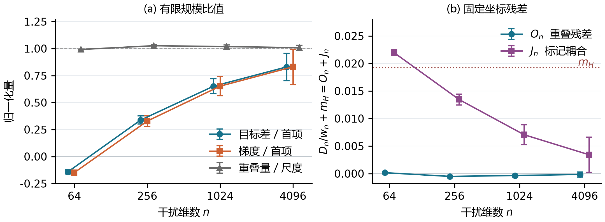

# 摘要

潜变量模型常这样拟合：在独立的先验抽样上取$K$个条件似然的平均来估计边际似然，再最小化这一估计的期望负对数。固定$K$时，它是一个独立的准则，而不是对数似然的带噪版本：把它估计得更准，并不会把它变成对数似然。我们问它偏好哪些依赖结构，这些偏好是否与积分模型的KL风险一致。在一个Gaussian--logistic模型中，我们追加$n$个被观察的公平硬币。积分之后，它们不改变任何候选的风险；在粒子平均内部，它们各粒子的似然却改变了哪些粒子占主导。在活跃Gaussian边际固定、$K\ge2$至多按$n$的多项式增长时，随$n$增大，我们对实际的非Gaussian权重一致地找出首个区分相关结构的项。它是一个严格凹势，奖励活跃对数似然在先验抽样间更大的方差。能够分辨这一收缩项的总体近极小点趋向相关矩阵类的谱边界，并保持正风险。在没有追加块、全部参数自由的情形，计算机辅助证明给出一个8粒子总体局部极小：其单变量边际全部正确，联合KL却约为$0.0104$；从该点出发，沿一条保持边际的路径，每个充分小的非零步都降低风险、抬高目标。因此，准确拟合有限目标，或正确拟合边际，都不能决定学到的是哪种依赖。

# 引言

许多潜变量模型的边际似然$p_\theta(y)=E_{Z}\,p_\theta(y\mid Z)$难以计算。一种简单的替代是抽取$K$个独立先验粒子$Z_1,\ldots,Z_K$，最小化其平均似然的期望负对数。它出现在模拟极大似然[@lee1995]、以先验抽样学习二元潜变量模型[@tipping1998]，以及提议分布固定为先验时的重要性加权界[@burda2016]中。由于对数是凹函数，这一目标有偏，且偏差依赖参数[@maddison2017; @sung2007]。因此固定$K$时，它是不同于似然的另一个准则。增加外层重复只会更准确地估计同一个有限$K$目标，不会把它变成积分对数似然。

一般的偏差结论留下了一个问题，这正是本文要回答的：*有限先验粒子目标偏好哪种依赖结构？这种偏好何时与积分模型$Q_\theta$的KL风险$D(P\Vert Q_\theta)$相冲突？*

{width=100%}

**一个受控比较。** 取三个二元观察，其潜在Gaussian logit相互独立，并使用$K=100$个粒子。再追加$n$个被观察的二元变量，它们是与其他一切独立的公平硬币。每个硬币有自己的潜在logit $G_j\sim N(0,1)$，结果$u_j\in\{-1,1\}$的发射概率为$\sigma(u_jG_j)$。在先验上平均后，每个硬币在每个候选下的概率都是$1/2$。因此每个候选的积分模型等于原模型乘以$2^{-n}$，所有风险都不变。在粒子平均内部，硬币的作用却不同。粒子$k$带有因子$\prod_j\sigma(u_jG_{kj})$，其先验均值虽为$2^{-n}$，取值却随粒子而变。这些因子决定哪些粒子主导平均，从而决定活跃似然如何竞争。若在平均*之前*先把硬币积掉，它们只贡献共同常数$2^{-n}$，什么也不改变。

图1在相同的活跃观察、活跃粒子和候选上比较$n=0$与$n=256$。没有硬币时，有限目标偏好真实的独立模型，而不是所有相关均为$.9$的等相关候选$C_b$，真值是严格局部极小。加入256个硬币后偏好反转：$C_b$得分更好，真值变成局部极大，匹配的网格搜索返回$C_b$，其风险为$.031$ nats。

我们把这一构造看作对照，而不是推荐的做法。追加块已知独立，其似然精确可分解。它的价值在于：改变估计器，同时保持活跃似然比和每个候选的KL风险。因此图1中发生的变化，都是这一准则自身的偏好。

**为什么需要精细尺度。** 随$n$增大，干扰对数权重在$\sqrt n$尺度上展开，平均由干扰权重最大的粒子主导。活跃边际固定时，一个先验粒子的期望损失不依赖候选相关矩阵，因此目标的主导项完全看不到依赖。直观地说，在这一渐近区间内，领先的选择项来自两个领先粒子近乎并列的事件，而这类事件的频率为$w_{n,K}\asymp\sqrt{\log K/n}$阶。于是选择发生在随$n$收缩的尺度上，这带来两个后果。把目标近似到$o(1)$的方法，可能对选中哪种相关毫无判断力；近似必须相对$w_{n,K}$准确。而识别这一偏好，需要对实际的非Gaussian对数似然权重、在所有候选上一致地控制近乎并列事件。对数权重的Gaussian模型可以形式地预测大$K$系数，却不提供这种控制（第6节）。

定理1提供了这种控制。所得的势严格凹，且有直接的解读：它奖励使观察的活跃对数似然在先验抽样间变化更大的相关矩阵。对真实相关为零的两个变量，精确似然把拟合的相关拉回零，极限粒子目标却把它推离零。定理2把凹性与相关矩阵的经典几何结合：能分辨$w_{n,K}$尺度的近极小点被推向该类的谱边界，其风险保持远离零。

**没有追加块时。** 硬币让机制变得可见，但留下一个自然的问题。假设没有指定的独立块，所有偏置和载荷都可学习，而有限目标的某个局部极小已经再现了每个观察边际。此时目标是否至少不会反对能降低风险的依赖变化？定理3对一个$K=8$的八条目、双因子模型给出否定回答。计算机辅助证明认证：精确总体目标在全部24个参数中、模共同旋转后，有一个秩一严格局部极小。所有边际都正确，联合KL约为$.0104$。沿一条只旋转载荷行、不改变行长的路径，每个充分小的非零步都降低风险、抬高目标。两部分因此回答同一准则上前后相继的问题：先是受控族中关于*选择*的渐近陈述，再是没有该控制时关于几何的有限、*局部*陈述。二者互不推出。

```{=latex}
\par\dimen0=\pagegoal\advance\dimen0 by -\pagetotal\ifdim\dimen0<6\baselineskip\newpage\fi
```

**贡献。**

- 对实际非Gaussian权重的一致选择尺度定理，覆盖每个固定$K\ge2$以及按$n$多项式增长的$K$，并给出极限势的条件方差解读（定理1）。
- 它的几何后果：对regret为$o(w_{n,K})$的总体近极小点，谱边界偏好与正的极限风险（定理2）。
- 有限尺度分析：带符号的固定$K$修正分离出标量重叠看不到的同粒子耦合，显式误差界在$n=4096$认证一个坐标的首项符号（第4节）。
- 一个计算机辅助证书：边际正确、风险为正的局部极小，带有同根、保持边际的冲突，并在一个小的显式教师族上延续（定理3及其推论）。

主要理论研究以先验粒子定义的总体目标；第4.3节另给一个指定有限程序的保证。这些结果都不描述随机优化器收敛到何处。

# 先验粒子目标与受控扩维

对潜变量$Z\sim p(z)$和条件似然$p_\theta(y\mid z)$，$K$粒子目标为$E_{Y\sim P}E_{Z_{1:K}}[-\log K^{-1}\sum_kp_\theta(Y\mid Z_k)]$，其中iid先验粒子独立于$Y$。$K=\infty$时它成为积分交叉熵。第一个模型只把活跃相关作为未知量。固定$m\ge2$、有限均值$\mu$及$0<\delta<1$：

$$
\begin{aligned}
\mathcal E_\delta^{(m)}
&=\{C=C^\top:\operatorname{diag}C=\mathbf1,\ C\succeq\delta I\},\\
X_A&=\mu+L_CZ,\qquad L_CL_C^\top=C,\\
X_{m+j}&=\tau_jG_j,\\
P(Y_i=y_i\mid X_i)&=\sigma(y_iX_i),\qquad y_i\in\{-1,1\}.
\end{aligned}
\tag{1}
$$

应用$L_C$之前，所有Gaussian输入均为独立标准正态；给定logit后观察条件独立。活跃方差与均值已知，活跃与干扰logit不相关。记$U$为干扰观察，并假设教师$C_*$位于相对内部，$C_*\succ\delta I$。由于每个干扰硬币在积分后都是公平的，

$$
Q_{C,\tau}^{(n)}(y,u)=2^{-n}Q_C^A(y),\qquad
\mathcal R(C)=D(Q_{C_*}^A\Vert Q_C^A).
\tag{2}
$$

这也是完整观察的KL风险。固定$n$改变干扰尺度，整个观察分布不变；改变$n$，活跃似然比和KL不变。取独立于观察的$K$个iid先验粒子$(Z_k,G_k)$，

$$
\begin{aligned}
\widehat Q_{C,\tau,K}^{(n)}(y,u)
&=K^{-1}\sum_{k=1}^Kp_{C,\tau}(y,u\mid Z_k,G_k),\\
F_{n,K}(C;\tau)&=E_{Y,U,Z,G}[-\log\widehat Q_{C,\tau,K}^{(n)}(Y,U)].
\end{aligned}
\tag{3}
$$

每次实现的混合$\widehat Q$都是归一化分布，故$F-H(P)=E_{Z,G}D(P\Vert\widehat Q)$。有限目标评价的是随机混合，风险评价的是它的平均。略去固定参数，二者之差是经典的Jensen项：

$$
\begin{aligned}
F_P(C)&=H(P)+\mathcal R(C)+\mathcal J_P(C),\\
\mathcal J_P(C)&=E_P[\log Q_C\\
&\qquad -E_{Z,G}\log\widehat Q_C]\ge0.
\end{aligned}
\tag{4}
$$

这里$P=Q_{C_*}^{(n)}$。$\mathcal J_P$非负是标准事实；对学习重要的是$\mathcal J_P$如何随$C$变化，而非负性本身并不决定这一点。这与对数评分的适当性并不矛盾，因为$F$是随机预测规则的期望评分，而不是$Q_C$的评分。另有两个事实界定了扩维做什么、不做什么。用可逆潜变量映射同时输运先验、发射和粒子，$\widehat Q$的每次实现都不变（附录A.1）；追加被观察的坐标则会改变估计器。并且$K=1$时目标只依赖固定边际，因而对$C$为常数：任何依赖选择都需要$K\ge2$。

# 有限目标偏好哪些相关

## 选择尺度

记$b_i=EY_i$，$\kappa_{ij}(c)$为潜在相关为$c$时$Y_i,Y_j$的协方差。固定边际使$b_i$与$C$无关，Price恒等式[@price1958]给出

$$
\begin{aligned}
\kappa_{ij}(0)&=0,\\
\kappa_{ij}'(c)&=\tfrac14 E_C[\operatorname{sech}^2(X_i/2)\\
&\qquad\quad{}\times\operatorname{sech}^2(X_j/2)]>0.
\end{aligned}
\tag{5}
$$

所以观察协方差识别潜在相关。对目标求导时，每个粒子的*依赖标记*按该粒子在平均中所占份额加权。令$\pi_k$为归一化的**完整**粒子似然（含干扰因子），则

$$
\begin{aligned}
\partial_{c_{ij}}F_{n,K}
&=-E\sum_k\pi_k(1-\pi_k)H_{k,ij},\\
H_{k,ij}&=Y_iY_j\sigma(-Y_iX_{ki})\sigma(-Y_jX_{kj}),\\
EH_{k,ij}&=\{\kappa_{ij}(C_*)+\kappa_{ij}(C)\}/4.
\end{aligned}
\tag{6}
$$

标记的均值成立，是因为标签与候选粒子独立。但在有限$n$下，粒子的权重与其标记相互耦合，这一点在第4节会起作用。

令干扰尺度全为一，记$F_{n,K}^*(C)=F_{n,K}(C;\mathbf1)$，并定义

$$
\begin{gathered}
v=\operatorname{Var}\log\sigma(G),\qquad J_K=E\max_{k\le K}G_k,\\
w_{n,K}=J_K/\sqrt{nv}.
\end{gathered}
\tag{7}
$$

这里$J_K$是$K$个标准Gaussian最大值的期望，$J_K\sim\sqrt{2\log K}$，且对整数$K\ge2$有$J_K^2\asymp1+\log K$（附录A.2）。因此在下文的多项式范围内$w_{n,K}\asymp\sqrt{\log K/n}$，固定$K$时$w_{n,K}\asymp n^{-1/2}$。一个启发式说明这一尺度：若$K$个干扰对数权重是标准差为$\sqrt{nv}$的Gaussian，最大两者之差在零处的密度为$K(K-1)\int\phi^2\Phi^{K-2}/\sqrt{nv}=w_{n,K}$。$O(1)$的活跃对数似然差只在这种近乎并列时才会改变主导粒子。

## 极限势

**定理1（一致方向与势）。** 固定$m,\mu,\delta$、$C_*\in\operatorname{relint}\mathcal E_\delta^{(m)}$及$C_0,p>0$。当$n\to\infty$，对$C\in\mathcal E_\delta^{(m)}$及整数$2\le K\le C_0n^p$一致有

$$
\begin{aligned}
\frac{\partial_{c_{ij}}F_{n,K}^*(C)}{w_{n,K}}
&\longrightarrow-\frac{\kappa_{ij}(C_*)+\kappa_{ij}(C)}4,\\
\frac{F_{n,K}^*(C)-F_{n,K}^*(I)}{w_{n,K}}
&\longrightarrow V(C),\\
V(C)&=-\frac14\sum_{i<j}\Bigl[\kappa_{ij}(C_*)c_{ij}\\
&\qquad\qquad+\int_0^{c_{ij}}\kappa_{ij}(u)\,du\Bigr].
\end{aligned}
\tag{8}
$$

证明（附录A.1--A.2）直接处理实际的log-sigmoid干扰权重。它借助对多项式$K$成立的一致中等尾部与密度估计，控制近乎并列的干扰对数权重对，并在固定维数的相关类上给出活跃评分的共同包络。紧性本身给不出收缩尺度上的控制。沿可行线段从$I$到$C$积分梯度得到$V$。

以下三种解读使(8)具体化。

*Jensen项吸收了风险。* $F^*_{n,K}$的差以$w_{n,K}$的速率消失，而风险差$\mathcal R(C)-\mathcal R(I)$与$n$无关。由(4)，Jensen项随$C$的变化在主导阶上抵消了风险差。在$w_{n,K}$尺度上留下的是$V$，它对相关结构的排序可以不同于观察风险。

*$V$奖励什么。* 令$A_C(y,Z)=\sum_i\log\sigma(y_iX_i)$为标签$y$在一次先验抽样下的活跃对数似然，$T(C)=E_Y\operatorname{Var}_ZA_C(Y,Z)$为它在先验抽样间的方差，再对真实标签平均。Price恒等式给出$\partial_{c_{ij}}T=\{\kappa_{ij}(C_*)+\kappa_{ij}(C)\}/2$，于是

$$
V(C)=-\tfrac12\{T(C)-T(I)\}.
$$

极限目标偏好这样的相关矩阵：在它之下，观察的活跃对数似然在先验抽样间变化更大。这是活跃对数似然的条件方差，不是似然本身、干扰权重或随机梯度的方差（附录B.1）。

*两个变量。* 对中心化变量、真实相关$\theta$与spin矩$r(\rho)$，精确交叉熵的导数为$r'(\rho)\{r(\rho)-r(\theta)\}/\{1-r(\rho)^2\}$，其下降把$\rho$推向$\theta$。$\theta=0$时，极限粒子梯度$-\kappa(\rho)/4$符号相反，下降把非零相关推离零。更一般地，由(5)，$V$在相关坐标中的Hessian为对角且各元严格为负：$V$严格凹。

## 谱边界与风险

紧凸集上的严格凹函数只在极点处取到最小值。对相关矩阵，这些点受一个经典秩界约束[@litam1994]。

**定理2（谱偏好与风险）。** 在定理1的条件下，令$\mathcal M=\arg\min_{\mathcal E_\delta^{(m)}}V$及$r_{\max}=\lfloor(\sqrt{8m+1}-1)/2\rfloor$。每个$C\in\mathcal M$满足

$$
\operatorname{rank}\left(\frac{C-\delta I}{1-\delta}\right)\le r_{\max}.
\tag{9}
$$

因此至少$m-r_{\max}$个特征值等于$\delta$，而$C$仍正定。对最终满足$2\le K_n\le C_0n^p$的整数序列，若$\widehat C_n\in\mathcal E_\delta^{(m)}$的总体regret满足$F_{n,K_n}^*(\widehat C_n)-\inf_C F_{n,K_n}^*(C)=o(w_{n,K_n})$，则

$$
\begin{gathered}
\operatorname{dist}(\widehat C_n,\mathcal M)\to0,\\
\liminf_n\mathcal R(\widehat C_n)
\ge\varepsilon_*,\\
\varepsilon_*:=\min_{C\in\mathcal M}\mathcal R(C)>0.
\end{gathered}
\tag{10}
$$

常数依赖$(m,\mu,\delta,C_*)$。(9)中的仿射映射把$\mathcal E_\delta^{(m)}$送到一个相关矩阵集合，其中秩为$r$的极点满足$r(r+1)/2\le m$。(5)的单调性使观察矩识别潜在相关，紧性使$\mathcal M$在观察KL上与内部教师分离（附录A.3）。例如在四变量实例(A.21)中，$\mu=(-.6,-.2,.2,.6)$、$\delta=.1$、教师特征值为$(.5,1,1.2,1.3)$时，至少两个极限特征值等于$.1$，且$\liminf_n\mathcal R(\widehat C_n)\ge9/12800$。

这里的“谱边界”指特征值落在下界$\delta$。被选中的矩阵仍正定，单个相关也不必全部增大。对regret为$o_p(w_{n,K_n})$的随机输出，到$\mathcal M$的距离依概率趋于零，且对每个$\eta>0$有$P\{\mathcal R(\widehat C_n)<\varepsilon_*-\eta\}\to0$。定理关心的是总体regret，而不是每个有限数据集：经验标签分布会改变$V$的线性项，只含单一标签的数据集可以让精确极小点与粒子极小点重合（附录A.6）。

**其他参数制度。** 两个变体说明制度很重要。若活跃均值和尺度也自由，均值取值于包含真实单变量概率logit的紧盒，尺度取值于$[0,S]^m$，硬币仍为单位尺度，则$o(1)$的总体regret已经把活跃尺度推向零。观察分布收敛到真实边际之积，风险趋于教师的总相关（附录A.8）。若改为共同干扰尺度可学习且可以为零，联合最小化会关闭硬币：额外的干扰惩罚消失，剩下带有自身偏差的活跃有限$K$目标（附录A.9）。定理1--2把干扰尺度固定为一，正是这一点使硬币成为对照。

# 渐近图景如何对接有限尺度

定理1在任何有限$n$下都不给余项界。因此我们细看一个实例：$m=3$、$\mu=0$、$C_*=I$、$\delta=.1$、$K=100$。令$C(\rho)$的所有非对角元为$\rho$，$C_b=C(.9)$。在$n=64,256,1024,4096$，我们把目标差$g_n=F_n(I)-F_n(C_b)$和$C(.45)$处自由$c_{12}$导数$D_n$与其首项预测比较，其中$F_n=F_{n,100}^*$、$w_n=w_{n,100}$。比值$A_n=g_n/\{w_n[V(I)-V(C_b)]\}$与$B_n=-D_n/(m_H^{\mathrm{ref}}w_n)$在首项精确时等于一；$m_H^{\mathrm{ref}}$是$\kappa(.45)/4$的固定数值参考。

## 权重重叠不是学习信号

一个自然的捷径是追踪标量权重重叠$\omega_n=E\sum_k\pi_k(1-\pi_k)$，它衡量平均中有多少份额在粒子间共享。若标记与权重独立，(6)给出$D_n=-m_H\omega_n$。$n=64$时重叠紧贴其首项尺度，$\omega_n/w_n\simeq.992$。然而$A_n\simeq-.143$、$B_n\simeq-.149$：目标差和导数都与其首项预测*反号*，条件区间排除零。恒等式$D_n=-m_H^{\mathrm{ref}}\omega_n-\mathcal C_n$（其中$\mathcal C_n=E\sum_k\pi_k(1-\pi_k)(H_{k,12}-m_H^{\mathrm{ref}})$）把重叠误差$O_n$与权重—标记耦合$J_n$分开（图2b）。在64、256和1024，耦合的幅度占主导。到4096，$A_n$与$B_n$的点估计约为$.83$，但区间未认证10%的相对精度。完整权重也含活跃评分，所以这一拆分是恒等式，而不是因果分解（附录C.6）。

{width=100%}

## 带符号的修正与认证的方向

标量重叠漏掉的部分可以在固定$K$下识别。记$L=\log\sigma(G)$、$\kappa_3=E(L-EL)^3$、$s_n=\sqrt{nv}$及$B_K=EM_K^2-1$，其中$M_K=\max_{k\le K}G_k$。对一个候选粒子，令$A_Y=\sum_i\log\sigma(Y_iX_i)$、$H_Y=H_{1,12}$（来自(6)）、$m_H=EH_Y$及$\bar c=E_Y\operatorname{Cov}_X(H_Y,A_Y)$。

::: {#fixed-k-proposition}

**命题（固定K修正）。** 在单位干扰尺度的中心化模型(1)中，固定$m$、正定候选$C$、教师标签律和整数$K\ge2$。当$n\to\infty$时，

$$
\begin{aligned}
D_n:=\partial_{c_{12}}F_{n,K}^*(C)
&=-\frac{m_HJ_K}{s_n}\\
&\quad+\frac{B_K}{s_n^2}
 \left(\frac{m_H\kappa_3}{3v}-\bar c\right)\\
&\quad+O_{K,m,C}(n^{-3/2}).
\end{aligned}
\tag{11}
$$

:::

新的成分是$\bar c$：*同一个粒子内部*、其依赖标记与活跃对数似然之间的协方差，先在给定标签下计算，再对标签平均。它不是粒子之间或训练梯度之间的协方差。活跃似然高的粒子获得更多权重；当它们的标记系统性地不同，加权后的标记就会偏移。对上述实例的$C=C(.45)$，$n^{-1}$系数为$b_2\simeq1.026$，分为干扰偏度部分$\simeq-.077$与标记—评分部分$\simeq1.103$（附录C.13）。因此修正与首项方向相反，且几乎全部来自同粒子耦合。这些系数是模型积分，而不是对梯度面板的拟合，不过推导修正时该面板已经可见。该命题在固定$K$下成立，不替代定理1的一致陈述。

::: {#finite-direction-corollary}

**有限规模推论。** 在$m=3$、$\mu=0$、$C_*=I$、$K=100$、$C=C(.45)$与单个自由$c_{12}$坐标处，显式误差界给出

$$
\begin{gathered}
-.002045393<D_{4096}<-.0003519373,\\
|D_{4096}-D_{4096}^{(0)}|<.001097138798\\
<|D_{4096}^{(0)}|,\qquad
D_n^{(0)}=-m_HJ_{100}/s_n.
\end{gathered}
\tag{12}
$$

:::

在$n=4096$，首项对这一坐标给出正确的符号。误差界约为$|D_{4096}^{(0)}|$的75.7%，因此这一证书关于符号，而不是10%的精度。在64、256和1024，同样的做法不能分辨符号。这些包围是确定性的，使用实际的Gumbel平滑干扰噪声和经认证的模型矩（[附录C.7起](#fixed-k-correction)）。

认证的符号有风险后果。由(5)和三变量观察律，$\partial_{c_{12}}\mathcal R=\kappa'(.45)\kappa/\{(1-\kappa)(1+3\kappa)\}>0$，其中$\kappa=\kappa(.45)>0$。因此$c_{12}$每个充分小的可行增加都降低$F^*_{4096,100}$，同时提高风险。这是一个有限的、坐标层面的目标—风险冲突，由其自身的显式余项界确立，而不是由定理2推出。

## $n=256$处的有限程序结论

图1的实例在$n=256$、$K=100$还给出有限程序陈述（附录C.15、D、E）。在理想iid抽样与声明数值条件下的99%审计事件上，类中每个总体regret低于$.00134$的相关矩阵，无论是否位于网格上，风险都高于$10^{-6}$；这在一个未被证明有算法能达到的近优条件下，排除了一个连续的低风险区域。在同一事件上，固定143点网格程序的新运行，以至少$.7035$的概率选出风险至少为$0.09/(32e)$的模型；这是该程序的概率下界，而不是观测频率。

# 没有追加块时：一个认证的局部冲突

## 全部参数自由的双因子模型

现在去掉对照。没有指定的独立块；所有偏置和载荷都被学习：

$$
\begin{aligned}
Z&\sim N(0,I_2),\qquad \theta=(b,W),\\
Y_j\mid Z&\sim\operatorname{Bernoulli}
 \{\sigma(b_j+w_j^\top Z)\},\\
F_K^q(\theta)&=E_{Y\sim q,Z_{1:K}}\Bigl[
-\log\Bigl\{K^{-1}\sum_{k=1}^K
p_\theta(Y\mid Z_k)\Bigr\}\Bigr].
\end{aligned}
\tag{13}
$$

这里$b$为logit偏置，$Y_j\in\{0,1\}$，先验粒子$Z_{1:K}$为iid且独立于$Y$；给定$Z$后各条目条件独立。目标$q$为经验律或教师律，$F_\infty^q$为积分交叉熵。教师有八个条目、零偏置，行长均为$.8$，角度为$(-.7,-.5,-.3,-.1,.1,.3,.5,.7)$，因此所有载荷两两内积为正。这一模型类不同于第3节：logit协方差$WW^\top$至多秩二、没有谱下界，载荷秩也不等于$\operatorname{Cov}(Y)$的秩。

## 边际正确、风险为正，并排斥一个改进

**定理3（计算机辅助的局部依赖冲突）。** 对(13)中的精确教师，令$q_*$为其观察律，$\mathcal R(\theta)=D(q_*\Vert Q_\theta)$。存在秩一内部参数$\theta_*=(0,a_*,0)$，$a_{*,i}>0$且$\nabla F_8^{q_*}(\theta_*)=0$，它在完整24维参数空间中、模共同潜变量旋转后是$F_8^{q_*}$的严格局部极小。每个观察边际都正确，$Q_{\theta_*}(Y_j=1)=q_*(Y_j=1)=1/2$，但$\mathcal R(\theta_*)\simeq.01043>0$。

存在固定的$d=d_{\mathrm{ang}}^{(8)}\in\mathbf1^\perp\subset\mathbb R^8$、$\|d\|_2=1$，使路径$\theta_{\mathrm{ang}}(t)=(0,W(t))$满足

$$
\begin{aligned}
W_i(t)&=a_{*,i}\bigl(\cos(td_i),\sin(td_i)\bigr),\\
r(t)&=\mathcal R(\theta_{\mathrm{ang}}(t)),\\
r'(0)&=0,\qquad r''(0)<-.00450377.
\end{aligned}
\tag{14}
$$

存在$\varepsilon>0$，使每个$0<|t|<\varepsilon$都有

$$
\begin{gathered}
F_8^{q_*}(\theta_{\mathrm{ang}}(t))>F_8^{q_*}(\theta_*),\\
\mathcal R(\theta_{\mathrm{ang}}(t))<\mathcal R(\theta_*),\\
\operatorname{rank}W(t)=2.
\end{gathered}
\tag{15}
$$

这条路径只改变依赖。行长固定，所以每个候选logit保持其Gaussian边际$N(0,a_{*,i}^2)$，每个观察仍是公平硬币，而$\operatorname{Cov}(X_i(t),X_j(t))=a_{*,i}a_{*,j}\cos\{t(d_i-d_j)\}$随之改变。这些保持不变的logit方差是候选自己的，不是教师的$.8^2$。由于该根是严格局部极小，而非常量的角路径离开旋转轨道，目标沿路径上升。风险下降，是因为它沿路径的曲率为负。这一冲突是二阶的、局部的：沿这条路径的每个充分小非零步都降低风险、抬高目标（附录I.10）。固定行长定义了这条比较路径，并不是对学习问题的约束。[附录I.8](#full-local-statement)中的完整陈述还认证了一个一阶风险导数为负的方向$d_{\mathrm{risk}}$；沿它走一个认证的$10^{-7}$步，会抬高$F_8$、降低风险并保持观察边际公平，同时改变行长。

作为尺度参照：在四个各含$4096$个教师样本的训练流中，独立Bernoulli拟合的KL约为$.107$，$K=8$的Adam训练结束于约$.011$（附录I.4）；共线子模型内积分目标的一个重新拟合驻点，KL约为$.0070$（I.6）。这些是数值比较，不是认证的最优值。

**证书概要。** 对称性把求根降为四个坐标，区间根包含证明在一个二进中心附近存在精确驻点。完整空间稳定性需要所有方向：全部16个偏置/径向方向和7个非旋转横向方向都有认证的正曲率；只检查角方向是不够的（[附录I.2](#full-hessian-criterion)、[I.8](#full-local-statement)）。(14)沿路径的风险曲率包含路径加速度。它借助Gaussian分部积分、解析求积误差界[@trefethen2014]和中点—半径算术[@johansson2017]在全部256个标签上被包围，再通过行长上的Lipschitz界从中心传递到真根（[I.10](#same-root-angle)）。

::: {#quantitative-persistence-corollary}

**推论（定量局部持续性）。** 保持教师的八个偏置为零、行长为$4/5$，只把其第一个角度改为$-.7+\lambda$，$|\lambda|\le.001$。记其观察律为$q_\lambda$，存在与定理3的根相连的光滑分支$\theta_\lambda=(0,a(\lambda),0)$，每一点都是其自身$F_8^{q_\lambda}$在完整空间中模旋转的严格局部极小。用同一固定$d$、并在(14)中以$a(\lambda)$替换$a_*$，对每个教师和每个充分小的非零$|t|<\varepsilon_\lambda$，得到一条秩二路径：它抬高该教师的有限目标、降低其自身风险$D(q_\lambda\Vert Q_\theta)$，并保持候选Gaussian logit边际和正确的公平观察边际。

:::

这一教师族打破了原教师的对称性，但范围很小：端点观察律的$L^1$差约为$1.6\times10^{-4}$（[附录I.11](#teacher-family-full-statement)）。对更一般、未量化的教师扰动，[附录I.9](#local-persistence)证明附近仍有一个秩一严格局部极小，并带有一阶风险下降方向。

## 弱载荷下的对齐直觉

固定$K>2$时的弱载荷展开给出直觉，但不是定量解释（附录I.1）。行长固定、载荷为$\varepsilon$阶时，在与角度无关的项之外，有限目标为$\varepsilon^4a_K\|c-\{K/(K-2)\}c_*\|^2+O(\varepsilon^6)$，其中$a_K>0$见(I.2)，$c$收集去掉共同尺度$\varepsilon$后各行的两两内积。它奖励相对教师被*放大*的内积。行长固定时，各行只能通过对齐来放大内积。在第3节的独立教师情形，极限势同样偏好教师所没有的依赖。两个展开分别推导，彼此不解释对方。共线构型的弱载荷稳定边界$K\simeq4.33$，并不预测载荷为$.8$时的行为。

数值学习与这一图景相容，但并不确立它（附录I.4--I.7）。在四个数据流中，$K=8$训练得到近乎共线的载荷，$K=64$和积分参照则没有。在每个$K$重新拟合后，共线点的局部类型在数值上于$K=11$与$12$之间改变；那里的角度探针只使风险变化约$.02\%$，这一效应量属于这些探针，而不属于认证的$K=8$冲突。

# 相关工作

<!-- RELATED_WORK -->

# 讨论

**这些结果改变了什么判断。** 固定$K$时，先验粒子目标有自己的依赖偏好，把它估计得更准，并不会把这些偏好移向积分似然。在受控族中，这些偏好是$w_{n,K}$阶的，却决定了选中哪些相关，并导致正的极限风险（定理1--2）。在有限尺度实例中，标量重叠可以紧贴其首项预测，而相关梯度却与自己的首项预测反号（第4节）。在完整空间局部极小处边际正确，并不意味着目标欢迎能降低风险的依赖变化（定理3）。

**范围。** 各结果的保证类型不同：定理1--2是一致渐近陈述；(12)中的推论是单个$n$上的确定性包围；第4.3节依赖带声明数值条件的99%审计事件；定理3是计算机辅助的局部证明。它们都使用先验粒子；除第4.3节的网格程序界外，研究对象都是总体目标。第一部分要求已知独立、单位尺度的追加块，固定的活跃维数与边际，以及相对$w_{n,K}$很小的regret。第二部分是一个模型及一个小的显式教师族。一个自然的后续问题是：学习得到的、适应后验的提议分布[@burda2016]会消除、缩小还是反转这一偏好。

**可复核性。** 随附的匿名补充材料提供保存的区间输入、证书与有限程序界的算术检查，以及图1--2的数据和作图脚本。其README说明运行命令与核验范围。这些检查重建保存证据，不重新运行生产求积或训练。

<!-- APPENDICES -->
